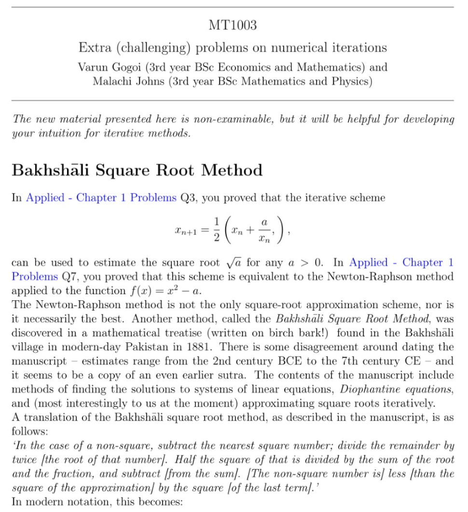
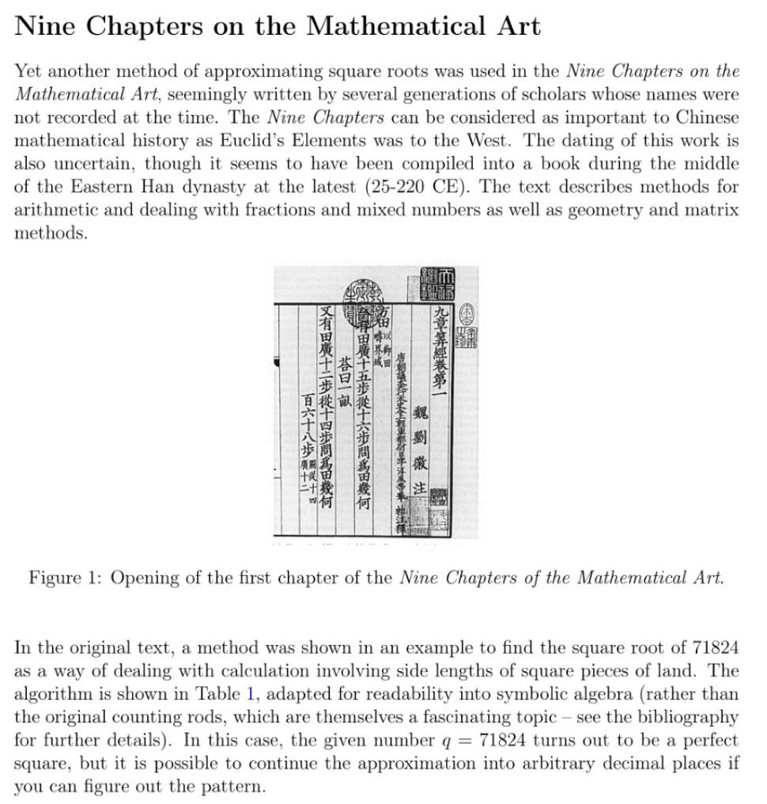
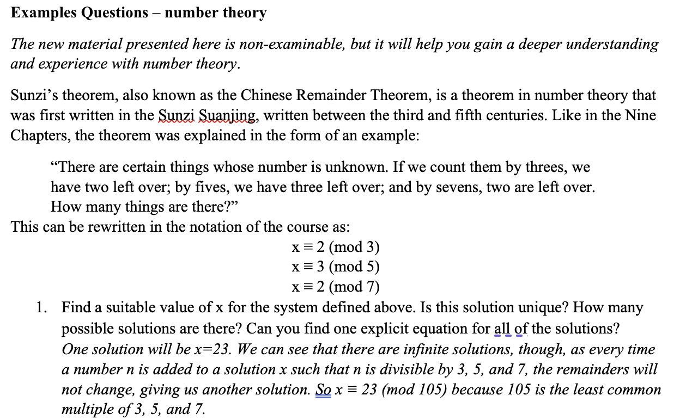
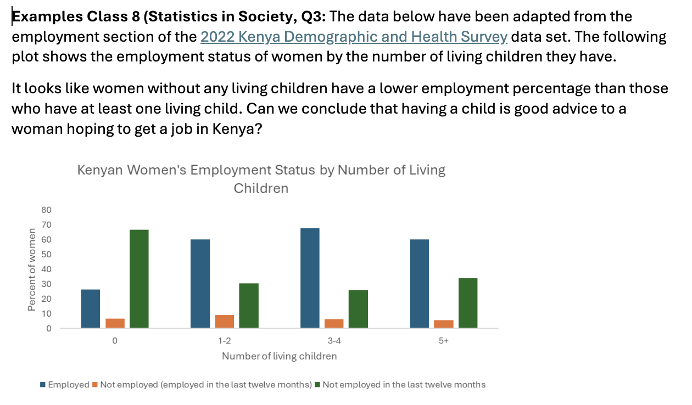
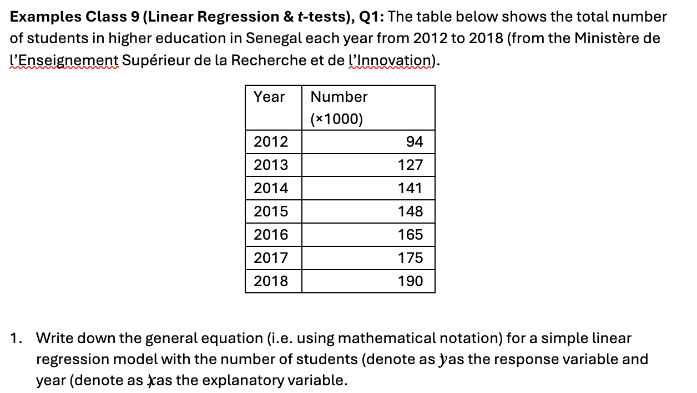
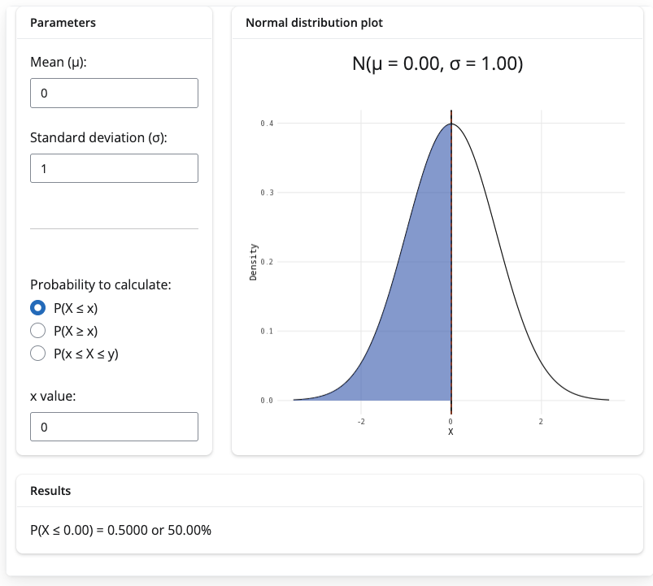

## About me {data-background-image="slides-bg.png"}

- Lecturer (Education Focused) at the University of St Andrews

- first in my family to go to university (MMath and PhD at UEA)

- Kurt Gödel fan

- enjoys cricket, coffee, and crosswords

- contact me at tdhc@st-andrews.ac.uk

# Context

## From the BRB {data-background-image="slides-bg.png" .smaller}

- **accessible** *(adj)*
    1. Within reach
    2. Approachable
    3. Easily(!) comprehensible
    
- **inclusive** *(adj)*
    1. Comprehensive
    2. Including everything 
    3. Including the stated limits or extremes (with *of*)
    4. Included
    5. Enclosing

## Problem {data-background-image="slides-bg.png" .smaller}

*need for both accessible and inclusive maths/stats resources*

- **traditional textbooks and learning resources**: can be difficult to parse for non-specialists, inaccessible, expensive, intimidating, Western-centric, 'easy/trivial/obvious'...
    
- **diverse backgrounds**: every country/region has their own curriculum, language, culture, mathematical stories; every human has their own experience with mathematics and statistics.

- **increased need for competency in maths/stats**

## Perspectives {data-background-image="slides-bg.png"}

- everyone's journey in studying mathematics/statistics is different

- everyone's perspective of what is hard and what is easy is different

- everyone's engagement with learning resources is different

want everyone to be able to **access** and **understand** the resources, and want everyone to feel **included** in their study of mathematics and statistics. 

## Perspectives {data-background-image="slides-bg.png"}

- communication is **audience dependent**, and an educator's audience could be **anybody**. 

- everyone is a product of their **perspectives and experiences** and these influence the creation of their learning resources

- these perspectives naturally limit the **scope, content, format, and dissemination** of any created resources

## Solution {data-background-image="slides-bg.png"}

**ask the audience**

{fig-alt="An image from Who Wants To Be A Millionaire saying 'I'll ask the audience'"}

# Co-creation - the nuts and bolts

## Students as co-creators (1/2) {data-background-image="slides-bg.png" .smaller}

- students can give **diverse perspectives needed** to create truly inclusive resources
    - different cultural backgrounds
    - different educational backgrounds
    - different experiences in learning
    - different mathematical idols

- from these, students provide and implement **creative and impactful ideas** in the production and curation of learning resources

## Students as co-creators (2/2) {data-background-image="slides-bg.png" .smaller}

not only this, but 

- students gain **agency** in their resource creation (what would have helped them in a similar situation?)

- **development of transferable skills** not often found in maths and stats degrees (long form writing, project management, teamwork)

- develop **empathy for learners / social responsibility / appreciation of other lived experiences**, particularly if the focus is on creating accessible and inclusive learning resources

## Staff as co-creators with students {data-background-image="slides-bg.png"}

- **project concept and design**
- **technical and disciplinary expertise**
- **advice on project management**
- **facilitator of student learning** (guide rather than boss)
- **ultimately, quality control and editing**

## Student involvement {data-background-image="slides-bg.png"}

- traditionally, the co-creation of resources for learning is generally **not** a core concern for students studying for a degree; it's very much an **extra-curricular activity**
    - (but nowadays, the lines can be blurred!)

- in any case, the time, energy, patience, and effort that a student gives to this endeavour should be **properly compensated** - not only in 'experience'.

- incentivisation can take many different forms!

## An ideal relationship {data-background-image="slides-bg.png"}

(1) students and staff as **equal partners** in resource creation

(2) where students are **incentivised** and **properly compensated** 

(3) to produce **high quality work** which is **ready for dissemination**

(4) and in doing so, **learn from each other** about best practice and new perspectives

# Opportunities at St Andrews - the methods

## Student-staff co-creation opportunities {data-background-image="slides-bg.png" .smaller}

I'm involved in student-staff co-creation of accessible and inclusive learning resources on **two projects** that use **three different methods**:
    
- **Inclusive Activities For Mathematics**: creating inclusive subhonours mathematics resources using history
    - Paid student internships (2025-present)
    
- [**STARMAST (starmast.org)**](https://starmast.org) - **St** **A**ndrews **R**esources in **Ma**thematics and **St**atistics
    - Summer Teams Enterprise Project (2023)
    - Vertically Integrated Project (2024-present)
    
# Inclusive Activities For Mathematics

## Project aims {data-background-image="slides-bg.png" .smaller}

*to provide teaching resources for subhonours mathematics and statistics module with embedded historical perspectives, promoting a diverse, inclusive, and decolonised curriculum*

- funded by £1500 from the University of St Andrews internal EDI Project Fund, plus matched funding from an INI Network Grant

- extra examples class questions for first-year modules MT1003 (Pure and Applied Mathematics) and MT1007 (Statistics in Practice)

- evaluation included: module evaluation, reflective question, bespoke survey

## Student involvement {data-background-image="slides-bg.png" .smaller}

- money for **three students** working for **70 hours apiece**

- selection process run by supervisors
    - students from a wide range of disciplines selected
    
- each student then:
    - investigated their own set of potential questions
    - discussed suitability / module alignment with supervisors
    - developed questions by themselves
    - sought feedback from supervisors
    - took part in the evaluation process

## Student outputs {data-background-image="slides-bg.png" .smaller}

::::{.columns}

::: {.column width="30%"}

- (MT1003) questions on square root finding (Bakhshāli method, Nine Chapters method) and Sunzi's theorem.

- (MT1007) statistics questions involving data sets collected internally from traditionally underrepresented countries

:::

::: {.column width="5%"}

 

:::

::: {.column width="60%"}

:::{.panel-tabset}

### MT1003 (1)

{width=70%}

### (2)

{width=70%}

### (3)

{width=90%}

### MT1007 (1)

{width=100%}
  
### (2)

{width=100%}

:::

:::

::::

## Evaluation of project (MT1003) {data-background-image="slides-bg.png"}

**+** *“It definitely raised my awareness about underrepresented groups, but I will be able to appreciate it more once I have completed these problems”*

**+** *"I think learning about the history of maths made it more exciting, and made me engage more in the course as maths will be evolving whilst we are completing the course"*

**+** *"Ancient Chinese root finding method very interesting, broadened my understanding"*

**-** *"Personally no change [in inclusion], but I welcome the effort"*

## Evaluation of project (MT1007) {data-background-image="slides-bg.png" .smaller}

**+** *“Before the [reflective question], I wasn’t aware of this issue and how this module is trying to raise awareness around it. I didn’t know that statistics was used to “prove” racist ideologies in the past and that these scientists’ names are still used.”*

**+** *"My awareness was raised by coming into contact with these”*

**+** *“Statistics that tell us information about groups we’re not as familiar with are interesting because it helps us learn things about them”*

**-** *"Personally no change [in inclusion], but I welcome the effort"*

## Impact of resources {data-background-image="slides-bg.png"}

- activities will **continue to run in future years**

- activities are **part of the HIDIM repository**

- obtained **further funding** from the EDI Project Fund to continue the project in Maths and Stats, and one of the student contributors has obtained funding for a similar project in Physics and Astronomy

## An ideal relationship? {data-background-image="slides-bg.png" .smaller}

- an ideal relationship?
    - **equal partners** ✅
    - students **incentivised** and **properly compensated** ✅
    - produce **high quality work** which is **ready for dissemination** ✅
    - **learn from each other** about best practice and new perspectives ✅
    
. . .

**but**

- obtaining internal funding to do this can be difficult, particularly for more ambitious / long-standing projects

# STARMAST

## Project aims {data-background-image="slides-bg.png" .smaller}

- create a **free-to-use, high-quality bank of inclusive and technically accessible learning resources in mathematics and statistics, suitable for everyone** 
    - want materials to be **inclusive** of all learners
    - cater for wide range of learning styles, while retaining **technical accessibility**
    - an **open educational resource**
    - to be **easy to search** for required specific topics

    
## STEP project outline {data-background-image="slides-bg.png"}

[Summer Teams Enterprise Programme](https://www.st-andrews.ac.uk/ceed/summer-enterprise-programme/)

- online programme over 7 weeks, 4-6 hours work each week
- reward is certificate on transcript
- teams of 6-7 students, with one paid graduate student acting as 'coach'
- students applied for programme overall, putting projects as first/second choice, no supervisory involvement in selection process

## STARMAST STEP project {data-background-image="slides-bg.png"}

- ran summer of 2023, aiming for release September 2023
- enough interest for two teams of 7 students each producing 12 guides between them, working in smaller teams or individually
    - topics included *rearranging equations, sigma notation, indices and logarithms, trigonometry, vectors*
- one graduate coach
- set up via github containing initial style guide, example guide, questions, answers

## Result {data-background-image="slides-bg.png"}

**partial success**

::::{.columns}

::: {.column width="45%"}

**yes!**

- all requested resources created
- students satisfied with impactful work
- framework for expansion in place
    
:::

::: {.column width="5%"}

 

:::

::: {.column width="45%"}
    
**but**
    
- inconsistent quality, including plenty of house style violations
- some parts missing
- some over-complications

:::

::::

## What went right? {data-background-image="slides-bg.png"}

::::{.columns}

::: {.column width="45%"}

**for me**

- something to work with!
- plenty of questions and answers
- basis for expansion
- lots of student interest

:::

::: {.column width="5%"}

 

:::

::: {.column width="45%"}
    
**for students**

- important and impactful project
- good opportunity for transferable skills
- won something(?) at STEP awards

:::

::::

## What went wrong? {data-background-image="slides-bg.png"}

::::{.columns}

::: {.column width="45%"}

**for me**

- no control over student selection
- disconnected from project
- dissatisfied with outputs, took time to put things right

:::

::: {.column width="5%"}

 

:::

::: {.column width="45%"}
    
**for students**

- little time to communicate with me
- long time to see publication (website published and made public May 2024)
- teamwork aspect diluted by online programme

:::

::::

## An ideal relationship? {data-background-image="slides-bg.png" .smaller}

- an ideal relationship?
    - **equal partners** ❌
    - students **incentivised** and **properly compensated** ✅
    - produce **high quality work** which is **ready for dissemination** ❌
    - **learn from each other** about best practice and new perspectives ✅
    
. . .

**but**

- setting this up is quick, easy, and a large amount of work was completed quickly - could be used as a 'proof of concept' for other student-staff co-creation activities

## VIP outline {data-background-image="slides-bg.png"}

[**V**ertically **I**ntegrated **P**roject:](https://www.st-andrews.ac.uk/education/vip/projects/)

- multi-year, multi-semester ongoing **research project** (with some leeway)

- students in **any year** can apply to **single projects**, and supervisors have **full control** over selection

- awards **module credits**, and students get a **grade** for their work

- allows students to **participate in the same project across multiple years**

## Our VIP {data-background-image="slides-bg.png"}

- **small group, weekly meetings, hands-on supervisor involvement**

- **attracting wide range of students**

    - mathematicians, statisticians, economists, cell biologists, computer scientists, art historians...
    - from first-years to final years

- **assessment**: 20% fortnightly reflective logs, 30% posters and group presentation, 50% final portfolio and reflective report

## Why VIP improved on STEP {data-background-image="slides-bg.png" .smaller}

::::{.columns}

::: {.column width="45%"}

**for me**

- full control over student selection
- collaboration with students, rather than sponsorship of students
- get to teach something out of my comfort zone :)

:::

::: {.column width="5%"}

 

:::

::: {.column width="45%"}
    
**for students**

- time to communicate with supervisor to float new ideas and understand minor project concerns
- module credits (as opposed to a certificate)
- chance to be part of a tight-knit team

:::

::::

## What could be better? {data-background-image="slides-bg.png"}

- quality of written outputs can be inconsistent (but generally better than STEP project)

    - increased staff time for quality control

- potential duplication of assessment modes for returning students

- some student group friction at times

## What's gone well? {data-background-image="slides-bg.png"}

- time for project to breathe and for a team to form

- nature of VIP allows for development of big ideas across semesters and years

- excellent student buy-in to an impactful and meaningful project

- high student satisfaction, both with those who create the resources and those who **use** the resources

- good integration of interdisciplinary skills

- **outstanding range of outputs**

## VIP outputs from students {data-background-image="slides-bg.png" .smaller}

- **interactive figures:** using **Desmos API**, **R Shiny**, and (soon) **html** - leveraging generative AI to help

:::{.panel-tabset}

### Desmos

{width=40%}

### R Shiny 1

{width=40%}

### R Shiny 2

  
### html

{width=50%}

:::

## VIP outputs from students {data-background-image="slides-bg.png" .smaller}

- **content**: guides on algebra, geometry, calculus, stats...

- **accessibility work**: discussions with disability charities, investigating multiple Quarto themes, **mp3 narration of guides**

  
## VIP outputs from students {data-background-image="slides-bg.png" .smaller}

::::{.columns}

::: {.column width="30%"}

- **branding and marketing**: colour scheme, logo, outreach plans, social media (Instagram and LinkedIn), ads and posters...

- [Instagram takeover of University of St Andrews main account](https://www.instagram.com/stories/highlights/17854680771690956/)

:::

::: {.column width="70%"}

:::{.panel-tabset}

### Brandkit

{width=35%}

### Insta

{width=50%}

### LinkedIn

{width=60%}

### P1

{width=40%}
  
### P2 

{width=40%}

### Ad 

{width=40%}

:::

:::

::::

## VIP outputs from students {data-background-image="slides-bg.png" .smaller}

- **website backend**: domain name, security, search engine optimisation, hosting, custom website style, cookies, analytics, feedback boxes, emails, mailing list, progress trackers...

{width="60%"}

## An ideal relationship? {data-background-image="slides-bg.png" .smaller}

- an ideal relationship?
    - **equal partners** ✅ in the main, but ❌ 'lecturer / student' relationship perpetuated by formal assessment process
    - students **incentivised** and **properly compensated** ✅
    - produce **high quality work** which is **ready for dissemination** ✅ more than the STEP project but ❌ still some editing work required
    - **learn from each other** about best practice and new perspectives ✅
    
. . .

- by far the best scheme for long-term projects and sustained impact 

## Impact of STARMAST project  {data-background-image="slides-bg.png"}

- now the **University's central hub for maths and stats support**

- **1200 users** in the past calendar year, with over **8000 website hits**

- resources used in **three Schools in the University**, with more to follow

- expertise obtained in developing accessible materials **used in several University Schools**
    
- [case study published in MSOR Connections](https://journals.gre.ac.uk/index.php/msor/article/view/1682)

# The end times

## Some thoughts {data-background-image="slides-bg.png" .smaller}

- **explore all possible mechanisms** for student-staff co-creation; honestly one of the most rewarding experiences in my job

- **think about student selection carefully**: grades may not be the best indicator - look for passion and excitement about the project

- **explore options for a mutually beneficial experience**: you will learn from each other and maximising these unique opportunities is key to success

- **think about dissemination and impact of your resources**: students are likely to be more invested if the material is going to be made public

- **put accessibility and inclusion at the heart of your project design**!

## Thanks!

 

**thank you for listening!**

 

get in touch with me at [**tdhc@st-andrews.ac.uk**](mailto:tdhc@st-andrews.ac.uk) if you'd like