## About me {data-background-image="slides-bg.png"}

- Lecturer (Education Focused) in the School of Mathematics and Statistics

- first in my family to go to university (MMath and PhD at UEA)

- enjoys cricket, coffee, and crosswords

- contact me at tdhc@st-andrews.ac.uk

# Context

<!-- ## From the BRB {data-background-image="slides-bg.png" .smaller} -->

<!-- - **accessible** *(adj)* -->
<!--     1. Within reach -->
<!--     2. Approachable -->
<!--     3. Easily(!) comprehensible -->

<!-- - **inclusive** *(adj)* -->
<!--     1. Comprehensive -->
<!--     2. Including everything  -->
<!--     3. Including the stated limits or extremes (with *of*) -->
<!--     4. Included -->
<!--     5. Enclosing -->

## Problem {data-background-image="slides-bg.png" .smaller}

*need for accessible and inclusive maths/stats resources*

- **traditional textbooks** can be difficult to parse for non-specialists, technically inaccessible, expensive, intimidating...
    
- **diverse backgrounds**: every country has their own curriculum, language; Masters courses attract wide backgrounds of students...

- **lack of local support**: minimal central maths/stats support at institution

- **increased need for competency in maths/stats**

## Solution {data-background-image="slides-bg.png"}

- creating a **free-to-use, high-quality bank of inclusive and technically accessible learning resources in mathematics and statistics, suitable for everyone** 

- in addition, **involving students** gives learners agency in their resource creation, teaches transferable skills not often found in maths and stats degrees, obtains diverse perspectives on learning...
    
- end product: [**STARMAST (starmast.org)**](https://starmast.org) - **St** **A**ndrews **R**esources in **Ma**thematics and **St**atistics

## Problems in solution {data-background-image="slides-bg.png" .smaller}

- **how to involve students?**
  - money? (difficult)
  - volunteering? (unfair)
  - **learning experience via a module** (best)
  
. . .

- **if a module, how to make it the best possible for the students?**
  - want students to enrol
  - want students to engage
  - want students to succeed
  - want an impact on students beyond a number at the end

# Module design

## VIP mechanism {data-background-image="slides-bg.png"}

[**V**ertically **I**ntegrated **P**roject:](https://www.st-andrews.ac.uk/education/vip/projects/)

- multi-year, multi-semester ongoing **research project** (with some leeway)

- students in **any year** can apply to **single projects**

- awards **module credits**, and students get a **grade** for their work

- allows students to **participate in the same project across multiple years**

## VIP ILOs {data-background-image="slides-bg.png" .smaller}

- function as a contributing and accountable member of a multidisciplinary team and to value the contributions and feedback from team members with diverse disciplinary backgrounds through peer-to-peer mentoring.

- apply self-management skills including taking responsibility, meeting deadlines, time management, self-organisation and reflection in pursuing personal and team goals.

- demonstrate research skills including project management, task planning and execution, professional ethics, handling unexpected challenges, presentation and communication in a collaborative context.

- display leadership skills including taking initiative, delegation, goal setting, prioritisation and motivating others.

- contribute to a project using disciplinary knowledge and expertise at the appropriate level of difficulty.

## Our VIP {data-background-image="slides-bg.png"}

- **small group, weekly meetings, hands-on supervisor involvement**

- **attracting wide range of students**

    - mathematicians, statisticians, economists, cell biologists, computer scientists, art historians...
    - from first-years to final years

- **assessment**: 20% fortnightly reflective logs, 30% posters and group presentation, 50% final portfolio and reflective report

## What do students do on the project {data-background-image="slides-bg.png" .smaller}

- **website backend**: domain name, security, search engine optimisation, hosting, custom website style, cookies, analytics, feedback boxes, emails, mailing list, progress trackers, in-house content organisation...

- **branding and marketing**: colour scheme, logo, outreach plans, social media, ads and posters...

- **accessibility work**: automatic narration of guides, interactive figures (using html and R Shiny live), built-in graphical calculators (desmos), full accessibility audit

- **content**: guides / overviews / explorations on algebra, geometry, calculus, stats, and many more...

## Project specific learning {data-background-image="slides-bg.png" .smaller}

- awareness of digital accessibility tools and challenges that students with disabilities have in learning

- ability to produce long-form writing of mathematical and statistical topics to a general audience

- development of presentation skills, with emphasis on accessible and inclusive design

- emphasis on teamwork and moving towards a common goal

(important to say these are goals **not** usually found in standard MT modules!) 

## Alignment {data-background-image="slides-bg.png"}

- **20% reflective logs** and **10% final reflective report** satisfy VIP ILOs

- **30% group poster / oral presentation** a little of both

- **40% final portfolio** definitely mine!

# Challenges and successes

## What could be better? {data-background-image="slides-bg.png"}

- quality of written outputs can be inconsistent

    - increased staff time for quality control

- potential duplication of assessment modes for returning students

- some student group friction at times

## What's gone well? {data-background-image="slides-bg.png" .smaller}

- time for project to breathe and for a team to form

- nature of VIP allows for development of big ideas across semesters and years

- excellent student buy-in to an impactful and meaningful project

- high student satisfaction, both with those who create the resources and those who **use** the resources

- good integration of interdisciplinary skills

- **outstanding range of outputs**

## VIP outputs from students {data-background-image="slides-bg.png" .smaller}

- **interactive figures:** using **Desmos API**, **R Shiny**, and **html** - responsibly using generative AI to help

:::{.panel-tabset}

### Desmos

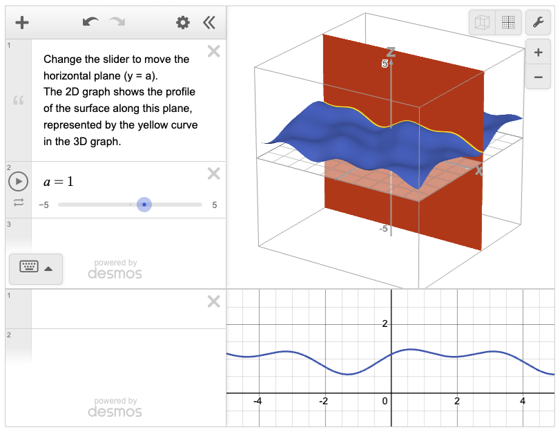{width=40%}

### R Shiny

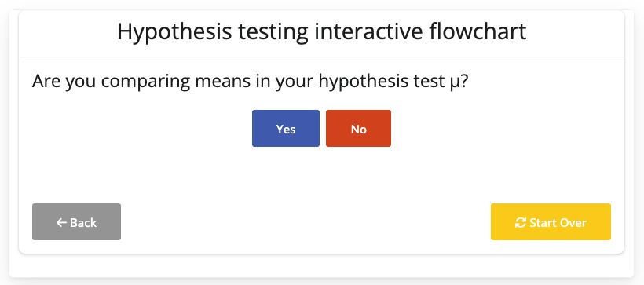
  
### html

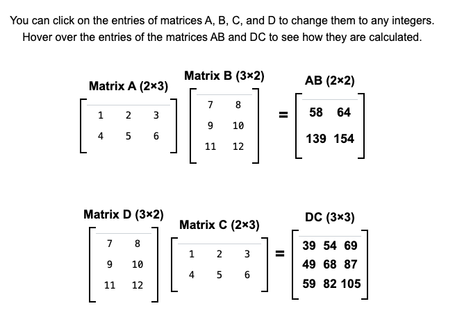{width=50%}

:::

## VIP outputs from students {data-background-image="slides-bg.png" .smaller}

- **content**: guides on algebra, geometry, calculus, stats...

- **accessibility work**: discussions with disability charities, investigating multiple Quarto themes, **mp3 narration of guides**

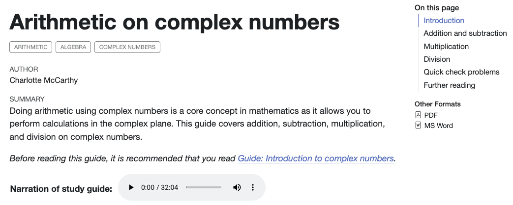
  
## VIP outputs from students {data-background-image="slides-bg.png" .smaller}

::::{.columns}

::: {.column width="30%"}

- **branding and marketing**: colour scheme, logo, outreach plans, social media (Instagram and LinkedIn), ads and posters...

- [Instagram takeover of University of St Andrews main account](https://www.instagram.com/stories/highlights/17854680771690956/)

:::

::: {.column width="70%"}

:::{.panel-tabset}

### Brandkit

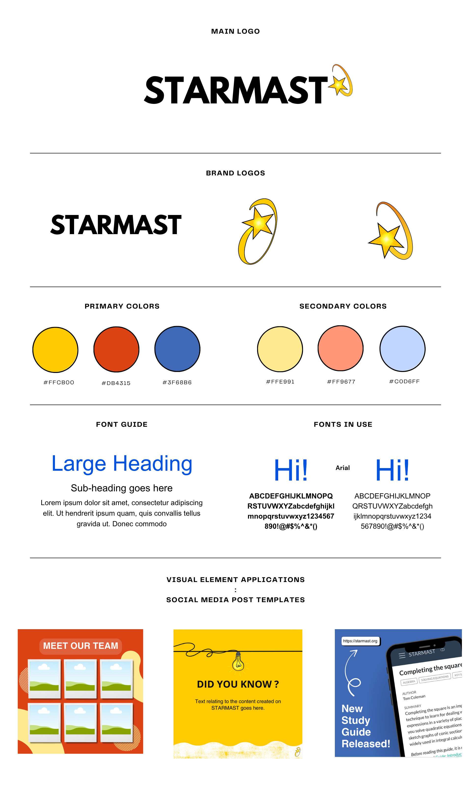{width=35%}

### Insta

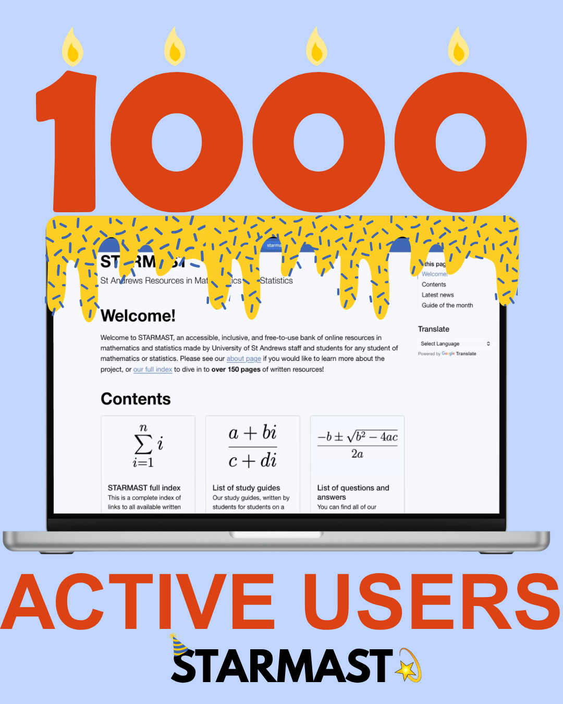{width=50%}

### LinkedIn

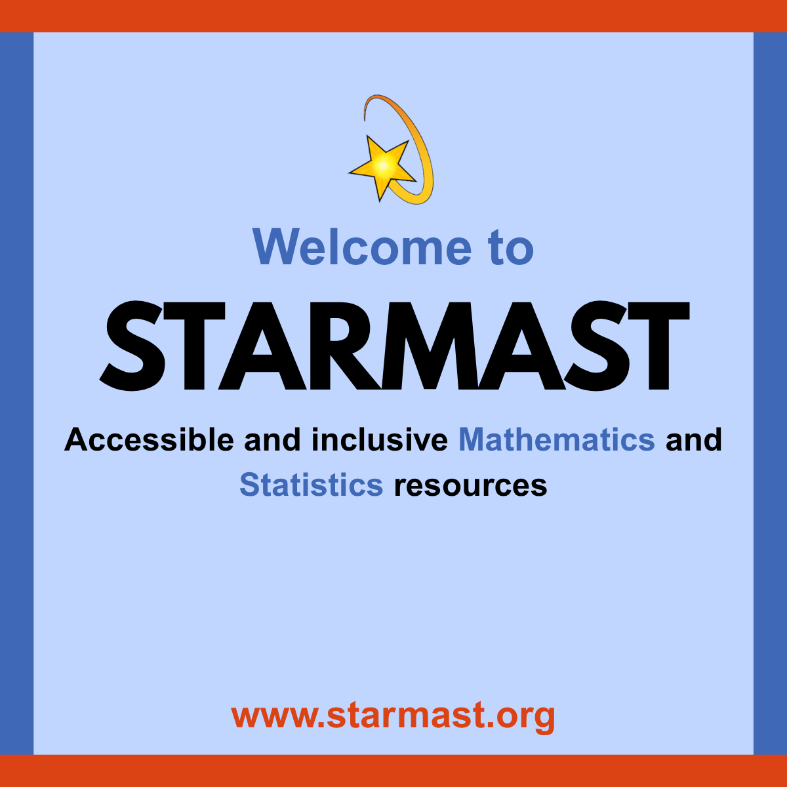{width=60%}

### P1

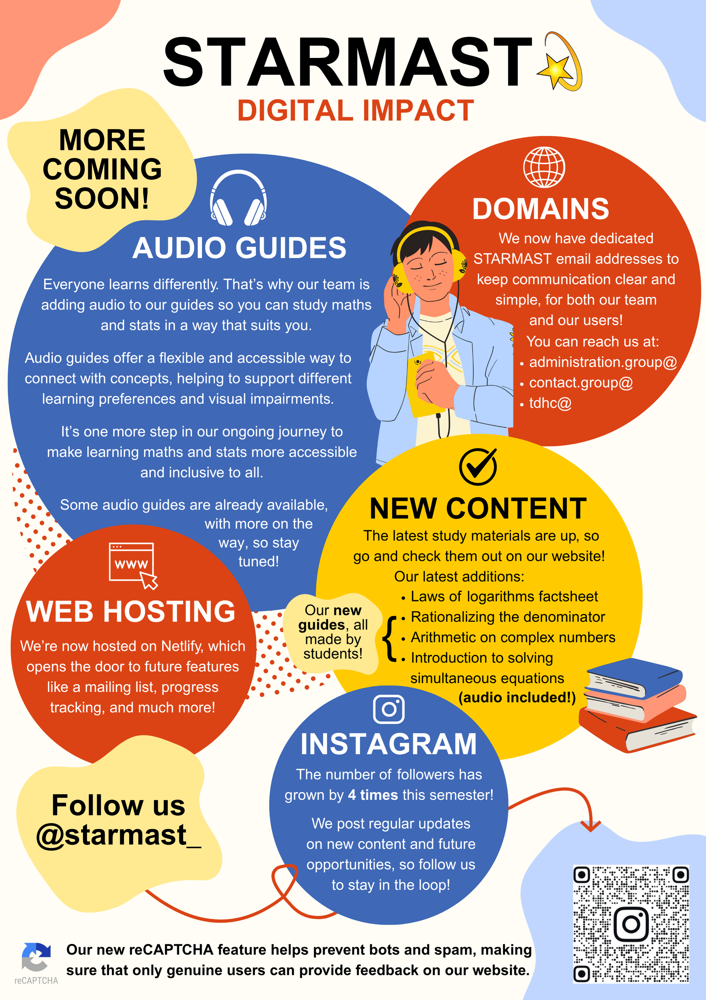{width=40%}
  
### P2 

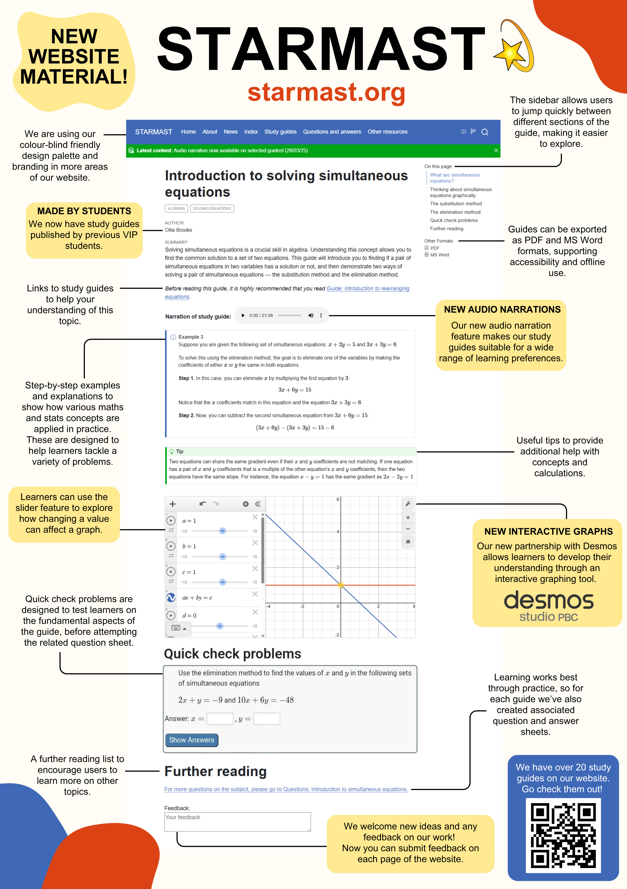{width=40%}

### Ad 

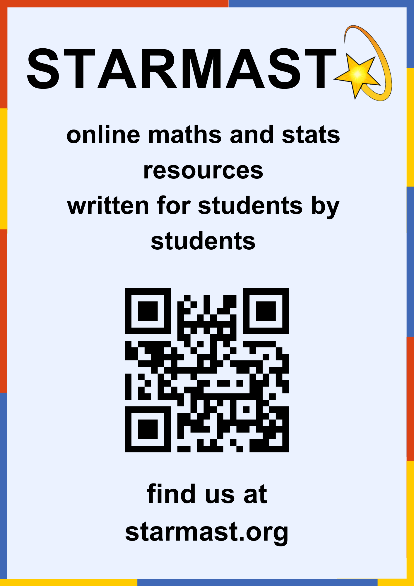{width=40%}

:::

:::

::::

## VIP outputs from students {data-background-image="slides-bg.png" .smaller}

- **website backend**: domain name, security, search engine optimisation, hosting, custom website style, cookies, analytics, feedback boxes, emails, mailing list, progress trackers...

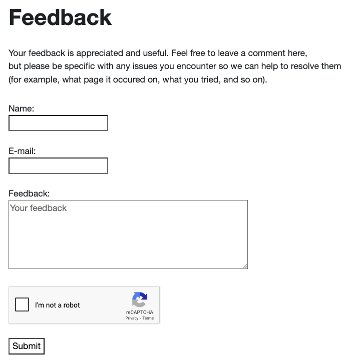{width="60%"}

## Impact of STARMAST project {data-background-image="slides-bg.png" .smaller}

- now the **University's central hub for maths and stats support**

- **1200 users** in the past calendar year, with over **8000 website hits**

- resources used in **four Schools in the University**, with more to follow

- expertise obtained in developing accessible materials **used in several University Schools**
    
- [case study published in MSOR Connections](https://journals.gre.ac.uk/index.php/msor/article/view/1682)

## thanks!

 

**thank you for listening!**

 

get in touch with me at [**tdhc@st-andrews.ac.uk**](mailto:tdhc@st-andrews.ac.uk) if you'd like