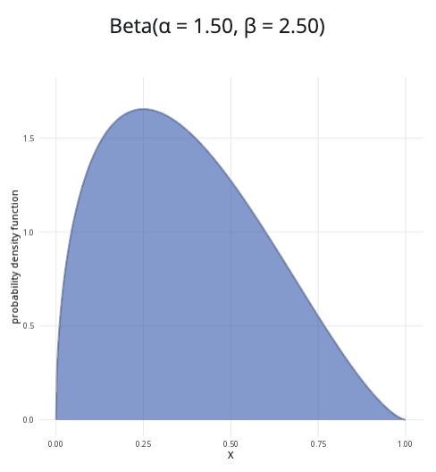

```{r, setup, include = FALSE}
library("webexercises")
```


::: {.content-visible when-format="html"}

```{=html}

<!DOCTYPE html>
<html lang="en">
<head>
  <meta charset="UTF-8">
  <meta name="viewport" content="width=device-width, initial-scale=1.0">
  <title>Beta Distribution Calculator</title>

  <style>
    * { box-sizing: border-box; }

    body {
      margin: 0;
      padding: 1rem;
      background: #f5f6f8;
      color: #222222;
    }

    .beta-calculator {
      width: 100%;
      max-width: 1200px;
      margin: 0 auto;
    }

    .beta-calculator .calculator-row {
      display: grid;
      grid-template-columns: minmax(280px, 1fr) minmax(0, 2fr);
      gap: 1rem;
      align-items: stretch;
    }

    .beta-calculator .calculator-card {
      margin-bottom: 1rem;
      overflow: hidden;
      background: #ffffff;
      border: 1px solid #dddddd;
      border-radius: 8px;
      box-shadow: 0 2px 6px rgba(0, 0, 0, 0.08);
    }

    .beta-calculator .calculator-card-header {
      padding: 0.75rem 1rem;
      color: #ffffff;
      background: #3F6BB6;
      font-weight: 700;
      line-height: 1.4;
    }

    .beta-calculator .calculator-card-body {
      padding: 1rem;
    }

    .beta-calculator .form-group {
      margin-bottom: 1rem;
    }

    .beta-calculator label {
      display: block;
      margin-bottom: 0.4rem;
      font-weight: 500;
    }

    .beta-calculator .distribution-slider {
      width: 100%;
      margin: 0.5rem 0;
      accent-color: #3F68B6;
      cursor: pointer;
    }

    .beta-calculator .slider-value {
      margin-top: 0.1rem;
      color: #3F68B6;
      text-align: center;
      font-weight: 700;
    }

    .beta-calculator hr {
      margin: 1.2rem 0;
      border: 0;
      border-top: 1px solid #dddddd;
    }

    .beta-calculator .probability-options {
      padding: 0;
      margin: 0;
      border: 0;
    }

    .beta-calculator .probability-options legend {
      margin-bottom: 0.6rem;
      font-size: 1rem;
      font-weight: 500;
    }

    .beta-calculator .radio-option {
      display: flex;
      align-items: center;
      gap: 0.45rem;
      margin-bottom: 0.55rem;
      cursor: pointer;
      font-weight: 400;
    }

    .beta-calculator .radio-option input {
      width: 16px;
      height: 16px;
      margin: 0;
      accent-color: #3F68B6;
    }

    .beta-calculator .conditional-input {
      margin-top: 1rem;
    }

    .beta-calculator .conditional-input[hidden] {
      display: none;
    }

    .beta-calculator .upper-label {
      margin-top: 1rem;
    }

    .beta-calculator .distribution-plot-title {
      margin-bottom: 1rem;
      text-align: center;
      font-size: 1.1rem;
      font-weight: 600;
    }

    .beta-calculator .beta-chart-wrapper {
      position: relative;
      width: 100%;
      height: 320px;
    }

    .beta-calculator canvas {
      width: 100% !important;
      height: 100% !important;
    }

    .beta-calculator .calculation-result {
      font-size: 1.05rem;
      line-height: 1.6;
      text-align: center;
    }

    .beta-calculator input:focus,
    .beta-calculator canvas:focus {
      outline: 3px solid rgba(63, 104, 182, 0.3);
      outline-offset: 2px;
    }

    @media (max-width: 768px) {
      .beta-calculator .calculator-row {
        grid-template-columns: 1fr;
      }

      .beta-calculator .plot-card {
        min-width: 0;
      }

      .beta-calculator .beta-chart-wrapper {
        height: 280px;
      }
    }

    @media (max-width: 480px) {
      body { padding: 0.5rem; }

      .beta-calculator .calculator-card-body {
        padding: 0.9rem;
      }

      .beta-calculator .beta-chart-wrapper {
        height: 250px;
      }
    }
  </style>
</head>

<body>

<div class="distribution-calculator beta-calculator">

  <div class="calculator-row">

    <div class="calculator-card parameters-card">
      <div class="calculator-card-header">Parameters</div>

      <div class="calculator-card-body">

        <div class="form-group">
          <label for="beta-alpha">Shape parameter (&alpha;):</label>
          <input
            type="range"
            id="beta-alpha"
            min="0.2"
            max="10"
            value="2"
            step="0.1"
            class="distribution-slider">
          <div class="slider-value" id="beta-alpha-value">2.0</div>
        </div>

        <div class="form-group">
          <label for="beta-beta">Shape parameter (&beta;):</label>
          <input
            type="range"
            id="beta-beta"
            min="0.2"
            max="10"
            value="5"
            step="0.1"
            class="distribution-slider">
          <div class="slider-value" id="beta-beta-value">5.0</div>
        </div>

        <hr>

        <fieldset class="probability-options">
          <legend>Probability to calculate:</legend>

          <label class="radio-option">
            <input type="radio" name="beta-prob-type" value="less" checked>
            <span>P(X &le; x)</span>
          </label>

          <label class="radio-option">
            <input type="radio" name="beta-prob-type" value="greater">
            <span>P(X &ge; x)</span>
          </label>

          <label class="radio-option">
            <input type="radio" name="beta-prob-type" value="between">
            <span>P(a &le; X &le; b)</span>
          </label>
        </fieldset>

        <div id="beta-x-container" class="conditional-input">
          <label for="beta-x">x value:</label>
          <input
            type="range"
            id="beta-x"
            min="0"
            max="1"
            value="0.5"
            step="0.01"
            class="distribution-slider">
          <div class="slider-value" id="beta-x-value">0.50</div>
        </div>

        <div id="beta-between-container" class="conditional-input" hidden>
          <label for="beta-lower">Lower bound (a):</label>
          <input
            type="range"
            id="beta-lower"
            min="0"
            max="1"
            value="0.2"
            step="0.01"
            class="distribution-slider">
          <div class="slider-value" id="beta-lower-value">0.20</div>

          <label for="beta-upper" class="upper-label">Upper bound (b):</label>
          <input
            type="range"
            id="beta-upper"
            min="0"
            max="1"
            value="0.7"
            step="0.01"
            class="distribution-slider">
          <div class="slider-value" id="beta-upper-value">0.70</div>
        </div>

      </div>
    </div>

    <div class="calculator-card plot-card">
      <div class="calculator-card-header">Beta distribution plot</div>

      <div class="calculator-card-body">
        <div id="beta-plot-title" class="distribution-plot-title">
          Beta(&alpha; = 2.0, &beta; = 5.0)
        </div>

        <div class="beta-chart-wrapper">
          <canvas
            id="beta-chart"
            tabindex="0"
            role="img"
            aria-label="Beta distribution probability density function">
          </canvas>
        </div>
      </div>
    </div>

  </div>

  <div class="calculator-card results-card">
    <div class="calculator-card-header">Results</div>
    <div class="calculator-card-body">
      <div id="beta-result" class="calculation-result" aria-live="polite"></div>
    </div>
  </div>

</div>

<script>
(function() {
  "use strict";

  const root = document.querySelector(".beta-calculator");
  if (!root) return;

  const alphaInput = root.querySelector("#beta-alpha");
  const betaInput = root.querySelector("#beta-beta");
  const xInput = root.querySelector("#beta-x");
  const lowerInput = root.querySelector("#beta-lower");
  const upperInput = root.querySelector("#beta-upper");

  const alphaDisplay = root.querySelector("#beta-alpha-value");
  const betaDisplay = root.querySelector("#beta-beta-value");
  const xDisplay = root.querySelector("#beta-x-value");
  const lowerDisplay = root.querySelector("#beta-lower-value");
  const upperDisplay = root.querySelector("#beta-upper-value");

  const title = root.querySelector("#beta-plot-title");
  const result = root.querySelector("#beta-result");
  const xContainer = root.querySelector("#beta-x-container");
  const betweenContainer = root.querySelector("#beta-between-container");
  const canvas = root.querySelector("#beta-chart");
  const ctx = canvas.getContext("2d");

  function logGamma(z) {
    const coefficients = [
      676.5203681218851,
      -1259.1392167224028,
      771.32342877765313,
      -176.61502916214059,
      12.507343278686905,
      -0.13857109526572012,
      9.9843695780195716e-6,
      1.5056327351493116e-7
    ];

    if (z < 0.5) {
      return Math.log(Math.PI) -
        Math.log(Math.sin(Math.PI * z)) -
        logGamma(1 - z);
    }

    z -= 1;
    let total = 0.99999999999980993;

    for (let i = 0; i < coefficients.length; i++) {
      total += coefficients[i] / (z + i + 1);
    }

    const t = z + coefficients.length - 0.5;

    return 0.5 * Math.log(2 * Math.PI) +
      (z + 0.5) * Math.log(t) - t + Math.log(total);
  }

  function betaContinuedFraction(a, b, x) {
    const maxIterations = 200;
    const epsilon = 3e-14;
    const tiny = 1e-300;
    const qab = a + b;
    const qap = a + 1;
    const qam = a - 1;

    let c = 1;
    let d = 1 - qab * x / qap;
    if (Math.abs(d) < tiny) d = tiny;
    d = 1 / d;
    let h = d;

    for (let m = 1; m <= maxIterations; m++) {
      const m2 = 2 * m;
      let aa = m * (b - m) * x /
        ((qam + m2) * (a + m2));

      d = 1 + aa * d;
      if (Math.abs(d) < tiny) d = tiny;
      c = 1 + aa / c;
      if (Math.abs(c) < tiny) c = tiny;
      d = 1 / d;
      h *= d * c;

      aa = -(a + m) * (qab + m) * x /
        ((a + m2) * (qap + m2));

      d = 1 + aa * d;
      if (Math.abs(d) < tiny) d = tiny;
      c = 1 + aa / c;
      if (Math.abs(c) < tiny) c = tiny;
      d = 1 / d;

      const delta = d * c;
      h *= delta;

      if (Math.abs(delta - 1) < epsilon) break;
    }

    return h;
  }

  function regularizedIncompleteBeta(x, a, b) {
    if (x <= 0) return 0;
    if (x >= 1) return 1;

    const logarithmicTerm =
      logGamma(a + b) - logGamma(a) - logGamma(b) +
      a * Math.log(x) + b * Math.log(1 - x);

    const front = Math.exp(logarithmicTerm);

    if (x < (a + 1) / (a + b + 2)) {
      return front * betaContinuedFraction(a, b, x) / a;
    }

    return 1 - front * betaContinuedFraction(b, a, 1 - x) / b;
  }

  function betaPDF(value, alpha, beta) {
    if (value <= 0 || value >= 1) return 0;

    return Math.exp(
      (alpha - 1) * Math.log(value) +
      (beta - 1) * Math.log(1 - value) -
      logGamma(alpha) - logGamma(beta) +
      logGamma(alpha + beta)
    );
  }

  function betaCDF(value, alpha, beta) {
    return regularizedIncompleteBeta(value, alpha, beta);
  }

  function getProbabilityType() {
    const selected = root.querySelector(
      'input[name="beta-prob-type"]:checked'
    );
    return selected ? selected.value : "less";
  }

  function formatValue(value) {
    return Number(value).toFixed(2);
  }

  function updateDisplay() {
    const alpha = parseFloat(alphaInput.value);
    const beta = parseFloat(betaInput.value);

    alphaDisplay.textContent = alpha.toFixed(1);
    betaDisplay.textContent = beta.toFixed(1);
    xDisplay.textContent = formatValue(xInput.value);
    lowerDisplay.textContent = formatValue(lowerInput.value);
    upperDisplay.textContent = formatValue(upperInput.value);

    title.textContent =
      `Beta(α = ${alpha.toFixed(1)}, β = ${beta.toFixed(1)})`;
  }

  function calculateProbability() {
    const alpha = parseFloat(alphaInput.value);
    const beta = parseFloat(betaInput.value);
    const x = parseFloat(xInput.value);
    let lower = parseFloat(lowerInput.value);
    let upper = parseFloat(upperInput.value);
    const type = getProbabilityType();

    if (upper < lower) {
      upper = lower;
      upperInput.value = upper;
      upperDisplay.textContent = formatValue(upper);
    }

    let probability;

    if (type === "less") {
      probability = betaCDF(x, alpha, beta);
      result.textContent =
        `P(X ≤ ${formatValue(x)}) = ${probability.toFixed(4)} ` +
        `or ${(probability * 100).toFixed(2)}%`;
    } else if (type === "greater") {
      probability = 1 - betaCDF(x, alpha, beta);
      result.textContent =
        `P(X ≥ ${formatValue(x)}) = ${probability.toFixed(4)} ` +
        `or ${(probability * 100).toFixed(2)}%`;
    } else {
      probability =
        betaCDF(upper, alpha, beta) -
        betaCDF(lower, alpha, beta);

      result.textContent =
        `P(${formatValue(lower)} ≤ X ≤ ${formatValue(upper)}) = ` +
        `${probability.toFixed(4)} or ` +
        `${(probability * 100).toFixed(2)}%`;
    }

    probability = Math.max(0, Math.min(1, probability));

    return { type, x, lower, upper, probability, alpha, beta };
  }

  function drawChart() {
    const selected = calculateProbability();
    const alpha = selected.alpha;
    const beta = selected.beta;
    const rect = canvas.getBoundingClientRect();

    if (!rect.width || !rect.height) return;

    const dpr = window.devicePixelRatio || 1;
    canvas.width = Math.round(rect.width * dpr);
    canvas.height = Math.round(rect.height * dpr);
    ctx.setTransform(dpr, 0, 0, dpr, 0, 0);

    const width = rect.width;
    const height = rect.height;
    const padding = { left: 58, right: 20, top: 25, bottom: 50 };
    const chartWidth = width - padding.left - padding.right;
    const chartHeight = height - padding.top - padding.bottom;
    const pointCount = 700;
    const epsilon = 0.001;
    const points = [];
    let maximumY = 0;

    ctx.clearRect(0, 0, width, height);

    for (let i = 0; i <= pointCount; i++) {
      const value = epsilon +
        (i / pointCount) * (1 - 2 * epsilon);
      const density = betaPDF(value, alpha, beta);

      if (Number.isFinite(density)) {
        points.push({ value, density });
        maximumY = Math.max(maximumY, density);
      }
    }

    maximumY = Math.max(0.5, Math.min(25, maximumY * 1.08));

    function xScale(value) {
      return padding.left + value * chartWidth;
    }

    function yScale(value) {
      const bounded = Math.min(value, maximumY);
      return padding.top + chartHeight -
        (bounded / maximumY) * chartHeight;
    }

    ctx.font = "12px Arial";
    ctx.textAlign = "right";
    ctx.textBaseline = "middle";

    for (let i = 0; i <= 4; i++) {
      const density = (i / 4) * maximumY;
      const y = yScale(density);

      ctx.strokeStyle = "#e5e5e5";
      ctx.lineWidth = 1;
      ctx.beginPath();
      ctx.moveTo(padding.left, y);
      ctx.lineTo(width - padding.right, y);
      ctx.stroke();

      ctx.fillStyle = "#555555";
      ctx.fillText(density.toFixed(1), padding.left - 8, y);
    }

    function fillArea(start, end, colour) {
      const boundedStart = Math.max(0, Math.min(1, start));
      const boundedEnd = Math.max(0, Math.min(1, end));
      if (boundedEnd <= boundedStart) return;

      ctx.beginPath();
      ctx.moveTo(xScale(boundedStart), yScale(0));

      let hasPoint = false;

      points.forEach(function(point) {
        if (point.value >= boundedStart && point.value <= boundedEnd) {
          ctx.lineTo(xScale(point.value), yScale(point.density));
          hasPoint = true;
        }
      });

      if (!hasPoint) return;

      ctx.lineTo(xScale(boundedEnd), yScale(0));
      ctx.closePath();
      ctx.fillStyle = colour;
      ctx.fill();
    }

    fillArea(0, 1, "rgba(211, 211, 211, 0.55)");

    if (selected.type === "less") {
      fillArea(0, selected.x, "rgba(63, 107, 182, 0.58)");
    } else if (selected.type === "greater") {
      fillArea(selected.x, 1, "rgba(63, 107, 182, 0.58)");
    } else {
      fillArea(selected.lower, selected.upper, "rgba(63, 107, 182, 0.58)");
    }

    ctx.beginPath();

    points.forEach(function(point, index) {
      const chartX = xScale(point.value);
      const chartY = yScale(point.density);

      if (index === 0) ctx.moveTo(chartX, chartY);
      else ctx.lineTo(chartX, chartY);
    });

    ctx.strokeStyle = "#274f91";
    ctx.lineWidth = 2.5;
    ctx.stroke();

    function drawBoundary(value) {
      if (value < 0 || value > 1) return;

      const density = value === 0 || value === 1
        ? 0
        : betaPDF(value, alpha, beta);

      ctx.save();
      ctx.setLineDash([5, 4]);
      ctx.strokeStyle = "#274f91";
      ctx.lineWidth = 1.5;
      ctx.beginPath();
      ctx.moveTo(xScale(value), yScale(0));
      ctx.lineTo(xScale(value), yScale(density));
      ctx.stroke();
      ctx.restore();
    }

    if (selected.type === "between") {
      drawBoundary(selected.lower);
      drawBoundary(selected.upper);
    } else {
      drawBoundary(selected.x);
    }

    ctx.strokeStyle = "#777777";
    ctx.lineWidth = 1;
    ctx.beginPath();
    ctx.moveTo(padding.left, padding.top);
    ctx.lineTo(padding.left, padding.top + chartHeight);
    ctx.lineTo(width - padding.right, padding.top + chartHeight);
    ctx.stroke();

    ctx.fillStyle = "#333333";
    ctx.font = "12px Arial";
    ctx.textAlign = "center";
    ctx.textBaseline = "alphabetic";

    for (let i = 0; i <= 5; i++) {
      const value = i / 5;
      ctx.fillText(
        value.toFixed(1),
        xScale(value),
        padding.top + chartHeight + 20
      );
    }

    ctx.font = "13px Arial";
    ctx.fillText(
      "value of X",
      padding.left + chartWidth / 2,
      height - 8
    );

    ctx.save();
    ctx.translate(15, padding.top + chartHeight / 2);
    ctx.rotate(-Math.PI / 2);
    ctx.textAlign = "center";
    ctx.fillText("probability density", 0, 0);
    ctx.restore();

    canvas.setAttribute(
      "aria-label",
      `Beta probability density plot with alpha ${alpha.toFixed(1)} and ` +
      `beta ${beta.toFixed(1)}. The selected probability is ` +
      `${selected.probability.toFixed(4)}.`
    );
  }

  function updateVisibility() {
    const type = getProbabilityType();
    xContainer.hidden = type === "between";
    betweenContainer.hidden = type !== "between";
  }

  function update() {
    updateVisibility();
    updateDisplay();
    drawChart();
  }

  alphaInput.addEventListener("input", update);
  betaInput.addEventListener("input", update);
  xInput.addEventListener("input", update);

  lowerInput.addEventListener("input", function() {
    if (parseFloat(lowerInput.value) > parseFloat(upperInput.value)) {
      upperInput.value = lowerInput.value;
    }
    update();
  });

  upperInput.addEventListener("input", function() {
    if (parseFloat(upperInput.value) < parseFloat(lowerInput.value)) {
      lowerInput.value = upperInput.value;
    }
    update();
  });

  root.querySelectorAll('input[name="beta-prob-type"]').forEach(
    function(radio) {
      radio.addEventListener("change", update);
    }
  );

  let resizeTimer;

  window.addEventListener("resize", function() {
    window.clearTimeout(resizeTimer);
    resizeTimer = window.setTimeout(drawChart, 80);
  });

  update();
})();
</script>

</body>
</html>


```

:::

::: {.content-hidden when-format="html"}

{width="80%"}

:::

**Where to use:** The beta distribution is used to model the distribution of *probabilities* or proportions. Hence, the random variable $0 \leq X \leq 1$.

**Notation:** $X \sim \textrm{Beta}(\alpha,\beta)$

**Parameters:** Two positive real numbers $\alpha,\beta$, which are shape parameters. These can be specified as follows in terms of $n$ and $k$ where $n$ is the number of Bernoulli trials and $k$ is the number of successes:

-   $\alpha = k + 1$
-   $\beta = n - k + 1$

| Quantity | Value | Notes |
|:--------|:----------------------------|:-------------------|
| **Mean** | $\mathbb{E}(X) = \dfrac{\alpha}{\alpha+\beta}$ |  |
| **Variance** | $\mathbb{V}(X) = \dfrac{\alpha\beta}{(\alpha+\beta)^2(\alpha+\beta+1)}$ |  |
| **PDF** | $\mathbb{P}(X=x)=\dfrac{x^{\alpha-1}(1-x)^{\beta-1}}{\textrm{B}(\alpha,\beta)}$ | $\textrm{B}(x,y)$ is the beta function |
| **CDF** | $\mathbb{P}(X \leq x)=I_{x}(\alpha,\beta)$ | $I_{x}(a,b)$ is the regularized incomplete beta function |

**Example:** Cantor’s Confectionery is visited by 10 customers, and 6 of them purchase something from the store. Taking the buying customers as successes and the total visiting customers as number of trials, there would be 6 successes, allowing you to find the following parameters:

-   $\alpha = 6 + 1 = 7$

-   $\beta = 10 - 6 + 1 = 5$

Then the distribution of the probabilities of a customer purchasing from Cantor’s Confectionery can be expressed as $X \sim \textrm{Beta}(7,5)$, meaning the first shape parameter is 7 and the second shape parameter is 5.

# Further reading {-}

[This interactive element appears in Overview: Probability distributions. Please click this link to go to the guide.](../overviews/o-distributions.qmd)

## Version history {-}

v1.0: initial version created 04/25 by tdhc and Michelle Arnetta as part of a University of St Andrews VIP project.

  - v1.1: moved to factsheet form and populated with material from [Overview: Probability distributions](../overviews/o-distributions.qmd) by tdhc.
  
  - v1.2: graph transferred from R Shinylive to html by tdhc in 06/26.
  
[This work is licensed under CC BY-NC-SA 4.0.](https://creativecommons.org/licenses/by-nc-sa/4.0/?ref=chooser-v1)


