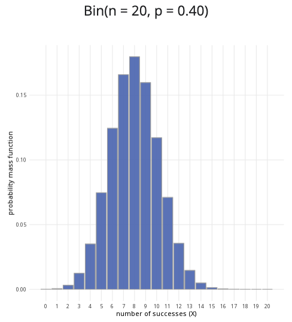

```{r, setup, include = FALSE}
library("webexercises")
```

::: {.content-visible when-format="html"}

```{=html}

<div class="distribution-calculator binomial-calculator">

  <div class="calculator-row">

    <!-- PARAMETERS CARD -->
    <div class="calculator-card parameters-card">

      <div class="calculator-card-header">
        Parameters
      </div>

      <div class="calculator-card-body">

        <div class="form-group">
          <label for="binomial-n">
            Number of trials (n):
          </label>

          <input
            type="number"
            id="binomial-n"
            value="10"
            min="1"
            step="1"
            class="form-control">
        </div>

        <div class="form-group">
          <label for="binomial-p">
            Probability of success (p):
          </label>

          <input
            type="range"
            id="binomial-p"
            min="0"
            max="1"
            value="0.5"
            step="0.01"
            class="distribution-slider">

          <div class="slider-value" id="binomial-p-value">
            0.50
          </div>
        </div>

        <hr>

        <fieldset class="probability-options">

          <legend>
            Probability to calculate:
          </legend>

          <label class="radio-option">
            <input
              type="radio"
              name="binomial-prob-type"
              value="less"
              checked>
            <span>P(X ≤ x)</span>
          </label>

          <label class="radio-option">
            <input
              type="radio"
              name="binomial-prob-type"
              value="greater">
            <span>P(X ≥ x)</span>
          </label>

          <label class="radio-option">
            <input
              type="radio"
              name="binomial-prob-type"
              value="between">
            <span>P(x ≤ X ≤ y)</span>
          </label>

        </fieldset>

        <!-- SINGLE X VALUE -->

        <div
          id="binomial-x-container"
          class="conditional-input">

          <label for="binomial-x">
            x value:
          </label>

          <input
            type="range"
            id="binomial-x"
            min="0"
            max="10"
            value="5"
            step="1"
            class="distribution-slider">

          <div class="slider-value" id="binomial-x-value">
            5
          </div>

        </div>

        <!-- LOWER / UPPER VALUES -->

        <div
          id="binomial-between-container"
          class="conditional-input"
          hidden>

          <label for="binomial-lower">
            Lower bound (x):
          </label>

          <input
            type="range"
            id="binomial-lower"
            min="0"
            max="10"
            value="3"
            step="1"
            class="distribution-slider">

          <div class="slider-value" id="binomial-lower-value">
            3
          </div>

          <label
            for="binomial-upper"
            class="upper-label">

            Upper bound (y):

          </label>

          <input
            type="range"
            id="binomial-upper"
            min="0"
            max="10"
            value="7"
            step="1"
            class="distribution-slider">

          <div class="slider-value" id="binomial-upper-value">
            7
          </div>

        </div>

      </div>
    </div>


    <!-- PLOT CARD -->

    <div class="calculator-card plot-card">

      <div class="calculator-card-header">
        Binomial distribution plot
      </div>

      <div class="calculator-card-body">

        <div
          id="binomial-plot-title"
          class="distribution-plot-title">

          Bin(n = 10, p = 0.50)

        </div>

        <div class="binomial-chart-wrapper">

          <canvas
            id="binomial-chart"
            tabindex="0"
            aria-label="Binomial distribution probability mass function">
          </canvas>

        </div>

      </div>
    </div>

  </div>


  <!-- RESULTS CARD -->

  <div class="calculator-card results-card">

    <div class="calculator-card-header">
      Results
    </div>

    <div class="calculator-card-body">

      <div
        id="binomial-result"
        class="calculation-result"
        aria-live="polite">
      </div>

    </div>

  </div>

</div>


<style>

/* =========================================================
   BINOMIAL CALCULATOR
   ========================================================= */

.binomial-calculator {
  width: 100%;
  max-width: 1200px;
  margin: 0 auto;
}


/* TOP ROW */

.binomial-calculator .calculator-row {
  display: grid;
  grid-template-columns: minmax(280px, 1fr) minmax(0, 2fr);
  gap: 1rem;
  align-items: stretch;
}


/* CARDS */

.binomial-calculator .calculator-card {
  background: #ffffff;
  border: 1px solid #dddddd;
  border-radius: 8px;
  overflow: hidden;
  box-shadow: 0 2px 6px rgba(0,0,0,0.08);
  margin-bottom: 1rem;
}


/* CARD HEADERS */

.binomial-calculator .calculator-card-header {
  background: #3F6BB6;
  color: #ffffff;
  padding: 0.75rem 1rem;
  font-weight: 700;
  line-height: 1.4;
}


/* CARD BODY */

.binomial-calculator .calculator-card-body {
  padding: 1rem;
}


/* FORM ELEMENTS */

.binomial-calculator .form-group {
  margin-bottom: 1rem;
}

.binomial-calculator label {
  display: block;
  margin-bottom: 0.4rem;
  font-weight: 500;
}

.binomial-calculator input[type="number"] {
  width: 100%;
  box-sizing: border-box;
  padding: 0.55rem 0.65rem;
  border: 1px solid #cccccc;
  border-radius: 5px;
  background: #ffffff;
  font-size: 1rem;
}


/* SLIDERS */

.binomial-calculator .distribution-slider {
  width: 100%;
  margin: 0.5rem 0;
  accent-color: #3F68B6;
  cursor: pointer;
}

.binomial-calculator .slider-value {
  text-align: center;
  color: #3F68B6;
  font-weight: 700;
  margin-top: 0.1rem;
}


/* DIVIDER */

.binomial-calculator hr {
  border: 0;
  border-top: 1px solid #dddddd;
  margin: 1.2rem 0;
}


/* RADIO BUTTONS */

.binomial-calculator .probability-options {
  border: 0;
  padding: 0;
  margin: 0;
}

.binomial-calculator .probability-options legend {
  font-size: 1rem;
  font-weight: 500;
  margin-bottom: 0.6rem;
}

.binomial-calculator .radio-option {
  display: flex;
  align-items: center;
  gap: 0.45rem;
  margin-bottom: 0.55rem;
  cursor: pointer;
  font-weight: 400;
}

.binomial-calculator .radio-option input {
  margin: 0;
  width: 16px;
  height: 16px;
  accent-color: #3F68B6;
}


/* CONDITIONAL INPUTS */

.binomial-calculator .conditional-input {
  margin-top: 1rem;
}

.binomial-calculator .conditional-input[hidden] {
  display: none;
}

.binomial-calculator .upper-label {
  margin-top: 1rem;
}


/* PLOT */

.binomial-calculator .distribution-plot-title {
  text-align: center;
  font-size: 1.1rem;
  font-weight: 600;
  margin-bottom: 1rem;
}

.binomial-calculator .binomial-chart-wrapper {
  position: relative;
  width: 100%;
  height: 320px;
}

.binomial-calculator canvas {
  width: 100% !important;
  height: 100% !important;
}


/* RESULTS */

.binomial-calculator .calculation-result {
  font-size: 1.05rem;
  line-height: 1.6;
  text-align: center;
}


/* FOCUS */

.binomial-calculator input:focus,
.binomial-calculator canvas:focus {
  outline: 3px solid rgba(63,104,182,0.3);
  outline-offset: 2px;
}


/* MOBILE */

@media (max-width: 768px) {

  .binomial-calculator .calculator-row {
    grid-template-columns: 1fr;
  }

  .binomial-calculator .plot-card {
    min-width: 0;
  }

  .binomial-calculator .binomial-chart-wrapper {
    height: 280px;
  }

}


/* SMALL MOBILE */

@media (max-width: 480px) {

  .binomial-calculator .calculator-card-body {
    padding: 0.9rem;
  }

  .binomial-calculator .binomial-chart-wrapper {
    height: 250px;
  }

}

</style>


<script>

/* =========================================================
   BINOMIAL DISTRIBUTION CALCULATOR
   ========================================================= */

(function() {

  const nInput =
    document.getElementById("binomial-n");

  const pInput =
    document.getElementById("binomial-p");

  const xInput =
    document.getElementById("binomial-x");

  const lowerInput =
    document.getElementById("binomial-lower");

  const upperInput =
    document.getElementById("binomial-upper");

  const pDisplay =
    document.getElementById("binomial-p-value");

  const xDisplay =
    document.getElementById("binomial-x-value");

  const lowerDisplay =
    document.getElementById("binomial-lower-value");

  const upperDisplay =
    document.getElementById("binomial-upper-value");

  const title =
    document.getElementById("binomial-plot-title");

  const result =
    document.getElementById("binomial-result");

  const xContainer =
    document.getElementById("binomial-x-container");

  const betweenContainer =
    document.getElementById("binomial-between-container");

  const canvas =
    document.getElementById("binomial-chart");

  const ctx =
    canvas.getContext("2d");


  /* -------------------------------------------------------
     BINOMIAL PMF
     ------------------------------------------------------- */

  function logGamma(z) {

    const coefficients = [
      676.5203681218851,
      -1259.1392167224028,
      771.32342877765313,
      -176.61502916214059,
      12.507343278686905,
      -0.13857109526572012,
      9.9843695780195716e-6,
      1.5056327351493116e-7
    ];

    if (z < 0.5) {
      return Math.log(Math.PI)
        - Math.log(Math.sin(Math.PI * z))
        - logGamma(1 - z);
    }

    z -= 1;

    let x = 0.99999999999980993;

    for (let i = 0; i < coefficients.length; i++) {
      x += coefficients[i] / (z + i + 1);
    }

    const t = z + coefficients.length - 0.5;

    return (
      0.5 * Math.log(2 * Math.PI) +
      (z + 0.5) * Math.log(t) -
      t +
      Math.log(x)
    );
  }


  function binomialPMF(k, n, p) {

    if (k < 0 || k > n) {
      return 0;
    }

    if (p === 0) {
      return k === 0 ? 1 : 0;
    }

    if (p === 1) {
      return k === n ? 1 : 0;
    }

    const logProbability =
      logGamma(n + 1) -
      logGamma(k + 1) -
      logGamma(n - k + 1) +
      k * Math.log(p) +
      (n - k) * Math.log(1 - p);

    return Math.exp(logProbability);
  }


  /* -------------------------------------------------------
     CUMULATIVE PROBABILITY
     ------------------------------------------------------- */

  function cumulativeProbability(k, n, p) {

    if (k < 0) return 0;

    if (k >= n) return 1;

    let total = 0;

    for (let i = 0; i <= k; i++) {
      total += binomialPMF(i, n, p);
    }

    return total;
  }


  /* -------------------------------------------------------
     CURRENT TEST TYPE
     ------------------------------------------------------- */

  function getTestType() {

    const selected =
      document.querySelector(
        'input[name="binomial-prob-type"]:checked'
      );

    return selected
      ? selected.value
      : "less";
  }


  /* -------------------------------------------------------
     UPDATE SLIDER RANGES
     ------------------------------------------------------- */

  function updateRanges() {

    let n =
      parseInt(nInput.value, 10);

    if (!Number.isFinite(n) || n < 1) {
      n = 1;
      nInput.value = 1;
    }

    xInput.max = n;
    lowerInput.max = n;
    upperInput.max = n;

    if (parseInt(xInput.value,10) > n) {
      xInput.value = n;
    }

    if (parseInt(lowerInput.value,10) > n) {
      lowerInput.value = n;
    }

    if (parseInt(upperInput.value,10) > n) {
      upperInput.value = n;
    }

    if (
      parseInt(upperInput.value,10) <
      parseInt(lowerInput.value,10)
    ) {
      upperInput.value =
        lowerInput.value;
    }

  }


  /* -------------------------------------------------------
     UPDATE DISPLAY
     ------------------------------------------------------- */

  function updateDisplay() {

    updateRanges();

    const n =
      parseInt(nInput.value,10);

    const p =
      parseFloat(pInput.value);

    const x =
      parseInt(xInput.value,10);

    const lower =
      parseInt(lowerInput.value,10);

    const upper =
      parseInt(upperInput.value,10);

    pDisplay.textContent =
      p.toFixed(2);

    xDisplay.textContent =
      x;

    lowerDisplay.textContent =
      lower;

    upperDisplay.textContent =
      upper;

    title.textContent =
      `Bin(n = ${n}, p = ${p.toFixed(2)})`;

  }


  /* -------------------------------------------------------
     CALCULATE RESULT
     ------------------------------------------------------- */

  function calculateProbability() {

    const n =
      parseInt(nInput.value,10);

    const p =
      parseFloat(pInput.value);

    const x =
      parseInt(xInput.value,10);

    let lower =
      parseInt(lowerInput.value,10);

    let upper =
      parseInt(upperInput.value,10);

    const type =
      getTestType();


    if (upper < lower) {

      upper = lower;

      upperInput.value =
        upper;

      upperDisplay.textContent =
        upper;

    }


    let probability;


    if (type === "less") {

      probability =
        cumulativeProbability(
          x,
          n,
          p
        );

      result.textContent =
        `P(X ≤ ${x}) = ` +
        `${probability.toFixed(4)} ` +
        `or ${(probability * 100).toFixed(2)}%`;

    }


    else if (type === "greater") {

      if (x === 0) {

        probability = 1;

      } else {

        probability =
          1 -
          cumulativeProbability(
            x - 1,
            n,
            p
          );

      }

      result.textContent =
        `P(X ≥ ${x}) = ` +
        `${probability.toFixed(4)} ` +
        `or ${(probability * 100).toFixed(2)}%`;

    }


    else {

      if (lower === upper) {

        probability =
          binomialPMF(
            lower,
            n,
            p
          );

      } else {

        const upperProbability =
          cumulativeProbability(
            upper,
            n,
            p
          );

        const lowerProbability =
          lower === 0
            ? 0
            : cumulativeProbability(
                lower - 1,
                n,
                p
              );

        probability =
          upperProbability -
          lowerProbability;

      }

      result.textContent =
        `P(${lower} ≤ X ≤ ${upper}) = ` +
        `${probability.toFixed(4)} ` +
        `or ${(probability * 100).toFixed(2)}%`;

    }


    return {
      type,
      x,
      lower,
      upper,
      probability
    };

  }


  /* -------------------------------------------------------
     DRAW CHART
     ------------------------------------------------------- */

  function drawChart() {

    const n =
      parseInt(nInput.value,10);

    const p =
      parseFloat(pInput.value);

    const res =
      calculateProbability();


    const rect =
      canvas.getBoundingClientRect();

    const dpr =
      window.devicePixelRatio || 1;

    canvas.width =
      rect.width * dpr;

    canvas.height =
      rect.height * dpr;

    ctx.setTransform(
      dpr,
      0,
      0,
      dpr,
      0,
      0
    );


    const width =
      rect.width;

    const height =
      rect.height;


    ctx.clearRect(
      0,
      0,
      width,
      height
    );


    const padding = {
      left: 55,
      right: 20,
      top: 25,
      bottom: 50
    };


    const chartWidth =
      width -
      padding.left -
      padding.right;

    const chartHeight =
      height -
      padding.top -
      padding.bottom;


    const probabilities = [];

    for(let k=0;k<=n;k++) {

      probabilities.push(
        binomialPMF(k,n,p)
      );

    }


    const maxProbability =
      Math.max(...probabilities);


    function xScale(k) {

      if(n === 0) {
        return padding.left;
      }

      return padding.left +
        (k / n) *
        chartWidth;

    }


    function yScale(value) {

      return padding.top +
        chartHeight -
        (value / maxProbability) *
        chartHeight *
        0.9;

    }


    /* GRID */

    ctx.strokeStyle =
      "#e5e5e5";

    ctx.lineWidth = 1;

    for(let i=0;i<=4;i++) {

      const y =
        padding.top +
        chartHeight -
        (i/4) *
        chartHeight;

      ctx.beginPath();

      ctx.moveTo(
        padding.left,
        y
      );

      ctx.lineTo(
        width - padding.right,
        y
      );

      ctx.stroke();

    }


    /* AXIS */

    ctx.strokeStyle =
      "#777";

    ctx.lineWidth = 1;

    ctx.beginPath();

    ctx.moveTo(
      padding.left,
      padding.top + chartHeight
    );

    ctx.lineTo(
      width - padding.right,
      padding.top + chartHeight
    );

    ctx.stroke();


    /* BARS */

    const barWidth =
      Math.max(
        2,
        Math.min(
          40,
          chartWidth / (n + 1) * 0.72
        )
      );


    for(let k=0;k<=n;k++) {

      const probability =
        probabilities[k];

      const barHeight =
        (probability / maxProbability) *
        chartHeight *
        0.9;

      const x =
        xScale(k) -
        barWidth / 2;

      const y =
        padding.top +
        chartHeight -
        barHeight;


      let highlighted = false;


      if(res.type === "less") {

        highlighted =
          k <= res.x;

      }

      else if(res.type === "greater") {

        highlighted =
          k >= res.x;

      }

      else if(res.type === "between") {

        highlighted =
          k >= res.lower &&
          k <= res.upper;

      }


      ctx.fillStyle =
        highlighted
          ? "#3F6BB6"
          : "#d3d3d3";


      ctx.fillRect(
        x,
        y,
        barWidth,
        barHeight
      );


      ctx.strokeStyle =
        "#777";

      ctx.strokeRect(
        x,
        y,
        barWidth,
        barHeight
      );

    }


    /* X AXIS LABELS */

    ctx.fillStyle =
      "#333";

    ctx.font =
      "12px Arial";

    ctx.textAlign =
      "center";

    for(let k=0;k<=n;k++) {

      const x =
        xScale(k);

      ctx.fillText(
        k,
        x,
        padding.top +
        chartHeight +
        20
      );

    }


    /* X LABEL */

    ctx.font =
      "13px Arial";

    ctx.fillText(
      "number of successes (X)",
      padding.left +
      chartWidth/2,
      height - 8
    );


    /* Y LABEL */

    ctx.save();

    ctx.translate(
      15,
      padding.top +
      chartHeight/2
    );

    ctx.rotate(-Math.PI/2);

    ctx.textAlign =
      "center";

    ctx.fillText(
      "probability mass function",
      0,
      0
    );

    ctx.restore();

  }


  /* -------------------------------------------------------
     VISIBILITY
     ------------------------------------------------------- */

  function updateVisibility() {

    const type =
      getTestType();

    if(
      type === "less" ||
      type === "greater"
    ) {

      xContainer.hidden = false;

      betweenContainer.hidden = true;

    } else {

      xContainer.hidden = true;

      betweenContainer.hidden = false;

    }

  }


  /* -------------------------------------------------------
     MASTER UPDATE
     ------------------------------------------------------- */

  function update() {

    updateVisibility();

    updateDisplay();

    drawChart();

  }


  /* -------------------------------------------------------
     EVENT LISTENERS
     ------------------------------------------------------- */

  nInput.addEventListener(
    "input",
    update
  );

  pInput.addEventListener(
    "input",
    update
  );

  xInput.addEventListener(
    "input",
    update
  );

  lowerInput.addEventListener(
    "input",
    function() {

      if(
        parseInt(upperInput.value,10) <
        parseInt(lowerInput.value,10)
      ) {

        upperInput.value =
          lowerInput.value;

      }

      update();

    }
  );

  upperInput.addEventListener(
    "input",
    update
  );


  document
    .querySelectorAll(
      'input[name="binomial-prob-type"]'
    )
    .forEach(
      radio =>
        radio.addEventListener(
          "change",
          update
        )
    );


  window.addEventListener(
    "resize",
    drawChart
  );


  /* INITIALISE */

  update();

})();

</script>

```


:::

::: {.content-hidden when-format="html"}

{width="80%"}

:::


**Where to use:** The binomial distribution is used when there are a fixed number of trials ($n$) and only two possible outcomes for each trial, representing $n$ many Bernoulli trials. Here, the random variable $X$ represents the number of successes.

**Notation:** $X \sim \textrm{Binomial}(n,p)$ or $X \sim B(n,p)$.

**Parameters:** Two numbers $n,p$ where: - $n$ is an integer representing the number of trials, - $p$ is a real number representing the probability of success of a trial (where $0 \le p \le 1$).

| Quantity | Value | Notes |
|:--------|:----------------------------|:-------------------|
| **Mean** | $\mathbb{E}(X) = np$ |  |
| **Variance** | $\mathbb{V}(X) = np(1-p)$ |  |
| **PMF** | $\mathbb{P}(X=x)=\dfrac{n!}{(n-x)!x!}p^xq^{(n-x)}$ |  |
| **CDF** | $\mathbb{P}(X\leq x)=I_{q}(n-\lfloor x \rfloor,1+\lfloor x \rfloor)$ | $I_x(a,b)$ regularized incomplete beta function, $\lfloor x \rfloor$ the floor function |

**Example:** You flip a coin $10$ times, and the probability of getting ‘heads’ is $0.5$. Taking ‘heads’ as a success, this can be expressed as $X \sim B(10, 0.5)$, meaning $10$ trials are conducted, where the probability of success in each trial is $0.5$.


# Further reading {-}

This interactive element appears in [Guide: PMFs, PDFs, CDFs](../studyguides/pmfspdfscdfs.qmd) and [Overview: Probability distributions.](../overviews/o-distributions.qmd) Please click the relevant links to go to the guides.

## Version history {-}

v1.0: initial version created 04/25 by tdhc and Michelle Arnetta as part of a University of St Andrews VIP project.

- v1.1: moved to factsheet form and populated with material from [Overview: Probability distributions](../overviews/o-distributions.qmd) by tdhc.
  
- v1.2: deprecated shinylive apps replaced 09/26 by tdhc.
  
[This work is licensed under CC BY-NC-SA 4.0.](https://creativecommons.org/licenses/by-nc-sa/4.0/?ref=chooser-v1)


