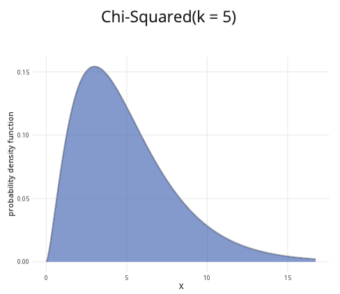

```{r, setup, include = FALSE}
library("webexercises")
```

::: {.content-visible when-format="html"}

```{=html}

<title>Chi-squared distribution calculator</title>

<style>
  * {
    box-sizing: border-box;
  }

  body {
    margin: 0;
    padding: 20px;
    background: #f5f5f5;
  }

  .calculator-container {
    max-width: 1200px;
    margin: 0 auto;
  }

  .top-row {
    display: grid;
    grid-template-columns: minmax(280px, 1fr) minmax(450px, 2fr);
    gap: 20px;
    align-items: stretch;
  }

  .card {
    background: white;
    border: 1px solid #ddd;
    border-radius: 8px;
    overflow: hidden;
    box-shadow: 0 1px 3px rgba(0,0,0,0.08);
  }

  .card-header {
    background: #3F68B6;
    color: white;
    padding: 12px 16px;
    font-size: 18px;
    font-weight: 700;
  }

  .card-body {
    padding: 18px;
  }

  .results-card {
    margin-top: 20px;
  }

  label {
    display: block;
    margin-bottom: 7px;
    font-weight: 600;
  }

  input[type="number"] {
    width: 100%;
    padding: 9px 10px;
    border: 1px solid #ccc;
    border-radius: 5px;
    font-size: 15px;
    margin-bottom: 16px;
  }

  input[type="number"]:focus {
    outline: none;
    border-color: #3F68B6;
    box-shadow: 0 0 0 2px rgba(63,104,182,0.15);
  }

  .radio-group {
    margin-top: 8px;
  }

  .radio-option {
    display: flex;
    align-items: center;
    gap: 7px;
    margin: 10px 0;
    font-weight: normal;
    cursor: pointer;
  }

  .radio-option input {
    accent-color: #3F68B6;
    width: 16px;
    height: 16px;
    margin: 0;
  }

  hr {
    border: 0;
    border-top: 1px solid #ddd;
    margin: 20px 0;
  }

  .slider-container {
    margin-bottom: 18px;
  }

  .slider-value {
    text-align: center;
    margin-top: 5px;
    font-weight: 700;
    color: #3F68B6;
  }

  input[type="range"] {
    width: 100%;
    accent-color: #3F68B6;
    cursor: pointer;
  }

  .plot-title {
    text-align: center;
    font-size: 17px;
    font-weight: 600;
    margin-bottom: 8px;
  }

  #plot {
    width: 100%;
    height: 300px;
    display: block;
  }

  .result-text {
    font-size: 17px;
    line-height: 1.6;
    text-align: center;
    color: black
    padding: 8px;
  }

  .probability-value {
    font-weight: 500;
    color: black;
  }

  .hidden {
    display: none;
  }

  @media (max-width: 850px) {
    body {
      padding: 12px;
    }

    .top-row {
      grid-template-columns: 1fr;
    }

    .card-header {
      font-size: 17px;
    }

    #plot {
      height: 280px;
    }
  }

  @media (max-width: 500px) {
    body {
      padding: 8px;
    }

    .card-body {
      padding: 14px;
    }

    #plot {
      height: 250px;
    }
  }
</style>
</head>

<body>

<div class="calculator-container">

  <div class="top-row">

    <!-- PARAMETERS -->
    <div class="card">
      <div class="card-header">
        Parameters
      </div>

      <div class="card-body">

        <label for="df">
          Degrees of freedom (k):
        </label>

        <input
          type="number"
          id="df"
          value="3"
          min="1"
          step="1"
        >

        <hr>

        <label>
          Probability to calculate:
        </label>

        <div class="radio-group">

          <label class="radio-option">
            <input
              type="radio"
              name="probType"
              value="less"
              checked
            >
            P(X ≤ x)
          </label>

          <label class="radio-option">
            <input
              type="radio"
              name="probType"
              value="greater"
            >
            P(X ≥ x)
          </label>

          <label class="radio-option">
            <input
              type="radio"
              name="probType"
              value="between"
            >
            P(x ≤ X ≤ y)
          </label>

        </div>

        <!-- LESS -->
        <div id="lessControls">

          <div class="slider-container">

            <label for="xLess">
              x value:
            </label>

            <input
              type="range"
              id="xLess"
              min="0"
              max="20"
              value="5"
              step="0.1"
            >

            <div
              class="slider-value"
              id="xLessValue"
            >
              5.0
            </div>

          </div>

        </div>

        <!-- GREATER -->
        <div id="greaterControls" class="hidden">

          <div class="slider-container">

            <label for="xGreater">
              x value:
            </label>

            <input
              type="range"
              id="xGreater"
              min="0"
              max="20"
              value="5"
              step="0.1"
            >

            <div
              class="slider-value"
              id="xGreaterValue"
            >
              5.0
            </div>

          </div>

        </div>

        <!-- BETWEEN -->
        <div id="betweenControls" class="hidden">

          <div class="slider-container">

            <label for="xLower">
              Lower bound (x):
            </label>

            <input
              type="range"
              id="xLower"
              min="0"
              max="20"
              value="2"
              step="0.1"
            >

            <div
              class="slider-value"
              id="xLowerValue"
            >
              2.0
            </div>

          </div>

          <div class="slider-container">

            <label for="xUpper">
              Upper bound (y):
            </label>

            <input
              type="range"
              id="xUpper"
              min="0"
              max="20"
              value="7"
              step="0.1"
            >

            <div
              class="slider-value"
              id="xUpperValue"
            >
              7.0
            </div>

          </div>

        </div>

      </div>
    </div>


    <!-- PLOT -->
    <div class="card">

      <div class="card-header">
        Chi-squared distribution plot
      </div>

      <div class="card-body">

        <div
          class="plot-title"
          id="plotTitle"
        >
          Chi-Squared(k = 3)
        </div>

        <canvas id="plot"></canvas>

      </div>

    </div>

  </div>


  <!-- RESULTS -->
  <div class="card results-card">

    <div class="card-header">
      Results
    </div>

    <div class="card-body">

      <div
        class="result-text"
        id="result"
      ></div>

    </div>

  </div>

</div>


<script>

/* =========================================================
   CHI-SQUARED DISTRIBUTION FUNCTIONS
   ========================================================= */

/*
   Log gamma using the Lanczos approximation.
*/
function logGamma(z) {

  const coefficients = [
    676.5203681218851,
    -1259.1392167224028,
    771.32342877765313,
    -176.61502916214059,
    12.507343278686905,
    -0.13857109526572012,
    9.9843695780195716e-6,
    1.5056327351493116e-7
  ];

  if (z < 0.5) {
    return Math.log(Math.PI)
      - Math.log(Math.sin(Math.PI * z))
      - logGamma(1 - z);
  }

  z -= 1;

  let x = 0.99999999999980993;

  for (let i = 0; i < coefficients.length; i++) {
    x += coefficients[i] / (z + i + 1);
  }

  const t = z + coefficients.length - 0.5;

  return (
    0.5 * Math.log(2 * Math.PI)
    + (z + 0.5) * Math.log(t)
    - t
    + Math.log(x)
  );
}


/*
   Regularised lower incomplete gamma function.
*/
function gammaLowerRegularized(a, x) {

  if (x < 0 || a <= 0) {
    return NaN;
  }

  if (x === 0) {
    return 0;
  }

  const EPS = 1e-12;
  const MAX_ITER = 10000;

  /*
     Series representation when x < a + 1.
  */
  if (x < a + 1) {

    let sum = 1 / a;
    let term = sum;
    let ap = a;

    for (let n = 1; n <= MAX_ITER; n++) {

      ap += 1;
      term *= x / ap;
      sum += term;

      if (Math.abs(term) < Math.abs(sum) * EPS) {
        break;
      }
    }

    return (
      sum *
      Math.exp(
        -x +
        a * Math.log(x) -
        logGamma(a)
      )
    );
  }

  /*
     Continued fraction for Q(a,x).
  */

  let b = x + 1 - a;
  let c = 1 / 1e-300;
  let d = 1 / b;
  let h = d;

  for (let i = 1; i <= MAX_ITER; i++) {

    const an = -i * (i - a);

    b += 2;

    d = an * d + b;

    if (Math.abs(d) < 1e-300) {
      d = 1e-300;
    }

    c = b + an / c;

    if (Math.abs(c) < 1e-300) {
      c = 1e-300;
    }

    d = 1 / d;

    const delta = d * c;

    h *= delta;

    if (Math.abs(delta - 1) < EPS) {
      break;
    }
  }

  const q =
    Math.exp(
      -x +
      a * Math.log(x) -
      logGamma(a)
    ) * h;

  return 1 - q;
}


/*
   Chi-square CDF.
*/
function chiSquareCDF(x, df) {

  if (x <= 0) {
    return 0;
  }

  return gammaLowerRegularized(
    df / 2,
    x / 2
  );
}


/*
   Chi-square PDF.
*/
function chiSquarePDF(x, df) {

  if (x < 0) {
    return 0;
  }

  if (x === 0) {

    if (df < 2) {
      return Infinity;
    }

    if (df === 2) {
      return 0.5;
    }

    return 0;
  }

  return Math.exp(
    (df / 2 - 1) * Math.log(x)
    - x / 2
    - (df / 2) * Math.log(2)
    - logGamma(df / 2)
  );
}


/*
   Approximate inverse CDF.

   Used to determine a sensible graph range,
   corresponding approximately to the 99.5th percentile.
*/
function chiSquareQuantile(prob, df) {

  let low = 0;
  let high = Math.max(20, df * 2 + 10);

  while (chiSquareCDF(high, df) < prob) {
    high *= 2;

    if (high > 1000) {
      break;
    }
  }

  for (let i = 0; i < 100; i++) {

    const mid = (low + high) / 2;

    if (chiSquareCDF(mid, df) < prob) {
      low = mid;
    } else {
      high = mid;
    }
  }

  return (low + high) / 2;
}


/* =========================================================
   DOM ELEMENTS
   ========================================================= */

const dfInput = document.getElementById("df");

const xLess = document.getElementById("xLess");
const xGreater = document.getElementById("xGreater");
const xLower = document.getElementById("xLower");
const xUpper = document.getElementById("xUpper");

const xLessValue = document.getElementById("xLessValue");
const xGreaterValue = document.getElementById("xGreaterValue");
const xLowerValue = document.getElementById("xLowerValue");
const xUpperValue = document.getElementById("xUpperValue");

const lessControls =
  document.getElementById("lessControls");

const greaterControls =
  document.getElementById("greaterControls");

const betweenControls =
  document.getElementById("betweenControls");

const plotTitle =
  document.getElementById("plotTitle");

const result =
  document.getElementById("result");

const canvas =
  document.getElementById("plot");

const ctx =
  canvas.getContext("2d");


/* =========================================================
   GET CURRENT TEST TYPE
   ========================================================= */

function getTestType() {

  return document.querySelector(
    'input[name="probType"]:checked'
  ).value;

}


/* =========================================================
   UPDATE CONTROLS
   ========================================================= */

function updateControls() {

  const type = getTestType();

  lessControls.classList.toggle(
    "hidden",
    type !== "less"
  );

  greaterControls.classList.toggle(
    "hidden",
    type !== "greater"
  );

  betweenControls.classList.toggle(
    "hidden",
    type !== "between"
  );

  update();

}


/* =========================================================
   DRAW PLOT
   ========================================================= */

function drawPlot() {

  const df = Number(dfInput.value);

  const type = getTestType();

  let maxX =
    chiSquareQuantile(0.995, df);

  maxX = Math.min(
    Math.max(maxX, 10),
    50
  );

  const rect =
    canvas.getBoundingClientRect();

  const dpr =
    window.devicePixelRatio || 1;

  canvas.width =
    rect.width * dpr;

  canvas.height =
    rect.height * dpr;

  ctx.setTransform(
    dpr,
    0,
    0,
    dpr,
    0,
    0
  );

  const width =
    rect.width;

  const height =
    rect.height;

  const margin = {
    left: 52,
    right: 20,
    top: 15,
    bottom: 42
  };

  const plotWidth =
    width - margin.left - margin.right;

  const plotHeight =
    height - margin.top - margin.bottom;


  /*
     Generate distribution.
  */

  const points = 700;

  const xs = [];
  const ys = [];

  let maxY = 0;

  for (let i = 0; i <= points; i++) {

    const x =
      maxX * i / points;

    const safeX =
      df === 1 && x === 0
        ? 0.000001
        : x;

    const y =
      chiSquarePDF(safeX, df);

    xs.push(x);
    ys.push(y);

    if (isFinite(y) && y > maxY) {
      maxY = y;
    }
  }

  maxY *= 1.1;


  function px(x) {

    return (
      margin.left +
      (x / maxX) * plotWidth
    );

  }

  function py(y) {

    return (
      margin.top +
      plotHeight -
      (y / maxY) * plotHeight
    );

  }


  /*
     Background.
  */

  ctx.clearRect(
    0,
    0,
    width,
    height
  );


  /*
     Grid lines.
  */

  ctx.strokeStyle =
    "#e5e5e5";

  ctx.lineWidth = 1;

  for (let i = 0; i <= 5; i++) {

    const y =
      margin.top +
      plotHeight * i / 5;

    ctx.beginPath();

    ctx.moveTo(
      margin.left,
      y
    );

    ctx.lineTo(
      width - margin.right,
      y
    );

    ctx.stroke();

  }


  /*
     Shading.
  */

  let shadeStart = null;
  let shadeEnd = null;

  if (type === "less") {

    shadeStart = 0;
    shadeEnd = Number(xLess.value);

  }

  if (type === "greater") {

    shadeStart = Number(xGreater.value);
    shadeEnd = maxX;

  }

  if (type === "between") {

    shadeStart = Number(xLower.value);
    shadeEnd = Number(xUpper.value);

  }


  if (shadeStart !== null) {

    shadeStart =
      Math.max(0, shadeStart);

    shadeEnd =
      Math.min(maxX, shadeEnd);

    ctx.beginPath();

    let started = false;

    for (let i = 0; i <= points; i++) {

      const x = xs[i];

      if (
        x >= shadeStart &&
        x <= shadeEnd
      ) {

        const y = ys[i];

        if (!started) {

          ctx.moveTo(
            px(x),
            py(y)
          );

          started = true;

        } else {

          ctx.lineTo(
            px(x),
            py(y)
          );

        }

      }

    }

    if (started) {

      ctx.lineTo(
        px(shadeEnd),
        py(0)
      );

      ctx.lineTo(
        px(shadeStart),
        py(0)
      );

      ctx.closePath();

      ctx.fillStyle =
        "rgba(63, 104, 182, 0.55)";

      ctx.fill();

    }

  }


  /*
     Distribution curve.
  */

  ctx.beginPath();

  for (let i = 0; i <= points; i++) {

    const x = xs[i];
    const y = ys[i];

    if (!isFinite(y)) {
      continue;
    }

    if (i === 0) {

      ctx.moveTo(
        px(x),
        py(y)
      );

    } else {

      ctx.lineTo(
        px(x),
        py(y)
      );

    }

  }

  ctx.strokeStyle =
    "#555";

  ctx.lineWidth = 2;

  ctx.stroke();


  /*
     Boundary lines.
  */

  ctx.setLineDash([5, 5]);

  ctx.strokeStyle =
    "#db4315";

  ctx.lineWidth = 2;

  if (type === "less") {

    drawBoundary(
      Number(xLess.value)
    );

  }

  if (type === "greater") {

    drawBoundary(
      Number(xGreater.value)
    );

  }

  if (type === "between") {

    drawBoundary(
      Number(xLower.value)
    );

    drawBoundary(
      Number(xUpper.value)
    );

  }

  ctx.setLineDash([]);


  /*
     Axis.
  */

  ctx.strokeStyle =
    "#555";

  ctx.lineWidth = 1;

  ctx.beginPath();

  ctx.moveTo(
    margin.left,
    margin.top + plotHeight
  );

  ctx.lineTo(
    width - margin.right,
    margin.top + plotHeight
  );

  ctx.stroke();


  /*
     X-axis ticks.
  */

  ctx.fillStyle =
    "#555";

  ctx.font =
    "12px Arial";

  ctx.textAlign =
    "center";

  const tickCount =
    6;

  for (let i = 0; i <= tickCount; i++) {

    const x =
      maxX * i / tickCount;

    const xpos =
      px(x);

    ctx.beginPath();

    ctx.moveTo(
      xpos,
      margin.top + plotHeight
    );

    ctx.lineTo(
      xpos,
      margin.top + plotHeight + 5
    );

    ctx.stroke();

    ctx.fillText(
      x.toFixed(1),
      xpos,
      margin.top + plotHeight + 20
    );

  }


  /*
     Axis labels.
  */

  ctx.font =
    "13px Arial";

  ctx.fillStyle =
    "#333";

  ctx.fillText(
    "X",
    margin.left + plotWidth / 2,
    height - 8
  );

  ctx.save();

  ctx.translate(
    15,
    margin.top + plotHeight / 2
  );

  ctx.rotate(-Math.PI / 2);

  ctx.fillText(
    "probability density function",
    0,
    0
  );

  ctx.restore();


  /*
     Boundary line helper.
  */

  function drawBoundary(value) {

    if (
      value < 0 ||
      value > maxX
    ) {
      return;
    }

    const xpos =
      px(value);

    ctx.beginPath();

    ctx.moveTo(
      xpos,
      margin.top
    );

    ctx.lineTo(
      xpos,
      margin.top + plotHeight
    );

    ctx.stroke();

  }

}


/* =========================================================
   UPDATE RESULTS
   ========================================================= */

function update() {

  let df =
    Number(dfInput.value);

  if (
    !Number.isFinite(df) ||
    df < 1
  ) {
    df = 1;
    dfInput.value = 1;
  }

  df =
    Math.round(df);

  dfInput.value =
    df;

  const type =
    getTestType();


  /*
     Update title.
  */

  plotTitle.textContent =
    `Chi-Squared(k = ${df})`;


  /*
     Calculate probability.
  */

  let probability;
  let explanation;


  if (type === "less") {

    const x =
      Number(xLess.value);

    probability =
      chiSquareCDF(x, df);

    xLessValue.textContent =
      x.toFixed(1);

    explanation =
      `P(X ≤ ${x.toFixed(1)}) = ` +
      `${probability.toFixed(6)} or ` +
      `${(probability * 100).toFixed(4)}%`;

  }


  else if (type === "greater") {

    const x =
      Number(xGreater.value);

    probability =
      1 - chiSquareCDF(x, df);

    xGreaterValue.textContent =
      x.toFixed(1);

    explanation =
      `P(X ≥ ${x.toFixed(1)}) = ` +
      `${probability.toFixed(6)} or ` +
      `${(probability * 100).toFixed(4)}%`;

  }


  else {

    let lower =
      Number(xLower.value);

    let upper =
      Number(xUpper.value);


    /*
       Make sure upper ≥ lower.
    */

    if (upper < lower) {

      upper =
        lower;

      xUpper.value =
        upper;

    }


    const lowerProb =
      chiSquareCDF(lower, df);

    const upperProb =
      chiSquareCDF(upper, df);

    probability =
      upperProb - lowerProb;

    xLowerValue.textContent =
      lower.toFixed(1);

    xUpperValue.textContent =
      upper.toFixed(1);

    explanation =
      `P(${lower.toFixed(1)} ≤ X ≤ ` +
      `${upper.toFixed(1)}) = ` +
      `${probability.toFixed(6)} or ` +
      `${(probability * 100).toFixed(4)}%`;

  }


  result.innerHTML =
    `<span class="probability-value">` +
    `${explanation}` +
    `</span>`;


  /*
     Update graph.
  */

  drawPlot();

}


/* =========================================================
   DYNAMIC SLIDER RANGE
   ========================================================= */

function updateSliderRanges() {

  const df =
    Math.max(
      1,
      Math.round(Number(dfInput.value))
    );

  let maxX =
    chiSquareQuantile(
      0.995,
      df
    );

  maxX =
    Math.min(
      Math.max(maxX, 10),
      50
    );

  /*
     Round up to nearest 0.1.
  */

  maxX =
    Math.ceil(maxX * 10) / 10;


  const sliders = [
    xLess,
    xGreater,
    xLower,
    xUpper
  ];


  sliders.forEach(slider => {

    const oldValue =
      Number(slider.value);

    slider.max =
      maxX;

    if (oldValue > maxX) {
      slider.value =
        maxX;
    }

  });


  /*
     Make sure lower ≤ upper.
  */

  if (
    Number(xUpper.value) <
    Number(xLower.value)
  ) {

    xUpper.value =
      xLower.value;

  }

}


/* =========================================================
   EVENT LISTENERS
   ========================================================= */

dfInput.addEventListener(
  "input",
  function() {

    updateSliderRanges();
    update();

  }
);


[
  xLess,
  xGreater,
  xLower,
  xUpper
].forEach(slider => {

  slider.addEventListener(
    "input",
    update
  );

});


document
  .querySelectorAll(
    'input[name="probType"]'
  )
  .forEach(radio => {

    radio.addEventListener(
      "change",
      updateControls
    );

  });


window.addEventListener(
  "resize",
  drawPlot
);


/* =========================================================
   INITIALISE
   ========================================================= */

updateSliderRanges();
updateControls();

</script>
</body>

```


:::

::: {.content-hidden when-format="html"}

{width="80%"}

:::

**Where to use:** The $\chi^2$ distribution is used for hypothesis testing, such as for goodness of fit tests and tests for independence. (See [Guide: Introduction to hypothesis testing](../studyguides/hypothesistesting.qmd) for more.) It is a special case of the gamma distribution, as $\chi^2(k)=\textrm{Gam}(\frac{k}{2},2)$.

**Notation:** $X \sim \chi^2(k)$

**Parameter:** The integer $k$ is the number of degrees of freedom in the sample.

| Quantity | Value | Notes |
|:--------|:----------------------------|:-------------------|
| **Mean** | $\mathbb{E}(X) = k$ |  |
| **Variance** | $\mathbb{V}(X) = 2k$ |  |
| **PDF** | $\mathbb{P}(X=x)=\dfrac{x^{\frac{k}{2}-1}\exp\left({-\frac{x}{2}}\right)}{2^\frac{k}{2}\Gamma\left(\frac{k}{2}\right)}$ | $\Gamma(x)$ is the gamma function |
| **CDF** | $\mathbb{P}(X \leq x)=\dfrac{1}{\Gamma\left(\frac{k}{2}\right)}\textrm{Gam}\left(\frac{k}{2},\frac{x}{2}\right)$ | $\Gamma(x)$ is the gamma function, $\textrm{Gam}(\alpha,\theta)$ is the PDF of the gamma distribution |

**Examples:**

-   **Goodness of fit example:** You have a six-sided die with six possible outcomes: $1, 2, 3, 4, 5,$ and $6$. You calculate the expected frequencies of each outcome. Then you roll the die many times and record the observed frequencies of each outcome. Since there are 6 categories, $$\textsf{degrees of freedom = number of categories} - 1 = 6 - 1 = 5$$ This can be expressed as $X \sim \chi^2(5)$, meaning the degrees of freedom is $5$.

-   **Test for independence example:** You are investigating whether there is a correlation between two variables: candy colour and flavour. You have $5$ categories of colours and 3 categories of flavours. Calculating the degrees of freedom can be done with the formula: $$(\textsf{categories of colours} - 1)(\textsf{categories of flavours} - 1) = (5-1)(3-1)=(4)(2)=8.$$ You can model $X \sim \chi^2(8)$, meaning that there are $8$ degrees of freedom.

# Further reading {-}

[This interactive element appears in Overview: Probability distributions. Please click this link to go to the guide.](../overviews/o-distributions.qmd)

## Version history {-}

v1.0: initial version created 04/25 by tdhc and Michelle Arnetta as part of a University of St Andrews VIP project.

  - v1.1: moved to factsheet form and populated with material from [Overview: Probability distributions](../overviews/o-distributions.qmd) by tdhc.
  
[This work is licensed under CC BY-NC-SA 4.0.](https://creativecommons.org/licenses/by-nc-sa/4.0/?ref=chooser-v1)


