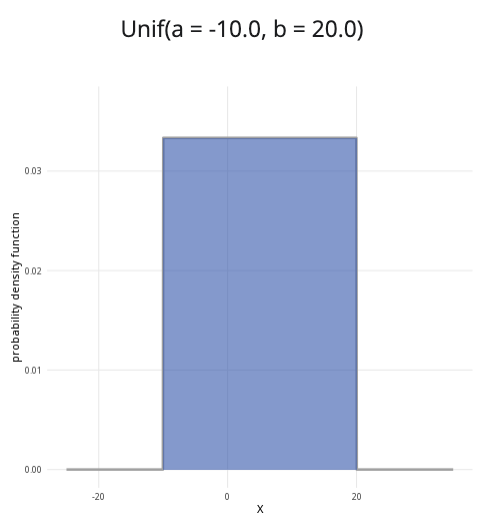

```{r, setup, include = FALSE}
library("webexercises")
```


::: {.content-visible when-format="html"}

```{=html}

<!DOCTYPE html>
<html lang="en">
<head>
  <meta charset="UTF-8">
  <meta name="viewport" content="width=device-width, initial-scale=1.0">
  <title>Continuous Uniform Distribution Calculator</title>

  <style>
    * { box-sizing: border-box; }

    body {
      margin: 0;
      padding: 1rem;
      background: #f5f6f8;
      color: #222222;
    }

    .continuous-uniform-calculator {
      width: 100%;
      max-width: 1200px;
      margin: 0 auto;
    }

    .continuous-uniform-calculator .calculator-row {
      display: grid;
      grid-template-columns: minmax(280px, 1fr) minmax(0, 2fr);
      gap: 1rem;
      align-items: stretch;
    }

    .continuous-uniform-calculator .calculator-card {
      margin-bottom: 1rem;
      overflow: hidden;
      background: #ffffff;
      border: 1px solid #dddddd;
      border-radius: 8px;
      box-shadow: 0 2px 6px rgba(0, 0, 0, 0.08);
    }

    .continuous-uniform-calculator .calculator-card-header {
      padding: 0.75rem 1rem;
      color: #ffffff;
      background: #3F6BB6;
      font-weight: 700;
      line-height: 1.4;
    }

    .continuous-uniform-calculator .calculator-card-body {
      padding: 1rem;
    }

    .continuous-uniform-calculator .form-group {
      margin-bottom: 1rem;
    }

    .continuous-uniform-calculator label {
      display: block;
      margin-bottom: 0.4rem;
      font-weight: 500;
    }

    .continuous-uniform-calculator input[type="number"] {
      width: 100%;
      padding: 0.55rem 0.65rem;
      border: 1px solid #cccccc;
      border-radius: 5px;
      background: #ffffff;
      font-size: 1rem;
    }

    .continuous-uniform-calculator .distribution-slider {
      width: 100%;
      margin: 0.5rem 0;
      accent-color: #3F68B6;
      cursor: pointer;
    }

    .continuous-uniform-calculator .slider-value {
      margin-top: 0.1rem;
      color: #3F68B6;
      text-align: center;
      font-weight: 700;
    }

    .continuous-uniform-calculator hr {
      margin: 1.2rem 0;
      border: 0;
      border-top: 1px solid #dddddd;
    }

    .continuous-uniform-calculator .probability-options {
      padding: 0;
      margin: 0;
      border: 0;
    }

    .continuous-uniform-calculator .probability-options legend {
      margin-bottom: 0.6rem;
      font-size: 1rem;
      font-weight: 500;
    }

    .continuous-uniform-calculator .radio-option {
      display: flex;
      align-items: center;
      gap: 0.45rem;
      margin-bottom: 0.55rem;
      cursor: pointer;
      font-weight: 400;
    }

    .continuous-uniform-calculator .radio-option input {
      width: 16px;
      height: 16px;
      margin: 0;
      accent-color: #3F68B6;
    }

    .continuous-uniform-calculator .conditional-input {
      margin-top: 1rem;
    }

    .continuous-uniform-calculator .conditional-input[hidden] {
      display: none;
    }

    .continuous-uniform-calculator .upper-label {
      margin-top: 1rem;
    }

    .continuous-uniform-calculator .distribution-plot-title {
      margin-bottom: 1rem;
      text-align: center;
      font-size: 1.1rem;
      font-weight: 600;
    }

    .continuous-uniform-calculator .chart-wrapper {
      position: relative;
      width: 100%;
      height: 320px;
    }

    .continuous-uniform-calculator canvas {
      width: 100% !important;
      height: 100% !important;
    }

    .continuous-uniform-calculator .calculation-result {
      font-size: 1.05rem;
      line-height: 1.6;
      text-align: center;
    }

    .continuous-uniform-calculator .input-error {
      min-height: 1.4em;
      margin-top: 0.5rem;
      color: #b00020;
      font-size: 0.92rem;
      font-weight: 600;
    }

    .continuous-uniform-calculator input:focus,
    .continuous-uniform-calculator canvas:focus {
      outline: 3px solid rgba(63, 104, 182, 0.3);
      outline-offset: 2px;
    }

    @media (max-width: 768px) {
      .continuous-uniform-calculator .calculator-row {
        grid-template-columns: 1fr;
      }

      .continuous-uniform-calculator .plot-card {
        min-width: 0;
      }

      .continuous-uniform-calculator .chart-wrapper {
        height: 280px;
      }
    }

    @media (max-width: 480px) {
      body { padding: 0.5rem; }

      .continuous-uniform-calculator .calculator-card-body {
        padding: 0.9rem;
      }

      .continuous-uniform-calculator .chart-wrapper {
        height: 250px;
      }
    }
  </style>
</head>

<body>

<div class="distribution-calculator continuous-uniform-calculator">

  <div class="calculator-row">

    <!-- PARAMETERS CARD -->
    <div class="calculator-card parameters-card">
      <div class="calculator-card-header">Parameters</div>

      <div class="calculator-card-body">

        <div class="form-group">
          <label for="continuous-uniform-minimum">
            Minimum value (a):
          </label>

          <input
            type="number"
            id="continuous-uniform-minimum"
            value="0"
            step="0.1"
            aria-describedby="continuous-uniform-error">
        </div>

        <div class="form-group">
          <label for="continuous-uniform-maximum">
            Maximum value (b):
          </label>

          <input
            type="number"
            id="continuous-uniform-maximum"
            value="10"
            step="0.1"
            aria-describedby="continuous-uniform-error">
        </div>

        <div
          id="continuous-uniform-error"
          class="input-error"
          role="alert"
          aria-live="assertive">
        </div>

        <hr>

        <fieldset class="probability-options">
          <legend>Probability to calculate:</legend>

          <label class="radio-option">
            <input
              type="radio"
              name="continuous-uniform-prob-type"
              value="less"
              checked>
            <span>P(X &le; x)</span>
          </label>

          <label class="radio-option">
            <input
              type="radio"
              name="continuous-uniform-prob-type"
              value="greater">
            <span>P(X &ge; x)</span>
          </label>

          <label class="radio-option">
            <input
              type="radio"
              name="continuous-uniform-prob-type"
              value="between">
            <span>P(x &le; X &le; y)</span>
          </label>
        </fieldset>

        <!-- SINGLE X VALUE -->
        <div id="continuous-uniform-x-container" class="conditional-input">
          <label for="continuous-uniform-x">x value:</label>

          <input
            type="range"
            id="continuous-uniform-x"
            min="0"
            max="10"
            value="5"
            step="0.1"
            class="distribution-slider">

          <div class="slider-value" id="continuous-uniform-x-value">5.00</div>
        </div>

        <!-- LOWER / UPPER VALUES -->
        <div id="continuous-uniform-between-container" class="conditional-input" hidden>
          <label for="continuous-uniform-lower">Lower bound (x):</label>

          <input
            type="range"
            id="continuous-uniform-lower"
            min="0"
            max="10"
            value="2"
            step="0.1"
            class="distribution-slider">

          <div class="slider-value" id="continuous-uniform-lower-value">2.00</div>

          <label for="continuous-uniform-upper" class="upper-label">
            Upper bound (y):
          </label>

          <input
            type="range"
            id="continuous-uniform-upper"
            min="0"
            max="10"
            value="8"
            step="0.1"
            class="distribution-slider">

          <div class="slider-value" id="continuous-uniform-upper-value">8.00</div>
        </div>

      </div>
    </div>

    <!-- PLOT CARD -->
    <div class="calculator-card plot-card">
      <div class="calculator-card-header">
        Continuous uniform distribution plot
      </div>

      <div class="calculator-card-body">
        <div
          id="continuous-uniform-plot-title"
          class="distribution-plot-title">
          Uniform(a = 0.00, b = 10.00)
        </div>

        <div class="chart-wrapper">
          <canvas
            id="continuous-uniform-chart"
            tabindex="0"
            role="img"
            aria-label="Continuous uniform distribution probability density function">
          </canvas>
        </div>
      </div>
    </div>

  </div>

  <!-- RESULTS CARD -->
  <div class="calculator-card results-card">
    <div class="calculator-card-header">Results</div>

    <div class="calculator-card-body">
      <div
        id="continuous-uniform-result"
        class="calculation-result"
        aria-live="polite"
        aria-atomic="true">
      </div>
    </div>
  </div>

</div>

<script>
/* =========================================================
   CONTINUOUS UNIFORM DISTRIBUTION CALCULATOR
   ========================================================= */

(function() {
  "use strict";

  const root = document.querySelector(".continuous-uniform-calculator");
  if (!root) return;

  const minimumInput = root.querySelector("#continuous-uniform-minimum");
  const maximumInput = root.querySelector("#continuous-uniform-maximum");
  const xInput = root.querySelector("#continuous-uniform-x");
  const lowerInput = root.querySelector("#continuous-uniform-lower");
  const upperInput = root.querySelector("#continuous-uniform-upper");

  const xDisplay = root.querySelector("#continuous-uniform-x-value");
  const lowerDisplay = root.querySelector("#continuous-uniform-lower-value");
  const upperDisplay = root.querySelector("#continuous-uniform-upper-value");

  const error = root.querySelector("#continuous-uniform-error");
  const title = root.querySelector("#continuous-uniform-plot-title");
  const result = root.querySelector("#continuous-uniform-result");
  const xContainer = root.querySelector("#continuous-uniform-x-container");
  const betweenContainer = root.querySelector("#continuous-uniform-between-container");
  const canvas = root.querySelector("#continuous-uniform-chart");
  const ctx = canvas.getContext("2d");

  function validateParameters() {
    const minimum = Number(minimumInput.value);
    const maximum = Number(maximumInput.value);
    let message = "";

    if (!Number.isFinite(minimum) || !Number.isFinite(maximum)) {
      message = "Enter numerical values for both distribution limits.";
    } else if (maximum <= minimum) {
      message = "The maximum value must be greater than the minimum value.";
    }

    error.textContent = message;
    minimumInput.setAttribute("aria-invalid", message ? "true" : "false");
    maximumInput.setAttribute("aria-invalid", message ? "true" : "false");

    return message ? null : { minimum, maximum };
  }

  function getProbabilityType() {
    const selected = root.querySelector(
      'input[name="continuous-uniform-prob-type"]:checked'
    );

    return selected ? selected.value : "less";
  }

  function clamp(value, minimum, maximum) {
    return Math.max(minimum, Math.min(maximum, value));
  }

  function sliderStep(minimum, maximum) {
    return Math.max(0.001, (maximum - minimum) / 100);
  }

  function formatValue(value) {
    return Number(value).toFixed(2);
  }

  function updateRanges(parameters) {
    const minimum = parameters.minimum;
    const maximum = parameters.maximum;
    const step = sliderStep(minimum, maximum);

    [xInput, lowerInput, upperInput].forEach(function(input) {
      input.min = minimum;
      input.max = maximum;
      input.step = step;

      const current = Number(input.value);

      input.value = Number.isFinite(current)
        ? clamp(current, minimum, maximum)
        : minimum;
    });

    if (Number(upperInput.value) < Number(lowerInput.value)) {
      upperInput.value = lowerInput.value;
    }
  }

  function updateDisplay(parameters) {
    updateRanges(parameters);

    xDisplay.textContent = formatValue(xInput.value);
    lowerDisplay.textContent = formatValue(lowerInput.value);
    upperDisplay.textContent = formatValue(upperInput.value);

    title.textContent =
      `Uniform(a = ${formatValue(parameters.minimum)}, ` +
      `b = ${formatValue(parameters.maximum)})`;
  }

  function uniformCDF(value, minimum, maximum) {
    if (value <= minimum) return 0;
    if (value >= maximum) return 1;
    return (value - minimum) / (maximum - minimum);
  }

  function calculateProbability(parameters) {
    const minimum = parameters.minimum;
    const maximum = parameters.maximum;
    const x = Number(xInput.value);
    let lower = Number(lowerInput.value);
    let upper = Number(upperInput.value);
    const type = getProbabilityType();
    let probability;

    if (upper < lower) {
      upper = lower;
      upperInput.value = upper;
      upperDisplay.textContent = formatValue(upper);
    }

    if (type === "less") {
      probability = uniformCDF(x, minimum, maximum);

      result.textContent =
        `P(X ≤ ${formatValue(x)}) = ${probability.toFixed(4)} ` +
        `or ${(probability * 100).toFixed(2)}%`;
    } else if (type === "greater") {
      probability = 1 - uniformCDF(x, minimum, maximum);

      result.textContent =
        `P(X ≥ ${formatValue(x)}) = ${probability.toFixed(4)} ` +
        `or ${(probability * 100).toFixed(2)}%`;
    } else {
      probability =
        uniformCDF(upper, minimum, maximum) -
        uniformCDF(lower, minimum, maximum);

      result.textContent =
        `P(${formatValue(lower)} ≤ X ≤ ${formatValue(upper)}) = ` +
        `${probability.toFixed(4)} or ` +
        `${(probability * 100).toFixed(2)}%`;
    }

    probability = Math.max(0, Math.min(1, probability));

    return {
      type,
      x,
      lower,
      upper,
      probability,
      minimum,
      maximum
    };
  }

  function drawChart(parameters) {
    const selected = calculateProbability(parameters);
    const rect = canvas.getBoundingClientRect();

    if (!rect.width || !rect.height) return;

    const dpr = window.devicePixelRatio || 1;
    canvas.width = Math.round(rect.width * dpr);
    canvas.height = Math.round(rect.height * dpr);
    ctx.setTransform(dpr, 0, 0, dpr, 0, 0);

    const width = rect.width;
    const height = rect.height;
    const padding = { left: 62, right: 22, top: 25, bottom: 52 };
    const chartWidth = width - padding.left - padding.right;
    const chartHeight = height - padding.top - padding.bottom;
    const range = selected.maximum - selected.minimum;
    const plotMinimum = selected.minimum - range * 0.15;
    const plotMaximum = selected.maximum + range * 0.15;
    const density = 1 / range;
    const maximumY = density * 1.25;

    ctx.clearRect(0, 0, width, height);

    function xScale(value) {
      return padding.left +
        ((value - plotMinimum) / (plotMaximum - plotMinimum)) * chartWidth;
    }

    function yScale(value) {
      return padding.top + chartHeight -
        (value / maximumY) * chartHeight;
    }

    /* GRID AND Y-AXIS LABELS */

    ctx.font = "12px Arial";
    ctx.textAlign = "right";
    ctx.textBaseline = "middle";

    for (let i = 0; i <= 4; i++) {
      const value = (i / 4) * maximumY;
      const y = yScale(value);

      ctx.strokeStyle = "#e5e5e5";
      ctx.lineWidth = 1;
      ctx.beginPath();
      ctx.moveTo(padding.left, y);
      ctx.lineTo(width - padding.right, y);
      ctx.stroke();

      ctx.fillStyle = "#555555";
      ctx.fillText(value.toFixed(2), padding.left - 8, y);
    }

    /* UNSELECTED DENSITY AREA */

    ctx.fillStyle = "rgba(211, 211, 211, 0.55)";
    ctx.fillRect(
      xScale(selected.minimum),
      yScale(density),
      xScale(selected.maximum) - xScale(selected.minimum),
      yScale(0) - yScale(density)
    );

    /* SELECTED PROBABILITY AREA */

    let selectedStart;
    let selectedEnd;

    if (selected.type === "less") {
      selectedStart = selected.minimum;
      selectedEnd = selected.x;
    } else if (selected.type === "greater") {
      selectedStart = selected.x;
      selectedEnd = selected.maximum;
    } else {
      selectedStart = selected.lower;
      selectedEnd = selected.upper;
    }

    selectedStart = clamp(
      selectedStart,
      selected.minimum,
      selected.maximum
    );

    selectedEnd = clamp(
      selectedEnd,
      selected.minimum,
      selected.maximum
    );

    if (selectedEnd > selectedStart) {
      ctx.fillStyle = "rgba(63, 107, 182, 0.58)";
      ctx.fillRect(
        xScale(selectedStart),
        yScale(density),
        xScale(selectedEnd) - xScale(selectedStart),
        yScale(0) - yScale(density)
      );
    }

    /* DENSITY OUTLINE */

    ctx.strokeStyle = "#274f91";
    ctx.lineWidth = 2.5;
    ctx.beginPath();
    ctx.moveTo(xScale(selected.minimum), yScale(0));
    ctx.lineTo(xScale(selected.minimum), yScale(density));
    ctx.lineTo(xScale(selected.maximum), yScale(density));
    ctx.lineTo(xScale(selected.maximum), yScale(0));
    ctx.stroke();

    /* BOUNDARY LINES */

    function drawBoundary(value) {
      if (value < selected.minimum || value > selected.maximum) return;

      ctx.save();
      ctx.setLineDash([5, 4]);
      ctx.strokeStyle = "#274f91";
      ctx.lineWidth = 1.5;
      ctx.beginPath();
      ctx.moveTo(xScale(value), yScale(0));
      ctx.lineTo(xScale(value), yScale(density));
      ctx.stroke();
      ctx.restore();
    }

    if (selected.type === "between") {
      drawBoundary(selected.lower);
      drawBoundary(selected.upper);
    } else {
      drawBoundary(selected.x);
    }

    /* AXES */

    ctx.strokeStyle = "#777777";
    ctx.lineWidth = 1;
    ctx.beginPath();
    ctx.moveTo(padding.left, padding.top);
    ctx.lineTo(padding.left, padding.top + chartHeight);
    ctx.lineTo(width - padding.right, padding.top + chartHeight);
    ctx.stroke();

    /* X-AXIS LABELS */

    ctx.fillStyle = "#333333";
    ctx.font = "12px Arial";
    ctx.textAlign = "center";
    ctx.textBaseline = "alphabetic";

    const tickCount = width < 500 ? 5 : 8;

    for (let i = 0; i <= tickCount; i++) {
      const value = plotMinimum +
        (i / tickCount) * (plotMaximum - plotMinimum);

      ctx.fillText(
        formatValue(value),
        xScale(value),
        padding.top + chartHeight + 20
      );
    }

    ctx.font = "13px Arial";
    ctx.fillText(
      "value of X",
      padding.left + chartWidth / 2,
      height - 8
    );

    ctx.save();
    ctx.translate(15, padding.top + chartHeight / 2);
    ctx.rotate(-Math.PI / 2);
    ctx.textAlign = "center";
    ctx.fillText("probability density", 0, 0);
    ctx.restore();

    canvas.setAttribute(
      "aria-label",
      `Continuous uniform probability density from ` +
      `${formatValue(selected.minimum)} to ${formatValue(selected.maximum)}. ` +
      `The density is ${density.toFixed(4)} and the selected probability is ` +
      `${selected.probability.toFixed(4)}.`
    );
  }

  function updateVisibility() {
    const type = getProbabilityType();
    xContainer.hidden = type === "between";
    betweenContainer.hidden = type !== "between";
  }

  function update() {
    updateVisibility();

    const parameters = validateParameters();

    if (!parameters) {
      result.textContent =
        "Enter valid distribution limits to calculate a probability.";
      ctx.clearRect(0, 0, canvas.width, canvas.height);
      return;
    }

    updateDisplay(parameters);
    drawChart(parameters);
  }

  minimumInput.addEventListener("input", update);
  maximumInput.addEventListener("input", update);
  xInput.addEventListener("input", update);

  lowerInput.addEventListener("input", function() {
    if (Number(lowerInput.value) > Number(upperInput.value)) {
      upperInput.value = lowerInput.value;
    }

    update();
  });

  upperInput.addEventListener("input", function() {
    if (Number(upperInput.value) < Number(lowerInput.value)) {
      lowerInput.value = upperInput.value;
    }

    update();
  });

  root
    .querySelectorAll('input[name="continuous-uniform-prob-type"]')
    .forEach(function(radio) {
      radio.addEventListener("change", update);
    });

  let resizeTimer;

  window.addEventListener("resize", function() {
    window.clearTimeout(resizeTimer);
    resizeTimer = window.setTimeout(update, 80);
  });

  update();
})();
</script>

</body>
</html>


```

:::

::: {.content-hidden when-format="html"}

{width="80%"}

:::

**Where to use:** The continuous uniform distribution is used when all continuous values $x$ in the interval $a$ to $b$ are equally likely. The random variable $X$ represents the outcome.

**Notation:** $X \sim \textrm{Uniform}(a,b)$ or $X \sim U(a,b)$.

**Parameters:** Two real numbers $a,b$, where

-   $a$ is the minimum value of an outcome,

-   $b$ is the maximum value of an outcome.

| Quantity | Value | Notes |
|:--------|:----------------------------|:-------------------|
| **Mean** | $\mathbb{E}(X) = \dfrac{a+b}{2}$ |  |
| **Variance** | $\mathbb{V}(X) = \dfrac{(b-a)^2}{12}$ |  |
| **PDF** | $\mathbb{P}(X=x)=\begin{cases} \dfrac{1}{b-a} & \textsf{if } a \leq x \leq b \\0 & \textsf{otherwise}\end{cases}$ |  |
| **CDF** | $\displaystyle\mathbb{P}(X\leq x)=\begin{cases} 0 & \textsf{if } x< a \\\dfrac{x-a}{b-a} & \textsf{if } a\leq x\leq b \\1 & \textsf{if } x>b \end{cases}$ |  |

**Example:** A machine from Cantor's Confectionery is programmed to chop long candy bars into pieces, each with a length between 30 millimetres to 50 millimetres. Due to variations in the machine, each continuous value between this interval is equally likely. This can be expressed as $X \sim U(30,50)$. It means 30 is the minimum value and 50 is the maximum value, where all continuous values of $X$ for $30 \leq x \leq 50$ are equally likely.

# Further reading {-}

This interactive element appears in [Overview: Probability distributions.](../overviews/o-distributions.qmd) 

## Version history {-}

v1.0: initial version created 08/25 by tdhc.

- v1.1: deprecated shinylive apps replaced 09/26 by tdhc.
  
[This work is licensed under CC BY-NC-SA 4.0.](https://creativecommons.org/licenses/by-nc-sa/4.0/?ref=chooser-v1)


