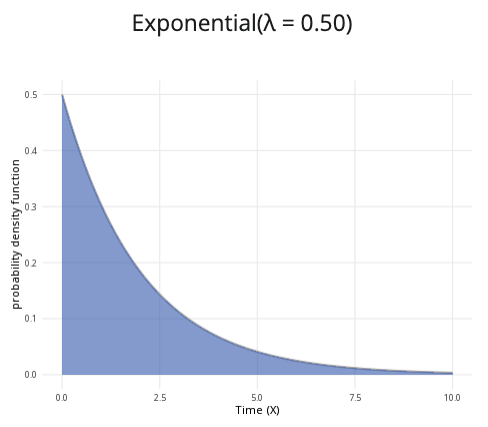

```{r, setup, include = FALSE}
library("webexercises")
```

::: {.content-visible when-format="html"}

```{=html}

<div class="distribution-calculator exponential-calculator">

  <div class="calculator-row">

    <!-- PARAMETERS CARD -->
    <div class="calculator-card parameters-card">

      <div class="calculator-card-header">
        Parameters
      </div>

      <div class="calculator-card-body">

        <div class="form-group">

          <label for="exponential-lambda">
            Rate parameter (&lambda;):
          </label>

          <input
            type="range"
            id="exponential-lambda"
            min="0.1"
            max="5"
            value="1"
            step="0.1"
            class="distribution-slider"
            aria-describedby="exponential-lambda-value">

          <div
            class="slider-value"
            id="exponential-lambda-value">
            1.00
          </div>

        </div>

        <div class="distribution-information">

          <div>
            Mean:
            <strong id="exponential-mean">1.000</strong>
          </div>

          <div>
            Standard deviation:
            <strong id="exponential-standard-deviation">1.000</strong>
          </div>

        </div>

        <hr>

        <fieldset class="probability-options">

          <legend>
            Probability to calculate:
          </legend>

          <label class="radio-option">

            <input
              type="radio"
              name="exponential-prob-type"
              value="less"
              checked>

            <span>P(X &le; x)</span>

          </label>

          <label class="radio-option">

            <input
              type="radio"
              name="exponential-prob-type"
              value="greater">

            <span>P(X &ge; x)</span>

          </label>

          <label class="radio-option">

            <input
              type="radio"
              name="exponential-prob-type"
              value="between">

            <span>P(a &le; X &le; b)</span>

          </label>

        </fieldset>


        <!-- SINGLE X VALUE -->

        <div
          id="exponential-x-container"
          class="conditional-input">

          <label for="exponential-x">
            x value:
          </label>

          <input
            type="range"
            id="exponential-x"
            min="0"
            max="10"
            value="2"
            step="0.1"
            class="distribution-slider"
            aria-describedby="exponential-x-value">

          <div
            class="slider-value"
            id="exponential-x-value">
            2.0
          </div>

        </div>


        <!-- LOWER AND UPPER VALUES -->

        <div
          id="exponential-between-container"
          class="conditional-input"
          hidden>

          <label for="exponential-lower">
            Lower bound (a):
          </label>

          <input
            type="range"
            id="exponential-lower"
            min="0"
            max="10"
            value="1"
            step="0.1"
            class="distribution-slider"
            aria-describedby="exponential-lower-value">

          <div
            class="slider-value"
            id="exponential-lower-value">
            1.0
          </div>

          <label
            for="exponential-upper"
            class="upper-label">
            Upper bound (b):
          </label>

          <input
            type="range"
            id="exponential-upper"
            min="0"
            max="10"
            value="3"
            step="0.1"
            class="distribution-slider"
            aria-describedby="exponential-upper-value">

          <div
            class="slider-value"
            id="exponential-upper-value">
            3.0
          </div>

        </div>

      </div>
    </div>


    <!-- PLOT CARD -->

    <div class="calculator-card plot-card">

      <div class="calculator-card-header">
        Exponential distribution plot
      </div>

      <div class="calculator-card-body">

        <div
          id="exponential-plot-title"
          class="distribution-plot-title">
          Exp(&lambda; = 1.00)
        </div>

        <div class="exponential-chart-wrapper">

          <canvas
            id="exponential-chart"
            tabindex="0"
            role="img"
            aria-label="Exponential distribution probability density function">
          </canvas>

        </div>

        <div class="plot-legend" aria-hidden="true">

          <span class="legend-item">
            <span class="legend-colour selected-colour"></span>
            Selected probability
          </span>

          <span class="legend-item">
            <span class="legend-colour unselected-colour"></span>
            Probability density
          </span>

        </div>

      </div>
    </div>

  </div>


  <!-- RESULTS CARD -->

  <div class="calculator-card results-card">

    <div class="calculator-card-header">
      Results
    </div>

<div class="calculator-card-body">

  <div
    id="exponential-result"
    class="calculation-result"
    aria-live="polite">
  </div>

    </div>

  </div>

</div>


<style>

/* =========================================================
   PAGE
   ========================================================= */

body {
  margin: 0;
  padding: 1rem;
  background: #f5f6f8;
  color: #222222;
}


/* =========================================================
   EXPONENTIAL CALCULATOR
   ========================================================= */

.exponential-calculator {
  width: 100%;
  max-width: 1200px;
  margin: 0 auto;
}


/* TOP ROW */

.exponential-calculator .calculator-row {
  display: grid;
  grid-template-columns: minmax(280px, 1fr) minmax(0, 2fr);
  gap: 1rem;
  align-items: stretch;
}


/* CARDS */

.exponential-calculator .calculator-card {
  background: #ffffff;
  border: 1px solid #dddddd;
  border-radius: 8px;
  overflow: hidden;
  box-shadow: 0 2px 6px rgba(0, 0, 0, 0.08);
  margin-bottom: 1rem;
}


/* CARD HEADERS */

.exponential-calculator .calculator-card-header {
  background: #3F6BB6;
  color: #ffffff;
  padding: 0.75rem 1rem;
  font-weight: 700;
  line-height: 1.4;
}


/* CARD BODY */

.exponential-calculator .calculator-card-body {
  padding: 1rem;
}


/* FORM ELEMENTS */

.exponential-calculator .form-group {
  margin-bottom: 1rem;
}

.exponential-calculator label {
  display: block;
  margin-bottom: 0.4rem;
  font-weight: 500;
}


/* SLIDERS */

.exponential-calculator .distribution-slider {
  width: 100%;
  margin: 0.5rem 0;
  accent-color: #3F68B6;
  cursor: pointer;
}

.exponential-calculator .slider-value {
  text-align: center;
  color: #3F68B6;
  font-weight: 700;
  margin-top: 0.1rem;
}


/* DISTRIBUTION INFORMATION */

.exponential-calculator .distribution-information {
  padding: 0.75rem;
  border: 1px solid #d9e2f2;
  border-radius: 5px;
  background: #f4f7fc;
  font-size: 0.95rem;
  line-height: 1.7;
}


/* DIVIDER */

.exponential-calculator hr {
  border: 0;
  border-top: 1px solid #dddddd;
  margin: 1.2rem 0;
}


/* RADIO BUTTONS */

.exponential-calculator .probability-options {
  border: 0;
  padding: 0;
  margin: 0;
}

.exponential-calculator .probability-options legend {
  font-size: 1rem;
  font-weight: 500;
  margin-bottom: 0.6rem;
}

.exponential-calculator .radio-option {
  display: flex;
  align-items: center;
  gap: 0.45rem;
  margin-bottom: 0.55rem;
  cursor: pointer;
  font-weight: 400;
}

.exponential-calculator .radio-option input {
  margin: 0;
  width: 16px;
  height: 16px;
  accent-color: #3F68B6;
}


/* CONDITIONAL INPUTS */

.exponential-calculator .conditional-input {
  margin-top: 1rem;
}

.exponential-calculator .conditional-input[hidden] {
  display: none;
}

.exponential-calculator .upper-label {
  margin-top: 1rem;
}


/* PLOT */

.exponential-calculator .distribution-plot-title {
  text-align: center;
  font-size: 1.1rem;
  font-weight: 600;
  margin-bottom: 1rem;
}

.exponential-calculator .exponential-chart-wrapper {
  position: relative;
  width: 100%;
  height: 320px;
}

.exponential-calculator canvas {
  width: 100% !important;
  height: 100% !important;
}


/* PLOT LEGEND */

.exponential-calculator .plot-legend {
  display: flex;
  flex-wrap: wrap;
  justify-content: center;
  gap: 1rem;
  margin-top: 0.8rem;
  font-size: 0.9rem;
}

.exponential-calculator .legend-item {
  display: inline-flex;
  align-items: center;
  gap: 0.4rem;
}

.exponential-calculator .legend-colour {
  display: inline-block;
  width: 18px;
  height: 12px;
  border: 1px solid #777777;
}

.exponential-calculator .selected-colour {
  background: rgba(63, 107, 182, 0.55);
}

.exponential-calculator .unselected-colour {
  background: rgba(211, 211, 211, 0.55);
}


/* RESULTS */

.exponential-calculator .calculation-result {
  color: black;
  font-size: 1.1rem;
  font-weight: 500;
  line-height: 1.6;
  text-align: center;
}

.exponential-calculator .calculation-working {
  margin-top: 0.65rem;
  color: #555555;
  font-size: 0.95rem;
  line-height: 1.6;
  text-align: center;
}


/* FOCUS */

.exponential-calculator input:focus,
.exponential-calculator canvas:focus {
  outline: 3px solid rgba(63, 104, 182, 0.3);
  outline-offset: 2px;
}


/* MOBILE */

@media (max-width: 768px) {

  .exponential-calculator .calculator-row {
    grid-template-columns: 1fr;
  }

  .exponential-calculator .plot-card {
    min-width: 0;
  }

  .exponential-calculator .exponential-chart-wrapper {
    height: 280px;
  }

}


/* SMALL MOBILE */

@media (max-width: 480px) {

  body {
    padding: 0.5rem;
  }

  .exponential-calculator .calculator-card-body {
    padding: 0.9rem;
  }

  .exponential-calculator .exponential-chart-wrapper {
    height: 250px;
  }

}

</style>


<script>

/* =========================================================
   EXPONENTIAL DISTRIBUTION CALCULATOR
   ========================================================= */

(function() {

  "use strict";


  /* -------------------------------------------------------
     ELEMENTS
     ------------------------------------------------------- */

  const lambdaInput =
    document.getElementById("exponential-lambda");

  const xInput =
    document.getElementById("exponential-x");

  const lowerInput =
    document.getElementById("exponential-lower");

  const upperInput =
    document.getElementById("exponential-upper");

  const lambdaDisplay =
    document.getElementById("exponential-lambda-value");

  const xDisplay =
    document.getElementById("exponential-x-value");

  const lowerDisplay =
    document.getElementById("exponential-lower-value");

  const upperDisplay =
    document.getElementById("exponential-upper-value");

  const meanDisplay =
    document.getElementById("exponential-mean");

  const standardDeviationDisplay =
    document.getElementById(
      "exponential-standard-deviation"
    );

  const title =
    document.getElementById("exponential-plot-title");

  const result =
    document.getElementById("exponential-result");

  const xContainer =
    document.getElementById("exponential-x-container");

  const betweenContainer =
    document.getElementById(
      "exponential-between-container"
    );

  const canvas =
    document.getElementById("exponential-chart");

  const ctx =
    canvas.getContext("2d");


  /* -------------------------------------------------------
     EXPONENTIAL PDF
     f(x) = lambda * exp(-lambda * x)
     ------------------------------------------------------- */

  function exponentialPDF(x, lambda) {

    if (x < 0) {
      return 0;
    }

    return lambda * Math.exp(-lambda * x);

  }


  /* -------------------------------------------------------
     EXPONENTIAL CDF
     F(x) = 1 - exp(-lambda * x)
     ------------------------------------------------------- */

  function exponentialCDF(x, lambda) {

    if (x <= 0) {
      return 0;
    }

    return 1 - Math.exp(-lambda * x);

  }


  /* -------------------------------------------------------
     SURVIVAL FUNCTION
     P(X >= x) = exp(-lambda * x)
     ------------------------------------------------------- */

  function exponentialSurvival(x, lambda) {

    if (x <= 0) {
      return 1;
    }

    return Math.exp(-lambda * x);

  }


  /* -------------------------------------------------------
     CURRENT PROBABILITY TYPE
     ------------------------------------------------------- */

  function getProbabilityType() {

    const selected =
      document.querySelector(
        'input[name="exponential-prob-type"]:checked'
      );

    return selected
      ? selected.value
      : "less";

  }


  /* -------------------------------------------------------
     NUMBER FORMATTING
     ------------------------------------------------------- */

  function formatInputValue(value) {

    return Number(value).toFixed(1);

  }


  function formatProbability(value) {

    const boundedValue =
      Math.max(0, Math.min(1, value));

    return boundedValue.toFixed(4);

  }


  function formatPercentage(value) {

    const boundedValue =
      Math.max(0, Math.min(1, value));

    return (boundedValue * 100).toFixed(2) + "%";

  }


  /* -------------------------------------------------------
     UPDATE DISPLAY
     ------------------------------------------------------- */

  function updateDisplay() {

    const lambda =
      parseFloat(lambdaInput.value);

    const x =
      parseFloat(xInput.value);

    const lower =
      parseFloat(lowerInput.value);

    const upper =
      parseFloat(upperInput.value);

    lambdaDisplay.textContent =
      lambda.toFixed(2);

    xDisplay.textContent =
      formatInputValue(x);

    lowerDisplay.textContent =
      formatInputValue(lower);

    upperDisplay.textContent =
      formatInputValue(upper);

    meanDisplay.textContent =
      (1 / lambda).toFixed(3);

    standardDeviationDisplay.textContent =
      (1 / (lambda*lambda)).toFixed(3);

    title.textContent =
      `Exp(\u03BB = ${lambda.toFixed(2)})`;

  }


  /* -------------------------------------------------------
     CALCULATE RESULT
     ------------------------------------------------------- */

  function calculateProbability() {

    const lambda =
      parseFloat(lambdaInput.value);

    const x =
      parseFloat(xInput.value);

    let lower =
      parseFloat(lowerInput.value);

    let upper =
      parseFloat(upperInput.value);

    const type =
      getProbabilityType();


    if (upper < lower) {

      upper = lower;

      upperInput.value =
        upper.toFixed(1);

      upperDisplay.textContent =
        formatInputValue(upper);

    }


    let probability = 0;


    if (type === "less") {

      probability =
        exponentialCDF(x, lambda);

      result.textContent =
        `P(X \u2264 ${formatInputValue(x)}) = ` +
        `${formatProbability(probability)} ` +
        `or ${formatPercentage(probability)}`;

    }


    else if (type === "greater") {

      probability =
        exponentialSurvival(x, lambda);

      result.textContent =
        `P(X \u2265 ${formatInputValue(x)}) = ` +
        `${formatProbability(probability)} ` +
        `or ${formatPercentage(probability)}`;

    }


    else {

      probability =
        exponentialCDF(upper, lambda) -
        exponentialCDF(lower, lambda);

      result.textContent =
        `P(${formatInputValue(lower)} \u2264 X \u2264 ` +
        `${formatInputValue(upper)}) = ` +
        `${formatProbability(probability)} ` +
        `or ${formatPercentage(probability)}`;

    }


    return {
      type,
      x,
      lower,
      upper,
      probability
    };

  }


  /* -------------------------------------------------------
     CHOOSE A PLOT LIMIT
     ------------------------------------------------------- */

  function getPlotMaximum(lambda, probabilityResult) {

    /*
      The theoretical support is x >= 0 and has no upper
      limit. The plotted range therefore uses:

      1. A high quantile of the distribution
      2. The currently selected values
      3. A small amount of extra space
    */

    const highQuantile =
      -Math.log(0.005) / lambda;

    let selectedMaximum;

    if (probabilityResult.type === "between") {

      selectedMaximum =
        probabilityResult.upper;

    } else {

      selectedMaximum =
        probabilityResult.x;

    }

    const requiredMaximum =
      Math.max(
        highQuantile,
        selectedMaximum * 1.2,
        1
      );

    /*
      Keep the plot within the range covered by the
      sliders, while still allowing a useful minimum.
    */

    return Math.min(
      12,
      Math.max(2, requiredMaximum)
    );

  }


  /* -------------------------------------------------------
     DETERMINE WHETHER X IS SELECTED
     ------------------------------------------------------- */

  function isSelected(x, probabilityResult) {

    const tolerance = 1e-9;

    if (probabilityResult.type === "less") {

      return (
        x <= probabilityResult.x + tolerance
      );

    }


    if (probabilityResult.type === "greater") {

      return (
        x >= probabilityResult.x - tolerance
      );

    }


    return (
      x >= probabilityResult.lower - tolerance &&
      x <= probabilityResult.upper + tolerance
    );

  }


  /* -------------------------------------------------------
     DRAW CHART
     ------------------------------------------------------- */

  function drawChart() {

    const lambda =
      parseFloat(lambdaInput.value);

    const probabilityResult =
      calculateProbability();

    const rect =
      canvas.getBoundingClientRect();

    if (rect.width === 0 || rect.height === 0) {
      return;
    }

    const dpr =
      window.devicePixelRatio || 1;

    canvas.width =
      Math.round(rect.width * dpr);

    canvas.height =
      Math.round(rect.height * dpr);

    ctx.setTransform(
      dpr,
      0,
      0,
      dpr,
      0,
      0
    );


    const width =
      rect.width;

    const height =
      rect.height;


    ctx.clearRect(
      0,
      0,
      width,
      height
    );


    const padding = {
      left: 62,
      right: 22,
      top: 25,
      bottom: 52
    };


    const chartWidth =
      width -
      padding.left -
      padding.right;

    const chartHeight =
      height -
      padding.top -
      padding.bottom;


    const maximumX =
      getPlotMaximum(
        lambda,
        probabilityResult
      );

    const maximumY =
      lambda * 1.08;


    function xScale(value) {

      return (
        padding.left +
        (value / maximumX) *
        chartWidth
      );

    }


    function yScale(value) {

      return (
        padding.top +
        chartHeight -
        (value / maximumY) *
        chartHeight
      );

    }


    /* -----------------------------------------------------
       GRID AND Y-AXIS LABELS
       ----------------------------------------------------- */

    ctx.font =
      "12px Arial";

    ctx.textAlign =
      "right";

    ctx.textBaseline =
      "middle";

    for (let i = 0; i <= 4; i++) {

      const probability =
        (i / 4) * maximumY;

      const y =
        yScale(probability);

      ctx.strokeStyle =
        "#e5e5e5";

      ctx.lineWidth = 1;

      ctx.beginPath();

      ctx.moveTo(
        padding.left,
        y
      );

      ctx.lineTo(
        width - padding.right,
        y
      );

      ctx.stroke();


      ctx.fillStyle =
        "#555555";

      ctx.fillText(
        probability.toFixed(2),
        padding.left - 8,
        y
      );

    }


    /* -----------------------------------------------------
       UNSELECTED AREA
       ----------------------------------------------------- */

    const pointCount =
      Math.max(400, Math.round(chartWidth * 1.5));

    ctx.beginPath();

    ctx.moveTo(
      xScale(0),
      yScale(0)
    );

    for (let i = 0; i <= pointCount; i++) {

      const x =
        (i / pointCount) *
        maximumX;

      const y =
        exponentialPDF(x, lambda);

      ctx.lineTo(
        xScale(x),
        yScale(y)
      );

    }

    ctx.lineTo(
      xScale(maximumX),
      yScale(0)
    );

    ctx.closePath();

    ctx.fillStyle =
      "rgba(211, 211, 211, 0.55)";

    ctx.fill();


    /* -----------------------------------------------------
       SELECTED AREA
       ----------------------------------------------------- */

    let selectedStart;
    let selectedEnd;


    if (probabilityResult.type === "less") {

      selectedStart = 0;

      selectedEnd =
        Math.min(
          maximumX,
          probabilityResult.x
        );

    }


    else if (probabilityResult.type === "greater") {

      selectedStart =
        Math.min(
          maximumX,
          probabilityResult.x
        );

      selectedEnd =
        maximumX;

    }


    else {

      selectedStart =
        Math.min(
          maximumX,
          probabilityResult.lower
        );

      selectedEnd =
        Math.min(
          maximumX,
          probabilityResult.upper
        );

    }


    if (selectedEnd >= selectedStart) {

      ctx.beginPath();

      ctx.moveTo(
        xScale(selectedStart),
        yScale(0)
      );

      const selectedPointCount =
        Math.max(
          2,
          Math.round(
            pointCount *
            (
              (selectedEnd - selectedStart) /
              maximumX
            )
          )
        );


      for (
        let i = 0;
        i <= selectedPointCount;
        i++
      ) {

        const x =
          selectedStart +
          (i / selectedPointCount) *
          (selectedEnd - selectedStart);

        const y =
          exponentialPDF(x, lambda);

        ctx.lineTo(
          xScale(x),
          yScale(y)
        );

      }


      ctx.lineTo(
        xScale(selectedEnd),
        yScale(0)
      );

      ctx.closePath();

      ctx.fillStyle =
        "rgba(63, 107, 182, 0.58)";

      ctx.fill();

    }


    /* -----------------------------------------------------
       DENSITY CURVE
       ----------------------------------------------------- */

    ctx.beginPath();

    for (let i = 0; i <= pointCount; i++) {

      const x =
        (i / pointCount) *
        maximumX;

      const y =
        exponentialPDF(x, lambda);

      if (i === 0) {

        ctx.moveTo(
          xScale(x),
          yScale(y)
        );

      } else {

        ctx.lineTo(
          xScale(x),
          yScale(y)
        );

      }

    }

    ctx.strokeStyle =
      "#274f91";

    ctx.lineWidth = 2.5;

    ctx.stroke();


    /* -----------------------------------------------------
       BOUNDARY LINES
       ----------------------------------------------------- */

    function drawBoundary(value) {

      if (value < 0 || value > maximumX) {
        return;
      }

      ctx.save();

      ctx.setLineDash([5, 4]);

      ctx.strokeStyle =
        "#274f91";

      ctx.lineWidth = 1.5;

      ctx.beginPath();

      ctx.moveTo(
        xScale(value),
        yScale(0)
      );

      ctx.lineTo(
        xScale(value),
        yScale(
          exponentialPDF(value, lambda)
        )
      );

      ctx.stroke();

      ctx.restore();

    }


    if (probabilityResult.type === "between") {

      drawBoundary(
        probabilityResult.lower
      );

      drawBoundary(
        probabilityResult.upper
      );

    } else {

      drawBoundary(
        probabilityResult.x
      );

    }


    /* -----------------------------------------------------
       AXES
       ----------------------------------------------------- */

    ctx.strokeStyle =
      "#777777";

    ctx.lineWidth = 1;

    ctx.beginPath();

    ctx.moveTo(
      padding.left,
      padding.top
    );

    ctx.lineTo(
      padding.left,
      padding.top + chartHeight
    );

    ctx.lineTo(
      width - padding.right,
      padding.top + chartHeight
    );

    ctx.stroke();


    /* -----------------------------------------------------
       X-AXIS LABELS
       ----------------------------------------------------- */

    ctx.fillStyle =
      "#333333";

    ctx.font =
      "12px Arial";

    ctx.textAlign =
      "center";

    ctx.textBaseline =
      "alphabetic";

    const tickCount =
      width < 500 ? 5 : 8;


    for (let i = 0; i <= tickCount; i++) {

      const value =
        (i / tickCount) *
        maximumX;

      const x =
        xScale(value);

      ctx.fillText(
        value.toFixed(1),
        x,
        padding.top +
        chartHeight +
        20
      );

    }


    /* -----------------------------------------------------
       X-AXIS TITLE
       ----------------------------------------------------- */

    ctx.font =
      "13px Arial";

    ctx.fillText(
      "value of X",
      padding.left +
      chartWidth / 2,
      height - 8
    );


    /* -----------------------------------------------------
       Y-AXIS TITLE
       ----------------------------------------------------- */

    ctx.save();

    ctx.translate(
      15,
      padding.top +
      chartHeight / 2
    );

    ctx.rotate(
      -Math.PI / 2
    );

    ctx.textAlign =
      "center";

    ctx.fillText(
      "probability density",
      0,
      0
    );

    ctx.restore();


    /* -----------------------------------------------------
       ACCESSIBLE CANVAS DESCRIPTION
       ----------------------------------------------------- */

    let canvasDescription;

    if (probabilityResult.type === "less") {

      canvasDescription =
        `Exponential probability density plot with rate ` +
        `${lambda.toFixed(2)}. The area from zero to ` +
        `${formatInputValue(probabilityResult.x)} is highlighted.`;

    }

    else if (probabilityResult.type === "greater") {

      canvasDescription =
        `Exponential probability density plot with rate ` +
        `${lambda.toFixed(2)}. The area greater than ` +
        `${formatInputValue(probabilityResult.x)} is highlighted.`;

    }

    else {

      canvasDescription =
        `Exponential probability density plot with rate ` +
        `${lambda.toFixed(2)}. The area between ` +
        `${formatInputValue(probabilityResult.lower)} and ` +
        `${formatInputValue(probabilityResult.upper)} is highlighted.`;

    }

    canvas.setAttribute(
      "aria-label",
      canvasDescription
    );

  }


  /* -------------------------------------------------------
     VISIBILITY
     ------------------------------------------------------- */

  function updateVisibility() {

    const type =
      getProbabilityType();

    if (
      type === "less" ||
      type === "greater"
    ) {

      xContainer.hidden = false;

      betweenContainer.hidden = true;

    } else {

      xContainer.hidden = true;

      betweenContainer.hidden = false;

    }

  }


  /* -------------------------------------------------------
     MASTER UPDATE
     ------------------------------------------------------- */

  function update() {

    updateVisibility();

    updateDisplay();

    drawChart();

  }


  /* -------------------------------------------------------
     EVENT LISTENERS
     ------------------------------------------------------- */

  lambdaInput.addEventListener(
    "input",
    update
  );

  xInput.addEventListener(
    "input",
    update
  );


  lowerInput.addEventListener(
    "input",
    function() {

      if (
        parseFloat(upperInput.value) <
        parseFloat(lowerInput.value)
      ) {

        upperInput.value =
          lowerInput.value;

      }

      update();

    }
  );


  upperInput.addEventListener(
    "input",
    function() {

      if (
        parseFloat(upperInput.value) <
        parseFloat(lowerInput.value)
      ) {

        lowerInput.value =
          upperInput.value;

      }

      update();

    }
  );


  document
    .querySelectorAll(
      'input[name="exponential-prob-type"]'
    )
    .forEach(function(radio) {

      radio.addEventListener(
        "change",
        update
      );

    });


  let resizeTimer;

  window.addEventListener(
    "resize",
    function() {

      window.clearTimeout(resizeTimer);

      resizeTimer =
        window.setTimeout(
          drawChart,
          80
        );

    }
  );


  /* -------------------------------------------------------
     INITIALISE
     ------------------------------------------------------- */

  update();

})();

</script>

```

 

:::

::: {.content-hidden when-format="html"}

{width="80%"}

:::


**Where to use:** The exponential distribution is used when $X$ is the waiting time before a certain event occurs. It is similar to the geometric distribution, but the exponential distribution uses a continuous waiting time instead of the integer number of trials.

**Notation:** $X \sim \textrm{Exponential}(\lambda)$ or $X \sim \textrm{Exp}(\lambda)$

**Parameter:** An integer $\lambda$, representing number of times an event occurs within a specific period of time.

| Quantity     | Value                                    | Notes |
|:-------------|:-----------------------------------------|:------|
| **Mean**     | $\mathbb{E}(X) = \frac{1}{\lambda}$      |       |
| **Variance** | $\mathbb{V}(X) = \frac{1}{\lambda^2}$    |       |
| **PDF**      | $\mathbb{P}(X=x)=\lambda e^{-\lambda x}$ |       |
| **CDF**      | $\mathbb{P}(X \leq x)=1-e^{-\lambda x}$  |       |

**Example:** Customers enter Cantor’s Confectionery at an average rate of 20 people per hour, and the time distance between each visit can be modelled by an exponential distribution. This can be expressed as $X \sim \textrm{Exp}(20)$.

# Further reading {-}

[This interactive element appears in Overview: Probability distributions. Please click this link to go to the guide.](../overviews/o-distributions.qmd)

## Version history {-}

v1.0: initial version created 04/25 by tdhc and Michelle Arnetta as part of a University of St Andrews VIP project.

- v1.1: moved to factsheet form and populated with material from [Overview: Probability distributions](../overviews/o-distributions.qmd) by tdhc.

- v1.2: deprecated shinylive apps replaced 09/26 by tdhc.
  
[This work is licensed under CC BY-NC-SA 4.0.](https://creativecommons.org/licenses/by-nc-sa/4.0/?ref=chooser-v1)


