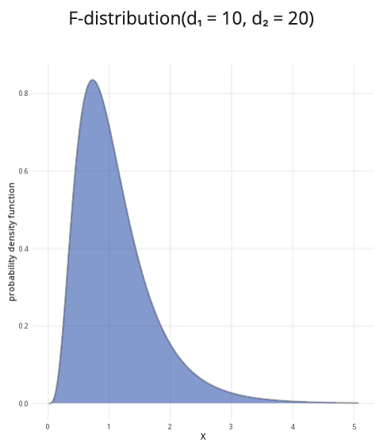

```{r, setup, include = FALSE}
library("webexercises")
```

::: {.content-visible when-format="html"}

```{=html}

<!DOCTYPE html>
<html lang="en">
<head>
  <meta charset="UTF-8">
  <meta name="viewport" content="width=device-width, initial-scale=1.0">
  <title>F-Distribution Calculator</title>

  <style>
    * { box-sizing: border-box; }

    body {
      margin: 0;
      padding: 1rem;
      background: #f5f6f8;
      color: #222222;
    }

    .f-calculator {
      width: 100%;
      max-width: 1200px;
      margin: 0 auto;
    }

    .f-calculator .calculator-row {
      display: grid;
      grid-template-columns: minmax(280px, 1fr) minmax(0, 2fr);
      gap: 1rem;
      align-items: stretch;
    }

    .f-calculator .calculator-card {
      margin-bottom: 1rem;
      overflow: hidden;
      background: #ffffff;
      border: 1px solid #dddddd;
      border-radius: 8px;
      box-shadow: 0 2px 6px rgba(0, 0, 0, 0.08);
    }

    .f-calculator .calculator-card-header {
      padding: 0.75rem 1rem;
      color: #ffffff;
      background: #3F6BB6;
      font-weight: 700;
      line-height: 1.4;
    }

    .f-calculator .calculator-card-body { padding: 1rem; }
    .f-calculator .form-group { margin-bottom: 1rem; }

    .f-calculator label {
      display: block;
      margin-bottom: 0.4rem;
      font-weight: 500;
    }

    .f-calculator input[type="number"] {
      width: 100%;
      padding: 0.55rem 0.65rem;
      border: 1px solid #cccccc;
      border-radius: 5px;
      background: #ffffff;
      font-size: 1rem;
    }

    .f-calculator .distribution-slider {
      width: 100%;
      margin: 0.5rem 0;
      accent-color: #3F68B6;
      cursor: pointer;
    }

    .f-calculator .slider-value {
      margin-top: 0.1rem;
      color: #3F68B6;
      text-align: center;
      font-weight: 700;
    }

    .f-calculator hr {
      margin: 1.2rem 0;
      border: 0;
      border-top: 1px solid #dddddd;
    }

    .f-calculator .probability-options {
      padding: 0;
      margin: 0;
      border: 0;
    }

    .f-calculator .probability-options legend {
      margin-bottom: 0.6rem;
      font-size: 1rem;
      font-weight: 500;
    }

    .f-calculator .radio-option {
      display: flex;
      align-items: center;
      gap: 0.45rem;
      margin-bottom: 0.55rem;
      cursor: pointer;
      font-weight: 400;
    }

    .f-calculator .radio-option input {
      width: 16px;
      height: 16px;
      margin: 0;
      accent-color: #3F68B6;
    }

    .f-calculator .conditional-input { margin-top: 1rem; }
    .f-calculator .conditional-input[hidden] { display: none; }
    .f-calculator .upper-label { margin-top: 1rem; }

    .f-calculator .distribution-plot-title {
      margin-bottom: 1rem;
      text-align: center;
      font-size: 1.1rem;
      font-weight: 600;
    }

    .f-calculator .f-chart-wrapper {
      position: relative;
      width: 100%;
      height: 320px;
    }

    .f-calculator canvas {
      width: 100% !important;
      height: 100% !important;
    }

    .f-calculator .calculation-result {
      font-size: 1.05rem;
      line-height: 1.6;
      text-align: center;
    }

    .f-calculator .input-error {
      min-height: 1.4em;
      margin-top: 0.5rem;
      color: #b00020;
      font-size: 0.92rem;
      font-weight: 600;
    }

    .f-calculator input:focus,
    .f-calculator canvas:focus {
      outline: 3px solid rgba(63, 104, 182, 0.3);
      outline-offset: 2px;
    }

    @media (max-width: 768px) {
      .f-calculator .calculator-row { grid-template-columns: 1fr; }
      .f-calculator .plot-card { min-width: 0; }
      .f-calculator .f-chart-wrapper { height: 280px; }
    }

    @media (max-width: 480px) {
      body { padding: 0.5rem; }
      .f-calculator .calculator-card-body { padding: 0.9rem; }
      .f-calculator .f-chart-wrapper { height: 250px; }
    }
  </style>
</head>

<body>

<div class="distribution-calculator f-calculator">

  <div class="calculator-row">

    <!-- PARAMETERS CARD -->
    <div class="calculator-card parameters-card">
      <div class="calculator-card-header">Parameters</div>

      <div class="calculator-card-body">

        <div class="form-group">
          <label for="f-df1">Numerator degrees of freedom (d₁):</label>
          <input
            type="number"
            id="f-df1"
            value="5"
            min="1"
            max="500"
            step="1"
            aria-describedby="f-parameter-error">
        </div>

        <div class="form-group">
          <label for="f-df2">Denominator degrees of freedom (d₂):</label>
          <input
            type="number"
            id="f-df2"
            value="10"
            min="1"
            max="500"
            step="1"
            aria-describedby="f-parameter-error">
        </div>

        <div
          id="f-parameter-error"
          class="input-error"
          role="alert"
          aria-live="assertive">
        </div>

        <hr>

        <fieldset class="probability-options">
          <legend>Probability to calculate:</legend>

          <label class="radio-option">
            <input type="radio" name="f-prob-type" value="less" checked>
            <span>P(F ≤ x)</span>
          </label>

          <label class="radio-option">
            <input type="radio" name="f-prob-type" value="greater">
            <span>P(F ≥ x)</span>
          </label>

          <label class="radio-option">
            <input type="radio" name="f-prob-type" value="between">
            <span>P(a ≤ F ≤ b)</span>
          </label>
        </fieldset>

        <!-- SINGLE X VALUE -->
        <div id="f-x-container" class="conditional-input">
          <label for="f-x">x value:</label>
          <input
            type="range"
            id="f-x"
            min="0"
            max="8"
            value="2"
            step="0.01"
            class="distribution-slider">
          <div class="slider-value" id="f-x-value">2.00</div>
        </div>

        <!-- LOWER / UPPER VALUES -->
        <div id="f-between-container" class="conditional-input" hidden>
          <label for="f-lower">Lower bound (a):</label>
          <input
            type="range"
            id="f-lower"
            min="0"
            max="8"
            value="0.5"
            step="0.01"
            class="distribution-slider">
          <div class="slider-value" id="f-lower-value">0.50</div>

          <label for="f-upper" class="upper-label">Upper bound (b):</label>
          <input
            type="range"
            id="f-upper"
            min="0"
            max="8"
            value="3"
            step="0.01"
            class="distribution-slider">
          <div class="slider-value" id="f-upper-value">3.00</div>
        </div>

      </div>
    </div>

    <!-- PLOT CARD -->
    <div class="calculator-card plot-card">
      <div class="calculator-card-header">F-distribution plot</div>

      <div class="calculator-card-body">
        <div id="f-plot-title" class="distribution-plot-title">
          F(d₁ = 5, d₂ = 10)
        </div>

        <div class="f-chart-wrapper">
          <canvas
            id="f-chart"
            tabindex="0"
            role="img"
            aria-label="F-distribution probability density function">
          </canvas>
        </div>
      </div>
    </div>

  </div>

  <!-- RESULTS CARD -->
  <div class="calculator-card results-card">
    <div class="calculator-card-header">Results</div>
    <div class="calculator-card-body">
      <div
        id="f-result"
        class="calculation-result"
        aria-live="polite"
        aria-atomic="true">
      </div>
    </div>
  </div>

</div>

<script>
/* =========================================================
   F-DISTRIBUTION CALCULATOR
   ========================================================= */

(function() {
  "use strict";

  const root = document.querySelector(".f-calculator");
  if (!root) return;

  const df1Input = root.querySelector("#f-df1");
  const df2Input = root.querySelector("#f-df2");
  const xInput = root.querySelector("#f-x");
  const lowerInput = root.querySelector("#f-lower");
  const upperInput = root.querySelector("#f-upper");

  const xDisplay = root.querySelector("#f-x-value");
  const lowerDisplay = root.querySelector("#f-lower-value");
  const upperDisplay = root.querySelector("#f-upper-value");

  const error = root.querySelector("#f-parameter-error");
  const title = root.querySelector("#f-plot-title");
  const result = root.querySelector("#f-result");
  const xContainer = root.querySelector("#f-x-container");
  const betweenContainer = root.querySelector("#f-between-container");
  const canvas = root.querySelector("#f-chart");
  const ctx = canvas.getContext("2d");

  function logGamma(z) {
    const coefficients = [
      676.5203681218851,
      -1259.1392167224028,
      771.32342877765313,
      -176.61502916214059,
      12.507343278686905,
      -0.13857109526572012,
      9.9843695780195716e-6,
      1.5056327351493116e-7
    ];

    if (z < 0.5) {
      return Math.log(Math.PI) -
        Math.log(Math.sin(Math.PI * z)) -
        logGamma(1 - z);
    }

    z -= 1;
    let total = 0.99999999999980993;

    for (let i = 0; i < coefficients.length; i++) {
      total += coefficients[i] / (z + i + 1);
    }

    const t = z + coefficients.length - 0.5;

    return 0.5 * Math.log(2 * Math.PI) +
      (z + 0.5) * Math.log(t) - t + Math.log(total);
  }

  function betaContinuedFraction(a, b, x) {
    const maxIterations = 250;
    const epsilon = 3e-14;
    const tiny = 1e-300;
    const qab = a + b;
    const qap = a + 1;
    const qam = a - 1;

    let c = 1;
    let d = 1 - qab * x / qap;
    if (Math.abs(d) < tiny) d = tiny;
    d = 1 / d;
    let h = d;

    for (let m = 1; m <= maxIterations; m++) {
      const m2 = 2 * m;
      let aa = m * (b - m) * x /
        ((qam + m2) * (a + m2));

      d = 1 + aa * d;
      if (Math.abs(d) < tiny) d = tiny;
      c = 1 + aa / c;
      if (Math.abs(c) < tiny) c = tiny;
      d = 1 / d;
      h *= d * c;

      aa = -(a + m) * (qab + m) * x /
        ((a + m2) * (qap + m2));

      d = 1 + aa * d;
      if (Math.abs(d) < tiny) d = tiny;
      c = 1 + aa / c;
      if (Math.abs(c) < tiny) c = tiny;
      d = 1 / d;

      const delta = d * c;
      h *= delta;

      if (Math.abs(delta - 1) < epsilon) break;
    }

    return h;
  }

  function regularizedIncompleteBeta(x, a, b) {
    if (x <= 0) return 0;
    if (x >= 1) return 1;

    const logarithmicTerm =
      logGamma(a + b) - logGamma(a) - logGamma(b) +
      a * Math.log(x) + b * Math.log(1 - x);

    const front = Math.exp(logarithmicTerm);

    if (x < (a + 1) / (a + b + 2)) {
      return front * betaContinuedFraction(a, b, x) / a;
    }

    return 1 - front * betaContinuedFraction(b, a, 1 - x) / b;
  }

  function fPDF(value, df1, df2) {
    if (value <= 0) return 0;

    const halfDf1 = df1 / 2;
    const halfDf2 = df2 / 2;

    const logDensity =
      halfDf1 * Math.log(df1 / df2) +
      (halfDf1 - 1) * Math.log(value) -
      (halfDf1 + halfDf2) * Math.log(1 + df1 * value / df2) -
      (logGamma(halfDf1) + logGamma(halfDf2) -
       logGamma(halfDf1 + halfDf2));

    return Math.exp(logDensity);
  }

  function fCDF(value, df1, df2) {
    if (value <= 0) return 0;

    const transformed =
      (df1 * value) / (df1 * value + df2);

    return regularizedIncompleteBeta(
      transformed,
      df1 / 2,
      df2 / 2
    );
  }

  function fQuantile(probability, df1, df2) {
    let lower = 0;
    let upper = 1;

    while (fCDF(upper, df1, df2) < probability && upper < 10000) {
      upper *= 2;
    }

    for (let i = 0; i < 80; i++) {
      const midpoint = (lower + upper) / 2;

      if (fCDF(midpoint, df1, df2) < probability) {
        lower = midpoint;
      } else {
        upper = midpoint;
      }
    }

    return (lower + upper) / 2;
  }

  function validateParameters() {
    const df1 = Number(df1Input.value);
    const df2 = Number(df2Input.value);
    let message = "";

    if (!Number.isInteger(df1) || !Number.isInteger(df2)) {
      message = "Both degrees of freedom must be whole numbers.";
    } else if (df1 < 1 || df2 < 1) {
      message = "Both degrees of freedom must be at least 1.";
    } else if (df1 > 500 || df2 > 500) {
      message = "Please use degrees of freedom no greater than 500.";
    }

    error.textContent = message;
    df1Input.setAttribute("aria-invalid", message ? "true" : "false");
    df2Input.setAttribute("aria-invalid", message ? "true" : "false");

    return message ? null : { df1, df2 };
  }

  function getProbabilityType() {
    const selected = root.querySelector(
      'input[name="f-prob-type"]:checked'
    );
    return selected ? selected.value : "less";
  }

  function clamp(value, minimum, maximum) {
    return Math.max(minimum, Math.min(maximum, value));
  }

  function formatValue(value) {
    return Number(value).toFixed(2);
  }

  function updateRanges(parameters) {
    const quantile = fQuantile(0.995, parameters.df1, parameters.df2);
    const maximum = Math.min(100, Math.max(5, quantile));
    const step = Math.max(0.001, maximum / 500);

    [xInput, lowerInput, upperInput].forEach(function(input) {
      input.min = 0;
      input.max = maximum;
      input.step = step;

      const current = Number(input.value);
      input.value = Number.isFinite(current)
        ? clamp(current, 0, maximum)
        : 0;
    });

    if (Number(upperInput.value) < Number(lowerInput.value)) {
      upperInput.value = lowerInput.value;
    }

    return maximum;
  }

  function updateDisplay(parameters) {
    const plotMaximum = updateRanges(parameters);

    xDisplay.textContent = formatValue(xInput.value);
    lowerDisplay.textContent = formatValue(lowerInput.value);
    upperDisplay.textContent = formatValue(upperInput.value);

    title.textContent =
      `F(d₁ = ${parameters.df1}, d₂ = ${parameters.df2})`;

    return plotMaximum;
  }

  function calculateProbability(parameters) {
    const df1 = parameters.df1;
    const df2 = parameters.df2;
    const x = Number(xInput.value);
    let lower = Number(lowerInput.value);
    let upper = Number(upperInput.value);
    const type = getProbabilityType();
    let probability;

    if (upper < lower) {
      upper = lower;
      upperInput.value = upper;
      upperDisplay.textContent = formatValue(upper);
    }

    if (type === "less") {
      probability = fCDF(x, df1, df2);
      result.textContent =
        `P(F ≤ ${formatValue(x)}) = ${probability.toFixed(4)} ` +
        `or ${(probability * 100).toFixed(2)}%`;
    } else if (type === "greater") {
      probability = 1 - fCDF(x, df1, df2);
      result.textContent =
        `P(F ≥ ${formatValue(x)}) = ${probability.toFixed(4)} ` +
        `or ${(probability * 100).toFixed(2)}%`;
    } else {
      probability =
        fCDF(upper, df1, df2) -
        fCDF(lower, df1, df2);

      result.textContent =
        `P(${formatValue(lower)} ≤ F ≤ ${formatValue(upper)}) = ` +
        `${probability.toFixed(4)} or ` +
        `${(probability * 100).toFixed(2)}%`;
    }

    probability = Math.max(0, Math.min(1, probability));

    return {
      type,
      x,
      lower,
      upper,
      probability,
      df1,
      df2
    };
  }

  function drawChart(parameters, plotMaximum) {
    const selected = calculateProbability(parameters);
    const rect = canvas.getBoundingClientRect();

    if (!rect.width || !rect.height) return;

    const dpr = window.devicePixelRatio || 1;
    canvas.width = Math.round(rect.width * dpr);
    canvas.height = Math.round(rect.height * dpr);
    ctx.setTransform(dpr, 0, 0, dpr, 0, 0);

    const width = rect.width;
    const height = rect.height;
    const padding = { left: 62, right: 22, top: 25, bottom: 52 };
    const chartWidth = width - padding.left - padding.right;
    const chartHeight = height - padding.top - padding.bottom;
    const pointCount = 800;
    const epsilon = Math.max(1e-6, plotMaximum / pointCount / 10);
    const points = [];
    let maximumY = 0;

    ctx.clearRect(0, 0, width, height);

    for (let i = 0; i <= pointCount; i++) {
      const value = epsilon +
        (i / pointCount) * (plotMaximum - epsilon);
      const density = fPDF(value, selected.df1, selected.df2);

      if (Number.isFinite(density)) {
        points.push({ value, density });
        maximumY = Math.max(maximumY, density);
      }
    }

    maximumY = Math.max(0.05, Math.min(50, maximumY * 1.1));

    function xScale(value) {
      return padding.left + (value / plotMaximum) * chartWidth;
    }

    function yScale(value) {
      const bounded = Math.min(value, maximumY);
      return padding.top + chartHeight -
        (bounded / maximumY) * chartHeight;
    }

    ctx.font = "12px Arial";
    ctx.textAlign = "right";
    ctx.textBaseline = "middle";

    for (let i = 0; i <= 4; i++) {
      const density = (i / 4) * maximumY;
      const y = yScale(density);

      ctx.strokeStyle = "#e5e5e5";
      ctx.lineWidth = 1;
      ctx.beginPath();
      ctx.moveTo(padding.left, y);
      ctx.lineTo(width - padding.right, y);
      ctx.stroke();

      ctx.fillStyle = "#555555";
      ctx.fillText(density.toFixed(2), padding.left - 8, y);
    }

    function fillArea(start, end, colour) {
      const boundedStart = clamp(start, 0, plotMaximum);
      const boundedEnd = clamp(end, 0, plotMaximum);
      if (boundedEnd <= boundedStart) return;

      ctx.beginPath();
      ctx.moveTo(xScale(boundedStart), yScale(0));
      let hasPoint = false;

      points.forEach(function(point) {
        if (point.value >= boundedStart && point.value <= boundedEnd) {
          ctx.lineTo(xScale(point.value), yScale(point.density));
          hasPoint = true;
        }
      });

      if (!hasPoint) return;

      ctx.lineTo(xScale(boundedEnd), yScale(0));
      ctx.closePath();
      ctx.fillStyle = colour;
      ctx.fill();
    }

    fillArea(0, plotMaximum, "rgba(211, 211, 211, 0.55)");

    if (selected.type === "less") {
      fillArea(0, selected.x, "rgba(63, 107, 182, 0.58)");
    } else if (selected.type === "greater") {
      fillArea(selected.x, plotMaximum, "rgba(63, 107, 182, 0.58)");
    } else {
      fillArea(selected.lower, selected.upper, "rgba(63, 107, 182, 0.58)");
    }

    ctx.beginPath();

    points.forEach(function(point, index) {
      const chartX = xScale(point.value);
      const chartY = yScale(point.density);

      if (index === 0) ctx.moveTo(chartX, chartY);
      else ctx.lineTo(chartX, chartY);
    });

    ctx.strokeStyle = "#274f91";
    ctx.lineWidth = 2.5;
    ctx.stroke();

    function drawBoundary(value) {
      if (value < 0 || value > plotMaximum) return;

      const density = value <= 0
        ? 0
        : fPDF(value, selected.df1, selected.df2);

      ctx.save();
      ctx.setLineDash([5, 4]);
      ctx.strokeStyle = "#274f91";
      ctx.lineWidth = 1.5;
      ctx.beginPath();
      ctx.moveTo(xScale(value), yScale(0));
      ctx.lineTo(xScale(value), yScale(density));
      ctx.stroke();
      ctx.restore();
    }

    if (selected.type === "between") {
      drawBoundary(selected.lower);
      drawBoundary(selected.upper);
    } else {
      drawBoundary(selected.x);
    }

    ctx.strokeStyle = "#777777";
    ctx.lineWidth = 1;
    ctx.beginPath();
    ctx.moveTo(padding.left, padding.top);
    ctx.lineTo(padding.left, padding.top + chartHeight);
    ctx.lineTo(width - padding.right, padding.top + chartHeight);
    ctx.stroke();

    ctx.fillStyle = "#333333";
    ctx.font = "12px Arial";
    ctx.textAlign = "center";
    ctx.textBaseline = "alphabetic";

    const tickCount = width < 500 ? 5 : 8;

    for (let i = 0; i <= tickCount; i++) {
      const value = (i / tickCount) * plotMaximum;

      ctx.fillText(
        formatValue(value),
        xScale(value),
        padding.top + chartHeight + 20
      );
    }

    ctx.font = "13px Arial";
    ctx.fillText(
      "F value",
      padding.left + chartWidth / 2,
      height - 8
    );

    ctx.save();
    ctx.translate(15, padding.top + chartHeight / 2);
    ctx.rotate(-Math.PI / 2);
    ctx.textAlign = "center";
    ctx.fillText("probability density", 0, 0);
    ctx.restore();

    canvas.setAttribute(
      "aria-label",
      `F-distribution probability density plot with ${selected.df1} ` +
      `numerator and ${selected.df2} denominator degrees of freedom. ` +
      `The selected probability is ${selected.probability.toFixed(4)}.`
    );
  }

  function updateVisibility() {
    const type = getProbabilityType();
    xContainer.hidden = type === "between";
    betweenContainer.hidden = type !== "between";
  }

  function update() {
    updateVisibility();

    const parameters = validateParameters();

    if (!parameters) {
      result.textContent =
        "Enter valid degrees of freedom to calculate a probability.";
      ctx.clearRect(0, 0, canvas.width, canvas.height);
      return;
    }

    const plotMaximum = updateDisplay(parameters);
    drawChart(parameters, plotMaximum);
  }

  df1Input.addEventListener("input", update);
  df2Input.addEventListener("input", update);
  xInput.addEventListener("input", update);

  lowerInput.addEventListener("input", function() {
    if (Number(lowerInput.value) > Number(upperInput.value)) {
      upperInput.value = lowerInput.value;
    }
    update();
  });

  upperInput.addEventListener("input", function() {
    if (Number(upperInput.value) < Number(lowerInput.value)) {
      lowerInput.value = upperInput.value;
    }
    update();
  });

  root.querySelectorAll('input[name="f-prob-type"]').forEach(
    function(radio) {
      radio.addEventListener("change", update);
    }
  );

  let resizeTimer;

  window.addEventListener("resize", function() {
    window.clearTimeout(resizeTimer);
    resizeTimer = window.setTimeout(update, 80);
  });

  update();
})();
</script>

</body>
</html>

```

:::

::: {.content-hidden when-format="html"}

{width="80%"}

:::

**Where to use:** The $F$-distribution is used for the ratio $(X/d_1)/(Y/d_2)$ of two independent random $\chi^2$ variables $X\sim \chi^2(d_1)$ and $Y\sim \chi^2(d_2)$. It is commonly used as a reference distribution in hypothesis testing to compare two variances or more than two means, such as Analysis of Variance (ANOVA) tests.

**Notation:** $X \sim F(d_{1},d_{2})$

**Parameters:** Two integers $d_1$ and $d_2$, where - $d_{1}$ degrees of freedom for the random variable $X\sim \chi^2(d_{1})$. - $d_{2}$ degrees of freedom for the random variable $Y\sim \chi^2(d_{2})$.

| Quantity | Value | Notes |
|:--------|:----------------------------|:-------------------|
| **Mean** | $\mathbb{E}(X) = \dfrac{d_{2}}{d_{2}-2}$ | $d_2>2$ |
| **Variance** | $\mathbb{V}(X) = \dfrac{2d_{2}(d_{1}+d_{2}-2)}{d_{1}(d_{2}-2)^2(d_{2}-4)}$ |  |
| **PDF** | $\mathbb{P}(X=x)=\dfrac{\sqrt{\frac{(d_{1}x)^{d_{1}}d_{2}^{d_{2}}}{(d_{1}x+d_{2})^{d_{1}+d_{2}}}}}{x\textrm{B}\left(\frac{d_{1}}{2},\frac{d_{2}}{2}\right)}$ | $\textrm{B}(x,y)$ is the beta function |
| **CDF** | $\mathbb{P}(X \leq x)=I_{\frac{d_{1}x}{d_{1}x+d_{2}}}(\frac{d_{1}}{2},\frac{d_{2}}{2})$ | $I_{x}(a,b)$ is the regularized incomplete beta function |

**Example:** You have three independent groups of data containing Cantor’s Confectionery chocolate bar lengths, and the total sample size is 90. From this, you would like to conduct an ANOVA test investigating if there is a statistically significant difference between the means of each group. You can find the degrees of freedom using the following methods:

-   $\textsf{numerator degrees of freedom = number of groups} - 1 = 3 - 1 = 2$

-   $\textsf{denominator degrees of freedom = sample size - number of groups} = 90 - 3 = 87$

The $F$ distribution, which will be used as a reference distribution for the ANOVA test, can be expressed as $X \sim F(2,87)$, meaning the numerator degrees of freedom is $2$ and the denominator degrees of freedom is $87$.

# Further reading {-}

[This interactive element appears in Overview: Probability distributions. Please click this link to go to the guide.](../overviews/o-distributions.qmd)

## Version history {-}

v1.0: initial version created 04/25 by tdhc and Michelle Arnetta as part of a University of St Andrews VIP project.

- v1.1: moved to factsheet form and populated with material from [Overview: Probability distributions](../overviews/o-distributions.qmd) by tdhc.

- v1.2: deprecated shinylive apps replaced 09/26 by tdhc.
  
[This work is licensed under CC BY-NC-SA 4.0.](https://creativecommons.org/licenses/by-nc-sa/4.0/?ref=chooser-v1)


