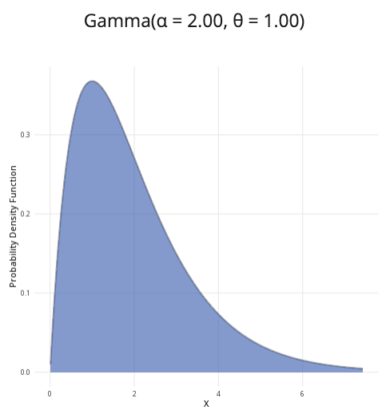

```{r, setup, include = FALSE}
library("webexercises")
```

::: {.content-visible when-format="html"}

```{=html}

<!DOCTYPE html>
<html lang="en">
<head>
  <meta charset="UTF-8">
  <meta name="viewport" content="width=device-width, initial-scale=1.0">
  <title>Gamma Distribution Calculator</title>
  <style>
    * { box-sizing: border-box; }
    body { margin: 0; padding: 1rem; background: #f5f6f8; color: #222 }
    .gdc-app { width: 100%; max-width: 1200px; margin: 0 auto; }
    .gdc-app .gdc-row { display: grid; grid-template-columns: minmax(290px, 1fr) minmax(0, 2fr); gap: 1rem; align-items: stretch; }
    .gdc-app .gdc-card { margin-bottom: 1rem; overflow: hidden; background: #fff; border: 1px solid #ddd; border-radius: 8px; box-shadow: 0 2px 6px rgba(0,0,0,.08); }
    .gdc-app .gdc-header { padding: .75rem 1rem; color: #fff; background: #3F6BB6; font-weight: 700; line-height: 1.4; }
    .gdc-app .gdc-body { padding: 1rem; }
    .gdc-app .gdc-group { margin-bottom: 1rem; }
    .gdc-app label { display: block; margin-bottom: .4rem; font-weight: 500; }
    .gdc-app input[type="number"], .gdc-app select { width: 100%; padding: .55rem .65rem; border: 1px solid #ccc; border-radius: 5px; background: #fff; font-size: 1rem; }
    .gdc-app input[type="range"] { width: 100%; margin: .5rem 0; accent-color: #3F68B6; cursor: pointer; }
    .gdc-app .gdc-slider-value { color: #3F68B6; text-align: center; font-weight: 700; }
    .gdc-app hr { margin: 1.2rem 0; border: 0; border-top: 1px solid #ddd; }
    .gdc-app fieldset { padding: 0; margin: 0; border: 0; }
    .gdc-app legend { margin-bottom: .6rem; font-weight: 600; }
    .gdc-app .gdc-radio { display: flex; align-items: center; gap: .45rem; margin-bottom: .55rem; cursor: pointer; font-weight: 400; }
    .gdc-app .gdc-radio input { width: 17px; height: 17px; margin: 0; accent-color: #3F68B6; }
    .gdc-app .gdc-conditional[hidden] { display: none; }
    .gdc-app .gdc-error { min-height: 1.4em; margin-top: .4rem; color: #b00020; font-size: .92rem; font-weight: 600; }
    .gdc-app .gdc-title { margin-bottom: .8rem; text-align: center; font-size: 1.1rem; font-weight: 600; }
    .gdc-app .gdc-chart-wrap { position: relative; width: 100%; height: 380px; }
    .gdc-app canvas { width: 100% !important; height: 100% !important; }
    .gdc-app .gdc-summary { display: grid; grid-template-columns: repeat(4, minmax(0, 1fr)); gap: .75rem; }
    .gdc-app .gdc-item { padding: .8rem; border: 1px solid #d9e2f2; border-radius: 6px; background: #f4f7fc; text-align: center; }
    .gdc-app .gdc-label { display: block; margin-bottom: .25rem; color: #555; font-size: .9rem; }
    .gdc-app .gdc-value { color: #203f73; font-size: 1.08rem; font-weight: 700; }
    .gdc-app .gdc-result { padding: .85rem; border: 1px solid #d9e2f2; border-radius: 6px; background: #f4f7fc; color: #203f73; text-align: center; font-size: 1.12rem; font-weight: 700; }
    .gdc-app .gdc-help { margin: .7rem 0 0; color: #555; font-size: .92rem; line-height: 1.5; }
    .gdc-app input:focus-visible, .gdc-app select:focus-visible, .gdc-app canvas:focus-visible { outline: 3px solid rgba(63,104,182,.4); outline-offset: 2px; }
    @media (max-width: 800px) { .gdc-app .gdc-row { grid-template-columns: 1fr; } .gdc-app .gdc-chart-wrap { height: 330px; } .gdc-app .gdc-summary { grid-template-columns: repeat(2, 1fr); } }
    @media (max-width: 520px) { body { padding: .5rem; } .gdc-app .gdc-body { padding: .9rem; } .gdc-app .gdc-chart-wrap { height: 290px; } .gdc-app .gdc-summary { grid-template-columns: 1fr; } }
  </style>
</head>
<body>
<main class="gdc-app">
  <div class="gdc-row">
    <section class="gdc-card" aria-labelledby="gdc-parameters-heading">
      <div class="gdc-header" id="gdc-parameters-heading">Parameters</div>
      <div class="gdc-body">
        <div class="gdc-group">
          <label for="gdc-shape">Shape (α):</label>
          <input id="gdc-shape" type="number" value="2" min="0.1" max="100" step="0.1" aria-describedby="gdc-error">
        </div>
        <div class="gdc-group">
          <label for="gdc-parameterisation">Second parameter:</label>
          <select id="gdc-parameterisation">
            <option value="scale" selected>Scale (θ)</option>
            <option value="rate">Rate (β)</option>
          </select>
        </div>
        <div class="gdc-group">
          <label for="gdc-second" id="gdc-second-label">Scale (θ):</label>
          <input id="gdc-second" type="number" value="2" min="0.01" max="100" step="0.1" aria-describedby="gdc-error">
        </div>
        <div id="gdc-error" class="gdc-error" role="alert" aria-live="assertive"></div>
        <hr>
        <fieldset>
          <legend>Probability to calculate:</legend>
          <label class="gdc-radio"><input type="radio" name="gdc-probability-type" value="less" checked><span>P(X ≤ x)</span></label>
          <label class="gdc-radio"><input type="radio" name="gdc-probability-type" value="greater"><span>P(X ≥ x)</span></label>
          <label class="gdc-radio"><input type="radio" name="gdc-probability-type" value="between"><span>P(a ≤ X ≤ b)</span></label>
        </fieldset>
        <div id="gdc-single-container" class="gdc-conditional gdc-group">
          <label for="gdc-x">x value:</label>
          <input id="gdc-x" type="range" min="0" max="15" value="5" step="0.01">
          <div class="gdc-slider-value" id="gdc-x-value">5.00</div>
        </div>
        <div id="gdc-between-container" class="gdc-conditional" hidden>
          <div class="gdc-group"><label for="gdc-lower">Lower bound (a):</label><input id="gdc-lower" type="range" min="0" max="15" value="2" step="0.01"><div class="gdc-slider-value" id="gdc-lower-value">2.00</div></div>
          <div class="gdc-group"><label for="gdc-upper">Upper bound (b):</label><input id="gdc-upper" type="range" min="0" max="15" value="7" step="0.01"><div class="gdc-slider-value" id="gdc-upper-value">7.00</div></div>
        </div>
      </div>
    </section>
    <section class="gdc-card" aria-labelledby="gdc-plot-heading">
      <div class="gdc-header" id="gdc-plot-heading">Gamma distribution plot</div>
      <div class="gdc-body">
        <div class="gdc-title" id="gdc-plot-title">Gamma(α = 2.00, θ = 2.00)</div>
        <div class="gdc-chart-wrap"><canvas id="gdc-chart" tabindex="0" role="img" aria-describedby="gdc-chart-description"></canvas></div>
        <p class="gdc-help" id="gdc-chart-description"></p>
      </div>
    </section>
  </div>
  <section class="gdc-card" aria-labelledby="gdc-result-heading">
    <div class="gdc-header" id="gdc-result-heading">Result</div>
    <div class="gdc-body"><div id="gdc-result" class="gdc-result" role="status" aria-live="polite" aria-atomic="true"></div></div>
  </section>
  <section class="gdc-card" aria-labelledby="gdc-summary-heading">
    <div class="gdc-header" id="gdc-summary-heading">Distribution summary</div>
    <div class="gdc-body"><div class="gdc-summary">
      <div class="gdc-item"><span class="gdc-label">Mean</span><span class="gdc-value" id="gdc-mean"></span></div>
      <div class="gdc-item"><span class="gdc-label">Variance</span><span class="gdc-value" id="gdc-variance"></span></div>
      <div class="gdc-item"><span class="gdc-label">Standard deviation</span><span class="gdc-value" id="gdc-sd"></span></div>
      <div class="gdc-item"><span class="gdc-label">Mode</span><span class="gdc-value" id="gdc-mode"></span></div>
    </div></div>
  </section>
</main>
<script>
(function(){
  "use strict";
  const app=document.querySelector('.gdc-app'); if(!app)return;
  const shapeInput=app.querySelector('#gdc-shape'), parameterisation=app.querySelector('#gdc-parameterisation'), secondInput=app.querySelector('#gdc-second'), secondLabel=app.querySelector('#gdc-second-label'), error=app.querySelector('#gdc-error');
  const xInput=app.querySelector('#gdc-x'), lowerInput=app.querySelector('#gdc-lower'), upperInput=app.querySelector('#gdc-upper'), xValue=app.querySelector('#gdc-x-value'), lowerValue=app.querySelector('#gdc-lower-value'), upperValue=app.querySelector('#gdc-upper-value');
  const singleContainer=app.querySelector('#gdc-single-container'), betweenContainer=app.querySelector('#gdc-between-container'), title=app.querySelector('#gdc-plot-title'), result=app.querySelector('#gdc-result'), description=app.querySelector('#gdc-chart-description');
  const meanOut=app.querySelector('#gdc-mean'), varianceOut=app.querySelector('#gdc-variance'), sdOut=app.querySelector('#gdc-sd'), modeOut=app.querySelector('#gdc-mode'), canvas=app.querySelector('#gdc-chart'), ctx=canvas.getContext('2d');
  function logGamma(z){const c=[676.5203681218851,-1259.1392167224028,771.3234287776531,-176.6150291621406,12.507343278686905,-.13857109526572012,9.984369578019572e-6,1.5056327351493116e-7];if(z<.5)return Math.log(Math.PI)-Math.log(Math.sin(Math.PI*z))-logGamma(1-z);z-=1;let x=.9999999999998099;for(let i=0;i<c.length;i++)x+=c[i]/(z+i+1);const t=z+c.length-.5;return .5*Math.log(2*Math.PI)+(z+.5)*Math.log(t)-t+Math.log(x)}
  function regularizedGammaP(a,x){if(x<=0)return 0;if(x<a+1){let sum=1/a,term=sum,ap=a;for(let n=1;n<=300;n++){ap++;term*=x/ap;sum+=term;if(Math.abs(term)<Math.abs(sum)*1e-15)break}return Math.min(1,sum*Math.exp(-x+a*Math.log(x)-logGamma(a)))}let b=x+1-a,c=1/1e-300,d=1/b,h=d;for(let i=1;i<=300;i++){const an=-i*(i-a);b+=2;d=an*d+b;if(Math.abs(d)<1e-300)d=1e-300;c=b+an/c;if(Math.abs(c)<1e-300)c=1e-300;d=1/d;const delta=d*c;h*=delta;if(Math.abs(delta-1)<1e-15)break}return Math.max(0,Math.min(1,1-Math.exp(-x+a*Math.log(x)-logGamma(a))*h))}
  function pdf(x,a,theta){if(x<0)return 0;if(x===0){if(a<1)return Infinity;if(a===1)return 1/theta;return 0}return Math.exp((a-1)*Math.log(x)-x/theta-logGamma(a)-a*Math.log(theta))}
  function cdf(x,a,theta){return x<=0?0:regularizedGammaP(a,x/theta)}
  function quantile(p,a,theta){let lo=0,hi=Math.max(theta,a*theta);while(cdf(hi,a,theta)<p&&hi<1e7)hi*=2;for(let i=0;i<90;i++){const mid=(lo+hi)/2;if(cdf(mid,a,theta)<p)lo=mid;else hi=mid}return(lo+hi)/2}
  function type(){const r=app.querySelector('input[name="gdc-probability-type"]:checked');return r?r.value:'less'}
  function parameters(){const a=Number(shapeInput.value),v=Number(secondInput.value);let message='';if(!Number.isFinite(a)||a<.1||a>100)message='Shape must be from 0.1 to 100.';else if(!Number.isFinite(v)||v<=0||v>100)message='Scale or rate must be greater than 0 and no more than 100.';error.textContent=message;shapeInput.setAttribute('aria-invalid',message?'true':'false');secondInput.setAttribute('aria-invalid',message?'true':'false');if(message)return null;return{a,theta:parameterisation.value==='scale'?v:1/v,v}}
  function updateRanges(p){const max=Math.max(.1,quantile(.997,p.a,p.theta));const step=Math.max(.001,max/600);[xInput,lowerInput,upperInput].forEach(i=>{i.max=max;i.step=step;i.value=Math.min(Number(i.value),max)});if(+upperInput.value<+lowerInput.value)upperInput.value=lowerInput.value;return max}
  function draw(p,max,calc){const r=canvas.getBoundingClientRect();if(!r.width||!r.height)return;const dpr=devicePixelRatio||1;canvas.width=Math.round(r.width*dpr);canvas.height=Math.round(r.height*dpr);ctx.setTransform(dpr,0,0,dpr,0,0);const w=r.width,h=r.height,pad={l:62,r:22,t:24,b:52},cw=w-pad.l-pad.r,ch=h-pad.t-pad.b,eps=Math.max(1e-7,max/100000),pts=[];let ymax=0;for(let i=0;i<=900;i++){const xv=eps+i/900*(max-eps),yv=pdf(xv,p.a,p.theta);if(Number.isFinite(yv)){pts.push({x:xv,y:yv});ymax=Math.max(ymax,yv)}}ymax=Math.max(.01,ymax*1.1);const xs=x=>pad.l+x/max*cw,ys=y=>pad.t+ch-Math.min(y,ymax)/ymax*ch;ctx.clearRect(0,0,w,h);ctx.font='12px Arial';ctx.textAlign='right';ctx.textBaseline='middle';for(let i=0;i<=4;i++){const y=i/4*ymax,py=ys(y);ctx.strokeStyle='#e5e5e5';ctx.beginPath();ctx.moveTo(pad.l,py);ctx.lineTo(w-pad.r,py);ctx.stroke();ctx.fillStyle='#555';ctx.fillText(y.toFixed(2),pad.l-8,py)}function area(start,end){start=Math.max(0,start);end=Math.min(max,end);if(end<=start)return;ctx.beginPath();ctx.moveTo(xs(start),ys(0));pts.forEach(q=>{if(q.x>=start&&q.x<=end)ctx.lineTo(xs(q.x),ys(q.y))});ctx.lineTo(xs(end),ys(0));ctx.closePath();ctx.fillStyle='rgba(63,107,182,.56)';ctx.fill()}if(calc.t==='less')area(0,calc.x);else if(calc.t==='greater')area(calc.x,max);else area(calc.lo,calc.hi);ctx.beginPath();pts.forEach((q,i)=>i?ctx.lineTo(xs(q.x),ys(q.y)):ctx.moveTo(xs(q.x),ys(q.y)));ctx.strokeStyle='#274f91';ctx.lineWidth=2.5;ctx.stroke();ctx.save();ctx.setLineDash([5,4]);ctx.strokeStyle='#274f91';ctx.lineWidth=1.5;const bounds=calc.t==='between'?[calc.lo,calc.hi]:[calc.x];bounds.forEach(v=>{if(v>=0&&v<=max){ctx.beginPath();ctx.moveTo(xs(v),ys(0));ctx.lineTo(xs(v),ys(Number.isFinite(pdf(v,p.a,p.theta))?pdf(v,p.a,p.theta):ymax));ctx.stroke()}});ctx.restore();ctx.strokeStyle='#777';ctx.lineWidth=1;ctx.beginPath();ctx.moveTo(pad.l,pad.t);ctx.lineTo(pad.l,pad.t+ch);ctx.lineTo(w-pad.r,pad.t+ch);ctx.stroke();ctx.fillStyle='#333';ctx.textAlign='center';ctx.textBaseline='alphabetic';const ticks=w<500?5:8;for(let i=0;i<=ticks;i++){const v=i/ticks*max;ctx.fillText(v.toFixed(2),xs(v),pad.t+ch+20)}ctx.font='13px Arial';ctx.fillText('X',pad.l+cw/2,h-8);ctx.save();ctx.translate(15,pad.t+ch/2);ctx.rotate(-Math.PI/2);ctx.fillText('Probability density',0,0);ctx.restore();const text=`Gamma distribution with shape ${p.a.toFixed(2)} and scale ${p.theta.toFixed(2)}. The shaded probability is ${calc.prob.toFixed(6)}.`;canvas.setAttribute('aria-label',text);description.textContent=text}
  function update(){secondLabel.textContent=parameterisation.value==='scale'?'Scale (θ):':'Rate (β):';singleContainer.hidden=type()==='between';betweenContainer.hidden=type()!=='between';const p=parameters();if(!p){result.textContent='Enter valid distribution parameters.';ctx.clearRect(0,0,canvas.width,canvas.height);return}const max=updateRanges(p),t=type(),x=+xInput.value,lo=+lowerInput.value,hi=+upperInput.value;let prob,label;if(t==='less'){prob=cdf(x,p.a,p.theta);label=`P(X ≤ ${x.toFixed(2)})`}else if(t==='greater'){prob=1-cdf(x,p.a,p.theta);label=`P(X ≥ ${x.toFixed(2)})`}else{prob=cdf(hi,p.a,p.theta)-cdf(lo,p.a,p.theta);label=`P(${lo.toFixed(2)} ≤ X ≤ ${hi.toFixed(2)})`}prob=Math.max(0,Math.min(1,prob));xValue.textContent=x.toFixed(2);lowerValue.textContent=lo.toFixed(2);upperValue.textContent=hi.toFixed(2);const symbol=parameterisation.value==='scale'?'θ':'β';title.textContent=`Gamma(α = ${p.a.toFixed(2)}, ${symbol} = ${p.v.toFixed(2)})`;result.textContent=`${label} = ${prob.toFixed(6)} (${(prob*100).toFixed(2)}%)`;const mean=p.a*p.theta,variance=p.a*p.theta*p.theta;meanOut.textContent=mean.toFixed(3);varianceOut.textContent=variance.toFixed(3);sdOut.textContent=Math.sqrt(variance).toFixed(3);modeOut.textContent=p.a>=1?((p.a-1)*p.theta).toFixed(3):'0 (boundary)';draw(p,max,{t,x,lo,hi,prob})}
  lowerInput.addEventListener('input',()=>{if(+lowerInput.value>+upperInput.value)upperInput.value=lowerInput.value;update()});upperInput.addEventListener('input',()=>{if(+upperInput.value<+lowerInput.value)lowerInput.value=upperInput.value;update()});[shapeInput,secondInput,xInput,parameterisation].forEach(i=>i.addEventListener('input',update));app.querySelectorAll('input[name="gdc-probability-type"]').forEach(r=>r.addEventListener('change',update));let timer;window.addEventListener('resize',()=>{clearTimeout(timer);timer=setTimeout(update,80)});update();
})();
</script>
</body>
</html>

```

:::

::: {.content-hidden when-format="html"}

{width="80%"}

:::

**Where to use:** The gamma distribution generalizes the exponential distribution, allowing for greater or lesser variance. It is used to model positive continuous random variables that have skewed distributions.

**Notation:** $X \sim \textrm{Gamma}(\alpha,\theta)$ or $X \sim \textrm{Gam}(\alpha,\theta)$

**Parameters:** Two real numbers $\alpha$ and $\theta$, which are related to the mean $\mu$ and variance $\sigma^2$:

-   $\alpha = \frac{\mu^2}{\sigma^2}$ (shape parameter)
-   $\theta=\frac{\sigma^2}{\mu}$ (scale parameter)

| Quantity | Value | Notes |
|:--------|:----------------------------|:-------------------|
| **Mean** | $\mathbb{E}(X) = \alpha\theta$ |  |
| **Variance** | $\mathbb{V}(X) = \alpha\theta^2$ |  |
| **PDF** | $\mathbb{P}(X=x)=\dfrac{x^{\alpha-1}\exp\left(-\frac{x}{\theta}\right)}{\Gamma(\alpha)\theta^{\alpha}}$ | $\Gamma(x)$ the gamma function of $x$ |
| **CDF** | $\mathbb{P}(X \leq x)=\dfrac{\textrm{Gam}\left(\alpha,\frac{x}{\theta}\right)}{\Gamma(\alpha)}$ | $\textrm{Gam}(\alpha,\theta)$ is the PDF of the gamma distribution |

**Example:** You collect historical data on the time to failure of a machine from Cantor’s Confectionery. The mean is 83 days and the variance is 50.3. You can then use this to estimate the shape and scale parameters of the gamma distribution:

-   $\alpha = \frac{83^2}{50.3} = 136.958250497 \approx 137$

-   $\theta = \frac{50.3}{83} = 0.60602409638 \approx 0.61$

The distribution can be expressed as $X \sim \textrm{Gam}(137,0.61)$, where the shape parameter is 137 and the scale parameter is 0.61.


# Further reading {-}

[This interactive element appears in Overview: Probability distributions. Please click this link to go to the guide.](../overviews/o-distributions.qmd)

## Version history {-}

v1.0: initial version created 04/25 by tdhc and Michelle Arnetta as part of a University of St Andrews VIP project.

- v1.1: moved to factsheet form and populated with material from [Overview: Probability distributions](../overviews/o-distributions.qmd) by tdhc.

- v1.2: deprecated shinylive apps replaced 09/26 by tdhc.
  
[This work is licensed under CC BY-NC-SA 4.0.](https://creativecommons.org/licenses/by-nc-sa/4.0/?ref=chooser-v1)


