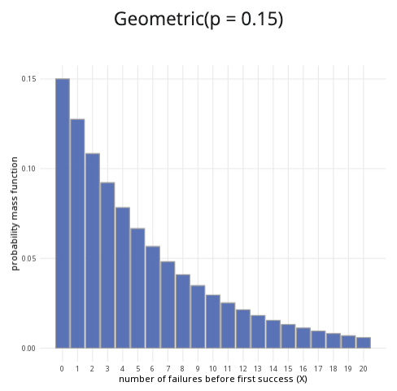

```{r, setup, include = FALSE}
library("webexercises")
```

::: {.content-visible when-format="html"}

```{=html}

<head>
  <meta charset="UTF-8">
  <meta name="viewport" content="width=device-width, initial-scale=1.0">
  <title>Geometric Distribution Calculator</title>

  <style>
    * {
      box-sizing: border-box;
    }

    body {
      margin: 0;
      padding: 1rem;
      background: #f5f6f8;
      color: #222222;
    }

    /* =========================================================
       GEOMETRIC DISTRIBUTION CALCULATOR
       ========================================================= */

    .geometric-calculator {
      width: 100%;
      max-width: 1200px;
      margin: 0 auto;
    }

    .geometric-calculator .calculator-row {
      display: grid;
      grid-template-columns: minmax(280px, 1fr) minmax(0, 2fr);
      gap: 1rem;
      align-items: stretch;
    }

    .geometric-calculator .calculator-card {
      background: #ffffff;
      border: 1px solid #dddddd;
      border-radius: 8px;
      overflow: hidden;
      box-shadow: 0 2px 6px rgba(0, 0, 0, 0.08);
      margin-bottom: 1rem;
    }

    .geometric-calculator .calculator-card-header {
      background: #3F6BB6;
      color: #ffffff;
      padding: 0.75rem 1rem;
      font-weight: 700;
      line-height: 1.4;
    }

    .geometric-calculator .calculator-card-body {
      padding: 1rem;
    }

    .geometric-calculator .form-group {
      margin-bottom: 1rem;
    }

    .geometric-calculator label {
      display: block;
      margin-bottom: 0.4rem;
      font-weight: 500;
    }

    .geometric-calculator .distribution-slider {
      width: 100%;
      margin: 0.5rem 0;
      accent-color: #3F68B6;
      cursor: pointer;
    }

    .geometric-calculator .slider-value {
      text-align: center;
      color: #3F68B6;
      font-weight: 700;
      margin-top: 0.1rem;
    }

    .geometric-calculator .distribution-note {
      padding: 0.7rem 0.8rem;
      border: 1px solid #d9e2f2;
      border-radius: 5px;
      background: #f4f7fc;
      font-size: 0.9rem;
      line-height: 1.5;
    }

    .geometric-calculator hr {
      border: 0;
      border-top: 1px solid #dddddd;
      margin: 1.2rem 0;
    }

    .geometric-calculator .probability-options {
      border: 0;
      padding: 0;
      margin: 0;
    }

    .geometric-calculator .probability-options legend {
      font-size: 1rem;
      font-weight: 500;
      margin-bottom: 0.6rem;
    }

    .geometric-calculator .radio-option {
      display: flex;
      align-items: center;
      gap: 0.45rem;
      margin-bottom: 0.55rem;
      cursor: pointer;
      font-weight: 400;
    }

    .geometric-calculator .radio-option input {
      margin: 0;
      width: 16px;
      height: 16px;
      accent-color: #3F68B6;
    }

    .geometric-calculator .conditional-input {
      margin-top: 1rem;
    }

    .geometric-calculator .conditional-input[hidden] {
      display: none;
    }

    .geometric-calculator .upper-label {
      margin-top: 1rem;
    }

    .geometric-calculator .distribution-plot-title {
      text-align: center;
      font-size: 1.1rem;
      font-weight: 600;
      margin-bottom: 1rem;
    }

    .geometric-calculator .geometric-chart-wrapper {
      position: relative;
      width: 100%;
      height: 320px;
    }

    .geometric-calculator canvas {
      width: 100% !important;
      height: 100% !important;
    }

    .geometric-calculator .calculation-result {
      font-size: 1.05rem;
      line-height: 1.6;
      text-align: center;
    }

    .geometric-calculator input:focus,
    .geometric-calculator canvas:focus {
      outline: 3px solid rgba(63, 104, 182, 0.3);
      outline-offset: 2px;
    }

    @media (max-width: 768px) {
      .geometric-calculator .calculator-row {
        grid-template-columns: 1fr;
      }

      .geometric-calculator .plot-card {
        min-width: 0;
      }

      .geometric-calculator .geometric-chart-wrapper {
        height: 280px;
      }
    }

    @media (max-width: 480px) {
      body {
        padding: 0.5rem;
      }

      .geometric-calculator .calculator-card-body {
        padding: 0.9rem;
      }

      .geometric-calculator .geometric-chart-wrapper {
        height: 250px;
      }
    }
  </style>
</head>

<body>

<div class="distribution-calculator geometric-calculator">

  <div class="calculator-row">

    <!-- PARAMETERS CARD -->
    <div class="calculator-card parameters-card">

      <div class="calculator-card-header">
        Parameters
      </div>

      <div class="calculator-card-body">

        <div class="form-group">
          <label for="geometric-p">
            Probability of success (p):
          </label>

          <input
            type="range"
            id="geometric-p"
            min="0.01"
            max="1"
            value="0.30"
            step="0.01"
            class="distribution-slider">

          <div class="slider-value" id="geometric-p-value">
            0.30
          </div>
        </div>

        <div class="distribution-note">
          X is the number of trials up to and including the first success.
          Therefore, X can take the values 1, 2, 3, ...
        </div>

        <hr>

        <fieldset class="probability-options">

          <legend>
            Probability to calculate:
          </legend>

          <label class="radio-option">
            <input
              type="radio"
              name="geometric-prob-type"
              value="less"
              checked>
            <span>P(X &le; x)</span>
          </label>

          <label class="radio-option">
            <input
              type="radio"
              name="geometric-prob-type"
              value="greater">
            <span>P(X &ge; x)</span>
          </label>

          <label class="radio-option">
            <input
              type="radio"
              name="geometric-prob-type"
              value="between">
            <span>P(a &le; X &le; b)</span>
          </label>

        </fieldset>

        <!-- SINGLE X VALUE -->
        <div id="geometric-x-container" class="conditional-input">

          <label for="geometric-x">
            x value:
          </label>

          <input
            type="range"
            id="geometric-x"
            min="1"
            max="30"
            value="4"
            step="1"
            class="distribution-slider">

          <div class="slider-value" id="geometric-x-value">
            4
          </div>

        </div>

        <!-- LOWER / UPPER VALUES -->
        <div id="geometric-between-container" class="conditional-input" hidden>

          <label for="geometric-lower">
            Lower bound (a):
          </label>

          <input
            type="range"
            id="geometric-lower"
            min="1"
            max="30"
            value="2"
            step="1"
            class="distribution-slider">

          <div class="slider-value" id="geometric-lower-value">
            2
          </div>

          <label for="geometric-upper" class="upper-label">
            Upper bound (b):
          </label>

          <input
            type="range"
            id="geometric-upper"
            min="1"
            max="30"
            value="6"
            step="1"
            class="distribution-slider">

          <div class="slider-value" id="geometric-upper-value">
            6
          </div>

        </div>

      </div>
    </div>

    <!-- PLOT CARD -->
    <div class="calculator-card plot-card">

      <div class="calculator-card-header">
        Geometric distribution plot
      </div>

      <div class="calculator-card-body">

        <div id="geometric-plot-title" class="distribution-plot-title">
          Geometric(p = 0.30)
        </div>

        <div class="geometric-chart-wrapper">
          <canvas
            id="geometric-chart"
            tabindex="0"
            role="img"
            aria-label="Geometric distribution probability mass function">
          </canvas>
        </div>

      </div>
    </div>

  </div>

  <!-- RESULTS CARD -->
  <div class="calculator-card results-card">

    <div class="calculator-card-header">
      Results
    </div>

    <div class="calculator-card-body">
      <div
        id="geometric-result"
        class="calculation-result"
        aria-live="polite">
      </div>
    </div>

  </div>

</div>

<script>
/* =========================================================
   GEOMETRIC DISTRIBUTION CALCULATOR
   X = NUMBER OF TRIALS UNTIL THE FIRST SUCCESS
   ========================================================= */

(function() {
  "use strict";

  const root = document.querySelector(".geometric-calculator");
  if (!root) return;

  const pInput = root.querySelector("#geometric-p");
  const xInput = root.querySelector("#geometric-x");
  const lowerInput = root.querySelector("#geometric-lower");
  const upperInput = root.querySelector("#geometric-upper");

  const pDisplay = root.querySelector("#geometric-p-value");
  const xDisplay = root.querySelector("#geometric-x-value");
  const lowerDisplay = root.querySelector("#geometric-lower-value");
  const upperDisplay = root.querySelector("#geometric-upper-value");

  const title = root.querySelector("#geometric-plot-title");
  const result = root.querySelector("#geometric-result");
  const xContainer = root.querySelector("#geometric-x-container");
  const betweenContainer = root.querySelector("#geometric-between-container");
  const canvas = root.querySelector("#geometric-chart");
  const ctx = canvas.getContext("2d");

  function geometricPMF(k, p) {
    if (k < 1 || !Number.isInteger(k)) return 0;
    return Math.pow(1 - p, k - 1) * p;
  }

  function geometricCDF(k, p) {
    if (k < 1) return 0;
    return 1 - Math.pow(1 - p, Math.floor(k));
  }

  function getProbabilityType() {
    const selected = root.querySelector(
      'input[name="geometric-prob-type"]:checked'
    );

    return selected ? selected.value : "less";
  }

  function updateDisplay() {
    const p = parseFloat(pInput.value);
    const x = parseInt(xInput.value, 10);
    const lower = parseInt(lowerInput.value, 10);
    const upper = parseInt(upperInput.value, 10);

    pDisplay.textContent = p.toFixed(2);
    xDisplay.textContent = x;
    lowerDisplay.textContent = lower;
    upperDisplay.textContent = upper;
    title.textContent = `Geometric(p = ${p.toFixed(2)})`;
  }

  function calculateProbability() {
    const p = parseFloat(pInput.value);
    const x = parseInt(xInput.value, 10);
    let lower = parseInt(lowerInput.value, 10);
    let upper = parseInt(upperInput.value, 10);
    const type = getProbabilityType();

    if (upper < lower) {
      upper = lower;
      upperInput.value = upper;
      upperDisplay.textContent = upper;
    }

    let probability;

    if (type === "less") {
      probability = geometricCDF(x, p);

      result.textContent =
        `P(X ≤ ${x}) = ${probability.toFixed(4)} ` +
        `or ${(probability * 100).toFixed(2)}%`;
    } else if (type === "greater") {
      probability = Math.pow(1 - p, x - 1);

      result.textContent =
        `P(X ≥ ${x}) = ${probability.toFixed(4)} ` +
        `or ${(probability * 100).toFixed(2)}%`;
    } else {
      probability =
        geometricCDF(upper, p) -
        geometricCDF(lower - 1, p);

      result.textContent =
        `P(${lower} ≤ X ≤ ${upper}) = ` +
        `${probability.toFixed(4)} or ` +
        `${(probability * 100).toFixed(2)}%`;
    }

    probability = Math.max(0, Math.min(1, probability));

    return { type, x, lower, upper, probability, p };
  }

  function getPlotMaximum(p, selected) {
    let tailLimit;

    if (p === 1) {
      tailLimit = 5;
    } else {
      tailLimit = Math.ceil(
        Math.log(0.005) / Math.log(1 - p)
      );
    }

    const selectedMaximum = selected.type === "between"
      ? selected.upper
      : selected.x;

    return Math.max(
      10,
      Math.min(50, Math.max(tailLimit, selectedMaximum + 3))
    );
  }

  function drawChart() {
    const selected = calculateProbability();
    const p = selected.p;
    const maximumK = getPlotMaximum(p, selected);
    const rect = canvas.getBoundingClientRect();

    if (!rect.width || !rect.height) return;

    const dpr = window.devicePixelRatio || 1;
    canvas.width = Math.round(rect.width * dpr);
    canvas.height = Math.round(rect.height * dpr);
    ctx.setTransform(dpr, 0, 0, dpr, 0, 0);

    const width = rect.width;
    const height = rect.height;
    const padding = { left: 58, right: 20, top: 25, bottom: 52 };
    const chartWidth = width - padding.left - padding.right;
    const chartHeight = height - padding.top - padding.bottom;
    const probabilities = [];

    ctx.clearRect(0, 0, width, height);

    for (let k = 1; k <= maximumK; k++) {
      probabilities.push(geometricPMF(k, p));
    }

    const maximumY = Math.max(...probabilities) * 1.12;

    function xScale(k) {
      return padding.left +
        ((k - 0.5) / maximumK) * chartWidth;
    }

    function yScale(value) {
      return padding.top + chartHeight -
        (value / maximumY) * chartHeight;
    }

    /* GRID AND Y LABELS */

    ctx.font = "12px Arial";
    ctx.textAlign = "right";
    ctx.textBaseline = "middle";

    for (let i = 0; i <= 4; i++) {
      const probability = (i / 4) * maximumY;
      const y = yScale(probability);

      ctx.strokeStyle = "#e5e5e5";
      ctx.lineWidth = 1;
      ctx.beginPath();
      ctx.moveTo(padding.left, y);
      ctx.lineTo(width - padding.right, y);
      ctx.stroke();

      ctx.fillStyle = "#555555";
      ctx.fillText(probability.toFixed(2), padding.left - 8, y);
    }

    /* BARS */

    const availableBarWidth = chartWidth / maximumK;
    const barWidth = Math.max(2, Math.min(34, availableBarWidth * 0.72));

    for (let k = 1; k <= maximumK; k++) {
      const probability = probabilities[k - 1];
      const barHeight = (probability / maximumY) * chartHeight;
      const x = xScale(k) - barWidth / 2;
      const y = padding.top + chartHeight - barHeight;
      let highlighted = false;

      if (selected.type === "less") {
        highlighted = k <= selected.x;
      } else if (selected.type === "greater") {
        highlighted = k >= selected.x;
      } else {
        highlighted = k >= selected.lower && k <= selected.upper;
      }

      ctx.fillStyle = highlighted ? "#3F6BB6" : "#d3d3d3";
      ctx.fillRect(x, y, barWidth, barHeight);

      ctx.strokeStyle = "#777777";
      ctx.lineWidth = 1;
      ctx.strokeRect(x, y, barWidth, barHeight);
    }

    /* AXES */

    ctx.strokeStyle = "#777777";
    ctx.lineWidth = 1;
    ctx.beginPath();
    ctx.moveTo(padding.left, padding.top);
    ctx.lineTo(padding.left, padding.top + chartHeight);
    ctx.lineTo(width - padding.right, padding.top + chartHeight);
    ctx.stroke();

    /* X-AXIS LABELS */

    ctx.fillStyle = "#333333";
    ctx.font = "12px Arial";
    ctx.textAlign = "center";
    ctx.textBaseline = "alphabetic";

    const labelInterval = maximumK <= 15
      ? 1
      : maximumK <= 30
        ? 2
        : 5;

    for (let k = 1; k <= maximumK; k++) {
      if (k === 1 || k === maximumK || k % labelInterval === 0) {
        ctx.fillText(
          k,
          xScale(k),
          padding.top + chartHeight + 20
        );
      }
    }

    ctx.font = "13px Arial";
    ctx.fillText(
      "trial of first success (X)",
      padding.left + chartWidth / 2,
      height - 8
    );

    /* Y-AXIS TITLE */

    ctx.save();
    ctx.translate(15, padding.top + chartHeight / 2);
    ctx.rotate(-Math.PI / 2);
    ctx.textAlign = "center";
    ctx.fillText("probability mass function", 0, 0);
    ctx.restore();

    canvas.setAttribute(
      "aria-label",
      `Geometric distribution probability mass function with success ` +
      `probability ${p.toFixed(2)}. The selected probability is ` +
      `${selected.probability.toFixed(4)}.`
    );
  }

  function updateVisibility() {
    const type = getProbabilityType();
    xContainer.hidden = type === "between";
    betweenContainer.hidden = type !== "between";
  }

  function update() {
    updateVisibility();
    updateDisplay();
    drawChart();
  }

  pInput.addEventListener("input", update);
  xInput.addEventListener("input", update);

  lowerInput.addEventListener("input", function() {
    if (parseInt(lowerInput.value, 10) > parseInt(upperInput.value, 10)) {
      upperInput.value = lowerInput.value;
    }
    update();
  });

  upperInput.addEventListener("input", function() {
    if (parseInt(upperInput.value, 10) < parseInt(lowerInput.value, 10)) {
      lowerInput.value = upperInput.value;
    }
    update();
  });

  root.querySelectorAll('input[name="geometric-prob-type"]').forEach(
    function(radio) {
      radio.addEventListener("change", update);
    }
  );

  let resizeTimer;

  window.addEventListener("resize", function() {
    window.clearTimeout(resizeTimer);
    resizeTimer = window.setTimeout(drawChart, 80);
  });

  update();
})();
</script>

</body>


```

:::

::: {.content-hidden when-format="html"}

{width="80%"}

:::

**Where to use:** The geometric distribution is used to count $X$, the number of Bernoulli trials until a successful outcome is reached.

**Notation:** $X \sim \textrm{Geometric}(p)$

**Parameter:** $p$ is the real number representing the probability of success in a single trial (where $0 \le p \le 1$).

| Quantity | Value | Notes |
|:--------|:----------------------------|:-------------------|
| **Mean** | $\mathbb{E}(X) = \dfrac{1}{p}$ |  |
| **Variance** | $\mathbb{V}(X) = \dfrac{1-p}{p^2}$ |  |
| **PMF** | $\mathbb{P}(X=x)=(1-p)^{k-1}p$ |  |
| **CDF** | $\displaystyle\mathbb{P}(X\leq x)=\begin{cases} 1-(1-p)^x & \textsf{if } x\geq0 \\0 & \textsf{if } x<0\end{cases}$ |  |

**Example:** You flip a coin multiple times, and the probability of getting ‘heads’ is $0.5$. You decide to stop flipping the coin once you get a ‘heads’. Taking ‘heads’ as a success, this can be expressed as $X \sim \textrm{Geometric}(0.5)$. It means the probability of success is $0.5$, and you will stop conducting trials after you reach a success.


# Further reading {-}

[This interactive element appears in Overview: Probability distributions. Please click this link to go to the guide.](../overviews/o-distributions.qmd)

## Version history {-}

v1.0: initial version created 04/25 by tdhc and Michelle Arnetta as part of a University of St Andrews VIP project.

- v1.1: moved to factsheet form and populated with material from [Overview: Probability distributions](../overviews/o-distributions.qmd) by tdhc.

- v1.2: deprecated shinylive apps replaced 09/26 by tdhc.
  
[This work is licensed under CC BY-NC-SA 4.0.](https://creativecommons.org/licenses/by-nc-sa/4.0/?ref=chooser-v1)


