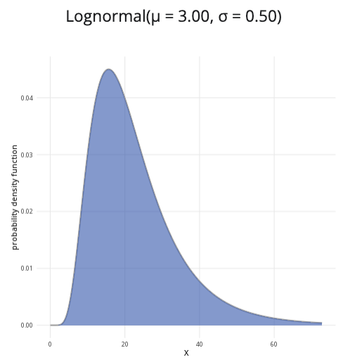

```{r, setup, include = FALSE}
library("webexercises")
```

::: {.content-visible when-format="html"}

```{=html}

<head>
  <meta charset="UTF-8">
  <meta name="viewport" content="width=device-width, initial-scale=1.0">
  <title>Lognormal Distribution Calculator</title>
  <style>
    * { box-sizing: border-box; }
    body {
      margin: 0;
      padding: 1rem;
      background: #f5f6f8;
      color: #222;
    }
    .lognormal-calculator { width: 100%; max-width: 1200px; margin: 0 auto; }
    .lognormal-calculator .calculator-row {
      display: grid;
      grid-template-columns: minmax(280px, 1fr) minmax(0, 2fr);
      gap: 1rem;
      align-items: stretch;
    }
    .lognormal-calculator .calculator-card {
      background: #fff;
      border: 1px solid #ddd;
      border-radius: 8px;
      overflow: hidden;
      box-shadow: 0 2px 6px rgba(0,0,0,0.08);
      margin-bottom: 1rem;
    }
    .lognormal-calculator .calculator-card-header {
      background: #3F6BB6;
      color: #fff;
      padding: 0.75rem 1rem;
      font-weight: 700;
      line-height: 1.4;
    }
    .lognormal-calculator .calculator-card-body { padding: 1rem; }
    .lognormal-calculator .form-group { margin-bottom: 1rem; }
    .lognormal-calculator label { display: block; margin-bottom: 0.4rem; font-weight: 500; }
    .lognormal-calculator .distribution-slider {
      width: 100%; margin: 0.5rem 0; accent-color: #3F68B6; cursor: pointer;
    }
    .lognormal-calculator .slider-value {
      text-align: center; color: #3F68B6; font-weight: 700; margin-top: 0.1rem;
    }
    .lognormal-calculator hr {
      border: 0; border-top: 1px solid #ddd; margin: 1.2rem 0;
    }
    .lognormal-calculator .probability-options { border: 0; padding: 0; margin: 0; }
    .lognormal-calculator .probability-options legend {
      font-size: 1rem; font-weight: 500; margin-bottom: 0.6rem;
    }
    .lognormal-calculator .radio-option {
      display: flex; align-items: center; gap: 0.45rem; margin-bottom: 0.55rem;
      cursor: pointer; font-weight: 400;
    }
    .lognormal-calculator .radio-option input {
      margin: 0; width: 16px; height: 16px; accent-color: #3F68B6;
    }
    .lognormal-calculator .conditional-input { margin-top: 1rem; }
    .lognormal-calculator .conditional-input[hidden] { display: none; }
    .lognormal-calculator .upper-label { margin-top: 1rem; }
    .lognormal-calculator .distribution-plot-title {
      text-align: center; font-size: 1.1rem; font-weight: 600; margin-bottom: 1rem;
    }
    .lognormal-calculator .lognormal-chart-wrapper {
      position: relative; width: 100%; height: 320px;
    }
    .lognormal-calculator canvas { width: 100% !important; height: 100% !important; }
    .lognormal-calculator .calculation-result {
      font-size: 1.05rem; line-height: 1.6; text-align: center;
    }
    .lognormal-calculator input:focus,
    .lognormal-calculator canvas:focus {
      outline: 3px solid rgba(63,104,182,0.3); outline-offset: 2px;
    }
    @media (max-width: 768px) {
      .lognormal-calculator .calculator-row { grid-template-columns: 1fr; }
      .lognormal-calculator .plot-card { min-width: 0; }
      .lognormal-calculator .lognormal-chart-wrapper { height: 280px; }
    }
    @media (max-width: 480px) {
      body { padding: 0.5rem; }
      .lognormal-calculator .calculator-card-body { padding: 0.9rem; }
      .lognormal-calculator .lognormal-chart-wrapper { height: 250px; }
    }
  </style>
</head>
<body>
<div class="distribution-calculator lognormal-calculator">
  <div class="calculator-row">
    <div class="calculator-card parameters-card">
      <div class="calculator-card-header">Parameters</div>
      <div class="calculator-card-body">
        <div class="form-group">
          <label for="lognormal-mu">Location parameter (&mu;):</label>
          <input type="range" id="lognormal-mu" min="-2" max="2" value="0" step="0.1" class="distribution-slider">
          <div class="slider-value" id="lognormal-mu-value">0.0</div>
        </div>
        <div class="form-group">
          <label for="lognormal-sigma">Scale parameter (&sigma;):</label>
          <input type="range" id="lognormal-sigma" min="0.1" max="1.5" value="0.5" step="0.1" class="distribution-slider">
          <div class="slider-value" id="lognormal-sigma-value">0.5</div>
        </div>
        <hr>
        <fieldset class="probability-options">
          <legend>Probability to calculate:</legend>
          <label class="radio-option"><input type="radio" name="lognormal-prob-type" value="less" checked><span>P(X &le; x)</span></label>
          <label class="radio-option"><input type="radio" name="lognormal-prob-type" value="greater"><span>P(X &ge; x)</span></label>
          <label class="radio-option"><input type="radio" name="lognormal-prob-type" value="between"><span>P(a &le; X &le; b)</span></label>
        </fieldset>
        <div id="lognormal-x-container" class="conditional-input">
          <label for="lognormal-x">x value:</label>
          <input type="range" id="lognormal-x" min="0" max="15" value="2" step="0.1" class="distribution-slider">
          <div class="slider-value" id="lognormal-x-value">2.0</div>
        </div>
        <div id="lognormal-between-container" class="conditional-input" hidden>
          <label for="lognormal-lower">Lower bound (a):</label>
          <input type="range" id="lognormal-lower" min="0" max="15" value="0.5" step="0.1" class="distribution-slider">
          <div class="slider-value" id="lognormal-lower-value">0.5</div>
          <label for="lognormal-upper" class="upper-label">Upper bound (b):</label>
          <input type="range" id="lognormal-upper" min="0" max="15" value="2" step="0.1" class="distribution-slider">
          <div class="slider-value" id="lognormal-upper-value">2.0</div>
        </div>
      </div>
    </div>
    <div class="calculator-card plot-card">
      <div class="calculator-card-header">Lognormal distribution plot</div>
      <div class="calculator-card-body">
        <div id="lognormal-plot-title" class="distribution-plot-title">Lognormal(&mu; = 0.0, &sigma; = 0.5)</div>
        <div class="lognormal-chart-wrapper">
          <canvas id="lognormal-chart" tabindex="0" role="img" aria-label="Lognormal distribution probability density function"></canvas>
        </div>
      </div>
    </div>
  </div>
  <div class="calculator-card results-card">
    <div class="calculator-card-header">Results</div>
    <div class="calculator-card-body">
      <div id="lognormal-result" class="calculation-result" aria-live="polite"></div>
    </div>
  </div>
</div>
<script>
(function() {
  "use strict";
  const root = document.querySelector(".lognormal-calculator");
  if (!root) return;
  const q = s => root.querySelector(s);
  const muInput=q("#lognormal-mu"), sigmaInput=q("#lognormal-sigma"), xInput=q("#lognormal-x");
  const lowerInput=q("#lognormal-lower"), upperInput=q("#lognormal-upper");
  const muDisplay=q("#lognormal-mu-value"), sigmaDisplay=q("#lognormal-sigma-value");
  const xDisplay=q("#lognormal-x-value"), lowerDisplay=q("#lognormal-lower-value"), upperDisplay=q("#lognormal-upper-value");
  const title=q("#lognormal-plot-title"), result=q("#lognormal-result");
  const xContainer=q("#lognormal-x-container"), betweenContainer=q("#lognormal-between-container");
  const canvas=q("#lognormal-chart"), ctx=canvas.getContext("2d");

  function erf(v) {
    const sign=v<0?-1:1, z=Math.abs(v), t=1/(1+0.3275911*z);
    const y=1-(((((1.061405429*t-1.453152027)*t+1.421413741)*t-0.284496736)*t+0.254829592)*t)*Math.exp(-z*z);
    return sign*y;
  }
  function normalCDF(z) { return 0.5*(1+erf(z/Math.sqrt(2))); }
  function pdf(v,mu,sigma) {
    if(v<=0||sigma<=0) return 0;
    return Math.exp(-Math.pow(Math.log(v)-mu,2)/(2*sigma*sigma))/(v*sigma*Math.sqrt(2*Math.PI));
  }
  function cdf(v,mu,sigma) { return v<=0?0:normalCDF((Math.log(v)-mu)/sigma); }
  function type() { const e=q('input[name="lognormal-prob-type"]:checked'); return e?e.value:"less"; }

  function display() {
    const mu=+muInput.value, sigma=+sigmaInput.value;
    muDisplay.textContent=mu.toFixed(1); sigmaDisplay.textContent=sigma.toFixed(1);
    xDisplay.textContent=(+xInput.value).toFixed(1);
    lowerDisplay.textContent=(+lowerInput.value).toFixed(1);
    upperDisplay.textContent=(+upperInput.value).toFixed(1);
    title.textContent=`Lognormal(μ = ${mu.toFixed(1)}, σ = ${sigma.toFixed(1)})`;
  }

  function calculate() {
    const mu=+muInput.value, sigma=+sigmaInput.value, x=+xInput.value;
    let lower=+lowerInput.value, upper=+upperInput.value;
    const t=type();
    if(upper<lower){ upper=lower; upperInput.value=upper.toFixed(1); }
    let probability;
    if(t==="less") {
      probability=cdf(x,mu,sigma);
      result.textContent=`P(X ≤ ${x.toFixed(1)}) = ${probability.toFixed(4)} or ${(probability*100).toFixed(2)}%`;
    } else if(t==="greater") {
      probability=1-cdf(x,mu,sigma);
      result.textContent=`P(X ≥ ${x.toFixed(1)}) = ${probability.toFixed(4)} or ${(probability*100).toFixed(2)}%`;
    } else {
      probability=cdf(upper,mu,sigma)-cdf(lower,mu,sigma);
      result.textContent=`P(${lower.toFixed(1)} ≤ X ≤ ${upper.toFixed(1)}) = ${probability.toFixed(4)} or ${(probability*100).toFixed(2)}%`;
    }
    return {type:t,x,lower,upper,probability};
  }

  function draw() {
    const mu=+muInput.value, sigma=+sigmaInput.value, selected=calculate();
    const rect=canvas.getBoundingClientRect(); if(!rect.width||!rect.height) return;
    const dpr=window.devicePixelRatio||1;
    canvas.width=Math.round(rect.width*dpr); canvas.height=Math.round(rect.height*dpr);
    ctx.setTransform(dpr,0,0,dpr,0,0);
    const width=rect.width,height=rect.height,pad={left:62,right:20,top:25,bottom:50};
    const cw=width-pad.left-pad.right,ch=height-pad.top-pad.bottom;
    ctx.clearRect(0,0,width,height);
    const chosenMax=selected.type==="between"?selected.upper:selected.x;
    const maxX=Math.max(2,chosenMax*1.2,Math.exp(mu+3.1*sigma));
    const points=Math.max(500,Math.round(cw*1.5)), start=Math.max(maxX/points/4,0.0001);
    let maxY=0;
    for(let i=0;i<=points;i++){const v=start+(i/points)*(maxX-start);maxY=Math.max(maxY,pdf(v,mu,sigma));}
    maxY=Math.max(maxY*1.1,0.01);
    const xs=v=>pad.left+(v/maxX)*cw, ys=v=>pad.top+ch-(v/maxY)*ch;

    ctx.font="12px Arial";ctx.textAlign="right";ctx.textBaseline="middle";
    for(let i=0;i<=4;i++){
      const d=(i/4)*maxY,y=ys(d);ctx.strokeStyle="#e5e5e5";ctx.lineWidth=1;
      ctx.beginPath();ctx.moveTo(pad.left,y);ctx.lineTo(width-pad.right,y);ctx.stroke();
      ctx.fillStyle="#555";ctx.fillText(d.toFixed(2),pad.left-8,y);
    }
    function fillArea(a,b,colour){
      a=Math.max(0,Math.min(maxX,a));b=Math.max(0,Math.min(maxX,b));if(b<=a)return;
      const count=Math.max(2,Math.round(points*(b-a)/maxX));ctx.beginPath();ctx.moveTo(xs(a),ys(0));
      for(let i=0;i<=count;i++){const v=a+(i/count)*(b-a);ctx.lineTo(xs(v),ys(pdf(v,mu,sigma)));}
      ctx.lineTo(xs(b),ys(0));ctx.closePath();ctx.fillStyle=colour;ctx.fill();
    }
    fillArea(0,maxX,"rgba(211,211,211,0.55)");
    if(selected.type==="less")fillArea(0,selected.x,"rgba(63,107,182,0.58)");
    else if(selected.type==="greater")fillArea(selected.x,maxX,"rgba(63,107,182,0.58)");
    else fillArea(selected.lower,selected.upper,"rgba(63,107,182,0.58)");

    ctx.beginPath();
    for(let i=0;i<=points;i++){const v=start+(i/points)*(maxX-start),px=xs(v),py=ys(pdf(v,mu,sigma));i?ctx.lineTo(px,py):ctx.moveTo(px,py);}
    ctx.strokeStyle="#274f91";ctx.lineWidth=2.5;ctx.stroke();
    function boundary(v){if(v<0||v>maxX)return;ctx.save();ctx.setLineDash([5,4]);ctx.strokeStyle="#274f91";ctx.lineWidth=1.5;ctx.beginPath();ctx.moveTo(xs(v),ys(0));ctx.lineTo(xs(v),ys(pdf(v,mu,sigma)));ctx.stroke();ctx.restore();}
    selected.type==="between"?(boundary(selected.lower),boundary(selected.upper)):boundary(selected.x);

    ctx.strokeStyle="#777";ctx.lineWidth=1;ctx.beginPath();ctx.moveTo(pad.left,pad.top);ctx.lineTo(pad.left,pad.top+ch);ctx.lineTo(width-pad.right,pad.top+ch);ctx.stroke();
    ctx.fillStyle="#333";ctx.font="12px Arial";ctx.textAlign="center";ctx.textBaseline="alphabetic";
    const ticks=width<500?5:8;
    for(let i=0;i<=ticks;i++){const v=(i/ticks)*maxX;ctx.fillText(v.toFixed(1),xs(v),pad.top+ch+20);}
    ctx.font="13px Arial";ctx.fillText("value of X",pad.left+cw/2,height-8);
    ctx.save();ctx.translate(15,pad.top+ch/2);ctx.rotate(-Math.PI/2);ctx.textAlign="center";ctx.fillText("probability density",0,0);ctx.restore();
    canvas.setAttribute("aria-label",`Lognormal density plot. Selected probability ${selected.probability.toFixed(4)}.`);
  }

  function update(){const t=type();xContainer.hidden=t==="between";betweenContainer.hidden=t!=="between";display();draw();}
  [muInput,sigmaInput,xInput].forEach(e=>e.addEventListener("input",update));
  lowerInput.addEventListener("input",()=>{if(+lowerInput.value>+upperInput.value)upperInput.value=lowerInput.value;update();});
  upperInput.addEventListener("input",()=>{if(+upperInput.value<+lowerInput.value)lowerInput.value=upperInput.value;update();});
  root.querySelectorAll('input[name="lognormal-prob-type"]').forEach(e=>e.addEventListener("change",update));
  let timer;window.addEventListener("resize",()=>{clearTimeout(timer);timer=setTimeout(draw,80);});
  update();
})();
</script>
</body>
</html>

```


:::

::: {.content-hidden when-format="html"}

{width="80%"}

:::


**Where to use:** The lognormal distribution is used to model continuous random variables with values that are both real and non-negative, wherein the logarithms of these variables follow a normal distribution. That is to say, if the random variable $X$ is lognormally distributed, then the random variable $Y = \ln(X)$ is normally distributed (where $\ln$ is the natural logarithm).

**Notation:** $X \sim \textrm{Lognormal}(\mu,\sigma^2)$

**Parameters:** As with the normal distribution, two numbers $\mu$ and $\sigma^2$ where:

-   $\mu$ is the expected value of the normally distributed random variable $Y = \ln(X)$,
-   $\sigma^2$ is the variance of the normally distributed random variable $Y = \ln(X)$.

| Quantity | Value | Notes |
|:--------|:----------------------------|:-------------------|
| **Mean** | $\mathbb{E}(X) = \exp(\mu+\frac{\sigma^2}{2})$ | $\exp(y) = e^y$ |
| **Variance** | $\mathbb{V}(X) = [\exp(\sigma^2)-1]\exp(2\mu+\sigma^2)$ | $\exp(y) = e^y$ |
| **PDF** | $\mathbb{P}(X=x)=\dfrac{1}{x\sigma\sqrt{2\pi}}\exp\left(-\dfrac{(\ln(x)-\mu)^2}{2\sigma^2}\right)$ | $\exp(y) = e^y$ |
| **CDF** | $\displaystyle\mathbb{P}(X\leq x)=\dfrac{1}{2}\left[1+\textrm{erf}\left(\dfrac{\ln(x)-\mu}{\sigma\sqrt{2}}\right)\right]$ | $\textrm{erf}(x)$ is the error function of $x$ |

**Example:** The logarithms of Cantor’s Confectionery’s stock prices follow a normal distribution. The mean of the stock prices’ natural logarithms is $8.01$, whereas the variance of the stock prices’ natural logarithms is $3$. This can be expressed as $X \sim \textrm{Lognormal}(8.01, 3)$, meaning the logarithm of the location parameter is $8.01$ and the logarithm of scale parameter is $3$.

# Further reading {-}

[This interactive element appears in Overview: Probability distributions. Please click this link to go to the guide.](../overviews/o-distributions.qmd)

## Version history {-}

v1.0: initial version created 04/25 by tdhc and Michelle Arnetta as part of a University of St Andrews VIP project.

- v1.1: moved to factsheet form and populated with material from [Overview: Probability distributions](../overviews/o-distributions.qmd) by tdhc.

- v1.2: deprecated shinylive apps replaced 09/26 by tdhc.
  
[This work is licensed under CC BY-NC-SA 4.0.](https://creativecommons.org/licenses/by-nc-sa/4.0/?ref=chooser-v1)


