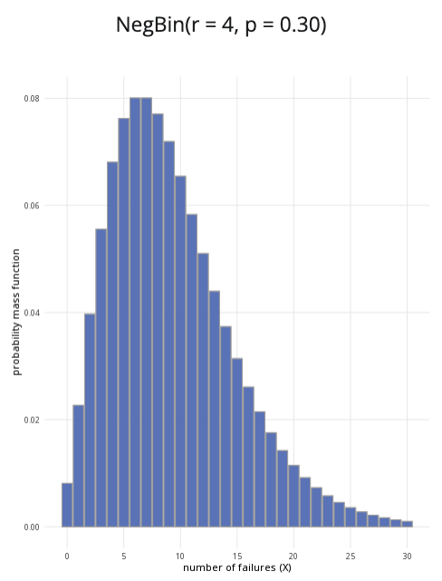

```{r, setup, include = FALSE}
library("webexercises")
```

::: {.content-visible when-format="html"}

```{=html}

<!DOCTYPE html>
<html lang="en">
<head>
<meta charset="UTF-8">
<meta name="viewport" content="width=device-width, initial-scale=1.0">

<title>Negative Binomial Distribution Calculator</title>

<style>

/* =========================================================
   GENERAL PAGE
   ========================================================= */

body {
  margin: 0;
  padding: 20px;
  background: #f5f5f5;
  color: #222;
}

.calculator-container {
  max-width: 1200px;
  margin: 0 auto;
}


/* =========================================================
   CARDS
   ========================================================= */

.card {
  background: white;
  border-radius: 10px;
  box-shadow: 0 2px 8px rgba(0,0,0,0.08);
  overflow: hidden;
  margin-bottom: 20px;
}

.card-header {
  background: #3F68B6;
  color: white;
  padding: 13px 18px;
  font-size: 18px;
  font-weight: 700;
}

.card-body {
  padding: 20px;
}


/* =========================================================
   TOP ROW
   ========================================================= */

.top-row {
  display: grid;
  grid-template-columns: minmax(280px, 1fr) minmax(450px, 2fr);
  gap: 20px;
  align-items: stretch;
}


/* =========================================================
   INPUTS
   ========================================================= */

.input-group {
  margin-bottom: 18px;
}

.input-group label {
  display: block;
  font-weight: 600;
  margin-bottom: 7px;
}

.number-input {
  width: 100%;
  box-sizing: border-box;
  padding: 9px 10px;
  border: 1px solid #ccc;
  border-radius: 5px;
  font-size: 15px;
}

.number-input:focus {
  outline: none;
  border-color: #3F68B6;
  box-shadow: 0 0 0 2px rgba(63,104,182,0.15);
}


/* =========================================================
   SLIDERS
   ========================================================= */

.slider-group {
  margin-bottom: 20px;
}

.slider-group label {
  display: block;
  font-weight: 600;
  margin-bottom: 8px;
}

.slider-value {
  font-weight: 700;
  color: #3F68B6;
}

input[type="range"] {
  width: 100%;
  accent-color: #3F68B6;
  cursor: pointer;
}

input[type="range"]:focus {
  outline: 2px solid rgba(63,104,182,0.3);
  outline-offset: 3px;
}


/* =========================================================
   RADIO BUTTONS
   ========================================================= */

.radio-group {
  margin-top: 10px;
}

.radio-option {
  display: flex;
  align-items: center;
  gap: 8px;
  margin: 10px 0;
  cursor: pointer;
}

.radio-option input {
  accent-color: #3F68B6;
  width: 17px;
  height: 17px;
}


/* =========================================================
   DIVIDER / HELP TEXT
   ========================================================= */

hr {
  border: none;
  border-top: 1px solid #ddd;
  margin: 20px 0;
}

.help-text {
  font-size: 14px;
  line-height: 1.5;
  color: #666;
}


/* =========================================================
   PLOT
   ========================================================= */

.plot-title {
  text-align: center;
  font-size: 18px;
  font-weight: 600;
  margin-bottom: 10px;
  color: #333;
}

#plot {
  width: 100%;
  height: 360px;
  display: block;
}


/* =========================================================
   RESULTS
   ========================================================= */

.result {
  font-size: 19px;
  text-align: center;
  padding: 10px 5px;
  line-height: 1.6;
}

.result-main {
  font-weight: 500;
}

.result-probability {
  color: black;
  font-weight: 500;
}


/* =========================================================
   RESPONSIVE
   ========================================================= */

@media (max-width: 850px) {

  body {
    padding: 10px;
  }

  .top-row {
    grid-template-columns: 1fr;
  }

  .card-body {
    padding: 16px;
  }

  #plot {
    height: 320px;
  }
}

@media (max-width: 500px) {

  .card-header {
    font-size: 16px;
  }

  .result {
    font-size: 16px;
  }

  #plot {
    height: 280px;
  }
}

</style>
</head>


<body>

<div class="calculator-container">

  <!-- =====================================================
       TOP ROW
       ===================================================== -->

  <div class="top-row">

    <!-- PARAMETERS CARD -->

    <div class="card">

      <div class="card-header">
        Parameters
      </div>

      <div class="card-body">

        <div class="input-group">

          <label for="rInput">
            Number of successes required (r):
          </label>

          <input
            type="number"
            id="rInput"
            class="number-input"
            value="5"
            min="1"
            step="1"
          >

        </div>


        <div class="slider-group">

          <label for="pInput">
            Probability of success (p):
            <span class="slider-value" id="pValue">0.50</span>
          </label>

          <input
            type="range"
            id="pInput"
            min="0.01"
            max="0.99"
            value="0.50"
            step="0.01"
          >

        </div>


        <hr>


        <div>

          <strong>Probability to calculate:</strong>

          <div class="radio-group">

            <label class="radio-option">
              <input
                type="radio"
                name="probType"
                value="less"
                checked
              >
              P(X ≤ x)
            </label>


            <label class="radio-option">
              <input
                type="radio"
                name="probType"
                value="greater"
              >
              P(X ≥ x)
            </label>


            <label class="radio-option">
              <input
                type="radio"
                name="probType"
                value="between"
              >
              P(x ≤ X ≤ y)
            </label>

          </div>

        </div>


        <!-- SINGLE X -->

        <div
          id="singleX"
          class="slider-group"
        >

          <label for="xInput">
            x value:
            <span
              class="slider-value"
              id="xValue"
            >5</span>
          </label>

          <input
            type="range"
            id="xInput"
            min="0"
            max="30"
            value="5"
            step="1"
          >

        </div>


        <!-- BETWEEN -->

        <div
          id="betweenInputs"
          style="display:none;"
        >

          <div class="slider-group">

            <label for="lowerInput">
              Lower bound (x):
              <span
                class="slider-value"
                id="lowerValue"
              >2</span>
            </label>

            <input
              type="range"
              id="lowerInput"
              min="0"
              max="30"
              value="2"
              step="1"
            >

          </div>


          <div class="slider-group">

            <label for="upperInput">
              Upper bound (y):
              <span
                class="slider-value"
                id="upperValue"
              >7</span>
            </label>

            <input
              type="range"
              id="upperInput"
              min="0"
              max="30"
              value="7"
              step="1"
            >

          </div>

        </div>


        <div class="help-text">

          The negative binomial distribution models the number of
          failures observed before achieving a specified number of
          successes.

        </div>

      </div>

    </div>


    <!-- PLOT CARD -->

    <div class="card">

      <div class="card-header">
        Negative binomial distribution plot
      </div>

      <div class="card-body">

        <div
          class="plot-title"
          id="plotTitle"
        >
          NegBin(r = 5, p = 0.50)
        </div>

        <canvas id="plot"></canvas>

      </div>

    </div>

  </div>


  <!-- =====================================================
       RESULTS CARD
       ===================================================== -->

  <div class="card">

    <div class="card-header">
      Results
    </div>

    <div class="card-body">

      <div
        class="result"
        id="result"
      >
      </div>

    </div>

  </div>

</div>


<script>

/* =========================================================
   ELEMENTS
   ========================================================= */

const rInput = document.getElementById("rInput");
const pInput = document.getElementById("pInput");

const xInput = document.getElementById("xInput");
const lowerInput = document.getElementById("lowerInput");
const upperInput = document.getElementById("upperInput");

const pValue = document.getElementById("pValue");

const xValue = document.getElementById("xValue");
const lowerValue = document.getElementById("lowerValue");
const upperValue = document.getElementById("upperValue");

const singleX = document.getElementById("singleX");
const betweenInputs = document.getElementById("betweenInputs");

const plotTitle = document.getElementById("plotTitle");
const result = document.getElementById("result");

const canvas = document.getElementById("plot");
const ctx = canvas.getContext("2d");


/* =========================================================
   NEGATIVE BINOMIAL PROBABILITY MASS FUNCTION
   =========================================================

   X = number of failures before r successes

   P(X=x) =
   choose(x+r-1, x) * p^r * (1-p)^x

   We calculate this using logarithms to avoid numerical
   overflow for larger values.
   ========================================================= */

function logGamma(z) {

  const coefficients = [
    676.5203681218851,
    -1259.1392167224028,
    771.32342877765313,
    -176.61502916214059,
    12.507343278686905,
    -0.13857109526572012,
    9.9843695780195716e-6,
    1.5056327351493116e-7
  ];

  if (z < 0.5) {

    return Math.log(Math.PI)
      - Math.log(Math.sin(Math.PI * z))
      - logGamma(1 - z);

  }

  z -= 1;

  let x = 0.99999999999980993;

  for (let i = 0; i < coefficients.length; i++) {
    x += coefficients[i] / (z + i + 1);
  }

  const t = z + coefficients.length - 0.5;

  return (
    0.5 * Math.log(2 * Math.PI)
    + (z + 0.5) * Math.log(t)
    - t
    + Math.log(x)
  );
}


function logChoose(n, k) {

  if (k < 0 || k > n) {
    return -Infinity;
  }

  return (
    logGamma(n + 1)
    - logGamma(k + 1)
    - logGamma(n - k + 1)
  );

}


function negBinPMF(x, r, p) {

  if (x < 0 || !Number.isInteger(x)) {
    return 0;
  }

  const logProb =
    logChoose(x + r - 1, x)
    + r * Math.log(p)
    + x * Math.log(1 - p);

  return Math.exp(logProb);

}


/* =========================================================
   DISTRIBUTION RANGE
   ========================================================= */

function getMaxX(r, p) {

  /*
   * Choose a useful plotting range.

   * Mean = r(1-p)/p
   * SD   = sqrt(r(1-p))/p

   We show approximately mean + 4 SD,
   with sensible minimum and maximum limits.
  */

  const mean = r * (1 - p) / p;
  const sd = Math.sqrt(r * (1 - p)) / p;

  let maxX = Math.ceil(mean + 4 * sd);

  maxX = Math.max(maxX, 10);
  maxX = Math.min(maxX, 100);

  return maxX;
}


/* =========================================================
   UPDATE X/Y SLIDER RANGES
   ========================================================= */

function updateSliderRanges() {

  const r = Math.max(
    1,
    Math.round(Number(rInput.value))
  );

  const p = Number(pInput.value);

  const maxX = getMaxX(r, p);

  xInput.max = maxX;
  lowerInput.max = maxX;
  upperInput.max = maxX;

  /*
   * Keep existing values inside the new range.
   */

  if (Number(xInput.value) > maxX) {
    xInput.value = maxX;
  }

  if (Number(lowerInput.value) > maxX) {
    lowerInput.value = maxX;
  }

  if (Number(upperInput.value) > maxX) {
    upperInput.value = maxX;
  }

}


/* =========================================================
   CUMULATIVE PROBABILITY
   ========================================================= */

function cumulativeProbability(x, r, p) {

  if (x < 0) {
    return 0;
  }

  let sum = 0;

  for (let i = 0; i <= x; i++) {

    sum += negBinPMF(i, r, p);

  }

  return Math.min(1, Math.max(0, sum));

}


/* =========================================================
   GET CURRENT PROBABILITY
   ========================================================= */

function calculateProbability() {

  const r = Math.max(
    1,
    Math.round(Number(rInput.value))
  );

  const p = Number(pInput.value);

  const type =
    document.querySelector(
      'input[name="probType"]:checked'
    ).value;


  if (type === "less") {

    const x = Math.round(Number(xInput.value));

    const prob =
      cumulativeProbability(x, r, p);

    return {
      probability: prob,
      type: type,
      x: x
    };

  }


  if (type === "greater") {

    const x = Math.round(Number(xInput.value));

    /*
     * P(X >= x)
     *
     * = 1 - P(X <= x-1)
     */

    let prob;

    if (x === 0) {
      prob = 1;
    } else {
      prob =
        1 -
        cumulativeProbability(x - 1, r, p);
    }

    return {
      probability: prob,
      type: type,
      x: x
    };

  }


  if (type === "between") {

    let lower =
      Math.round(Number(lowerInput.value));

    let upper =
      Math.round(Number(upperInput.value));

    if (upper < lower) {
      upper = lower;
      upperInput.value = upper;
    }

    /*
     * P(lower <= X <= upper)
     */

    const upperProb =
      cumulativeProbability(upper, r, p);

    const lowerProb =
      lower === 0
        ? 0
        : cumulativeProbability(lower - 1, r, p);

    const prob =
      upperProb - lowerProb;

    return {
      probability: prob,
      type: type,
      lower: lower,
      upper: upper
    };

  }

}


/* =========================================================
   UPDATE RESULT
   ========================================================= */

function updateResult() {

  const r =
    Math.max(
      1,
      Math.round(Number(rInput.value))
    );

  const p =
    Number(pInput.value);

  const res =
    calculateProbability();

  const prob =
    res.probability;


  if (res.type === "less") {

    result.innerHTML =
      `<span class="result-main">
        P(X ≤ ${res.x}) =
      </span>
      <span class="result-probability">
        ${prob.toFixed(6)}
      </span>
      or ${(
        prob * 100
      ).toFixed(4)}%`;

  }


  else if (res.type === "greater") {

    result.innerHTML =
      `<span class="result-main">
        P(X ≥ ${res.x}) =
      </span>
      <span class="result-probability">
        ${prob.toFixed(6)}
      </span>
      <br>
      or ${(
        prob * 100
      ).toFixed(4)}%`;

  }


  else {

    result.innerHTML =
      `<span class="result-main">
        P(${res.lower} ≤ X ≤ ${res.upper}) =
      </span>
      <span class="result-probability">
        ${prob.toFixed(6)}
      </span>
      <br>
      or ${(
        prob * 100
      ).toFixed(4)}%`;

  }

}


/* =========================================================
   DRAW PLOT
   ========================================================= */

function drawPlot() {

  const r =
    Math.max(
      1,
      Math.round(Number(rInput.value))
    );

  const p =
    Number(pInput.value);

  const maxX =
    getMaxX(r, p);

  const res =
    calculateProbability();


  /*
   * Canvas sizing
   */

  const rect =
    canvas.getBoundingClientRect();

  const dpr =
    window.devicePixelRatio || 1;

  canvas.width =
    rect.width * dpr;

  canvas.height =
    rect.height * dpr;

  ctx.setTransform(
    dpr,
    0,
    0,
    dpr,
    0,
    0
  );


  const width =
    rect.width;

  const height =
    rect.height;


  /*
   * Plot margins
   */

  const margin = {
    left: 55,
    right: 20,
    top: 25,
    bottom: 50
  };


  const plotWidth =
    width -
    margin.left -
    margin.right;

  const plotHeight =
    height -
    margin.top -
    margin.bottom;


  /*
   * Clear
   */

  ctx.clearRect(
    0,
    0,
    width,
    height
  );


  /*
   * Distribution
   */

  const values = [];

  let maxProb = 0;

  for (let x = 0; x <= maxX; x++) {

    const prob =
      negBinPMF(x, r, p);

    values.push(prob);

    maxProb =
      Math.max(
        maxProb,
        prob
      );

  }


  /*
   * Scales
   */

  function xScale(x) {

    return (
      margin.left +
      (x / maxX) *
      plotWidth
    );

  }


  function yScale(y) {

    return (
      margin.top +
      plotHeight -
      (y / maxProb) *
      plotHeight *
      0.9
    );

  }


  /*
   * Axes
   */

  ctx.strokeStyle = "#888";
  ctx.lineWidth = 1;

  ctx.beginPath();

  ctx.moveTo(
    margin.left,
    margin.top
  );

  ctx.lineTo(
    margin.left,
    margin.top + plotHeight
  );

  ctx.lineTo(
    margin.left + plotWidth,
    margin.top + plotHeight
  );

  ctx.stroke();


  /*
   * Bars
   */

  const barWidth =
    Math.max(
      2,
      (plotWidth / (maxX + 1)) * 0.72
    );


  values.forEach(
    (prob, x) => {

      const barX =
        xScale(x) -
        barWidth / 2;

      const barY =
        yScale(prob);

      const barHeight =
        margin.top +
        plotHeight -
        barY;


      /*
       * Determine whether this bar
       * is inside selected probability.
       */

      let highlighted = false;


      if (res.type === "less") {

        highlighted =
          x <= res.x;

      }


      else if (res.type === "greater") {

        highlighted =
          x >= res.x;

      }


      else if (res.type === "between") {

        highlighted =
          x >= res.lower &&
          x <= res.upper;

      }


      /*
       * Draw bar
       */

      ctx.fillStyle =
        highlighted
          ? "#3F68B6"
          : "#d8d8d8";

      ctx.fillRect(
        barX,
        barY,
        barWidth,
        barHeight
      );


      /*
       * Border
       */

      ctx.strokeStyle =
        "#888";

      ctx.lineWidth = 0.7;

      ctx.strokeRect(
        barX,
        barY,
        barWidth,
        barHeight
      );

    }
  );


  /*
   * X axis labels
   *
   * Avoid displaying every label when
   * there are lots of bars.
   */

  ctx.fillStyle = "#555";
  ctx.font = "12px Arial";
  ctx.textAlign = "center";

  let labelStep = 1;

  if (maxX > 40) {
    labelStep = 5;
  } else if (maxX > 25) {
    labelStep = 2;
  }

  for (
    let x = 0;
    x <= maxX;
    x += labelStep
  ) {

    ctx.fillText(
      x,
      xScale(x),
      margin.top +
      plotHeight +
      20
    );

  }


  /*
   * Axis labels
   */

  ctx.font =
    "13px Arial";

  ctx.fillStyle =
    "#444";

  ctx.textAlign =
    "center";

  ctx.fillText(
    "number of failures (X)",
    margin.left +
    plotWidth / 2,
    height - 10
  );


  /*
   * Rotated Y axis label
   */

  ctx.save();

  ctx.translate(
    15,
    margin.top +
    plotHeight / 2
  );

  ctx.rotate(-Math.PI / 2);

  ctx.textAlign =
    "center";

  ctx.fillText(
    "probability mass function",
    0,
    0
  );

  ctx.restore();

}


/* =========================================================
   UPDATE EVERYTHING
   ========================================================= */

function updateCalculator() {

  let r =
    Math.max(
      1,
      Math.round(Number(rInput.value))
    );

  /*
   * Ensure r input is an integer.
   */

  rInput.value = r;


  const p =
    Number(pInput.value);


  /*
   * Display p.
   */

  pValue.textContent =
    p.toFixed(2);


  /*
   * Update slider ranges.
   */

  updateSliderRanges();


  /*
   * Display x values.
   */

  xValue.textContent =
    xInput.value;

  lowerValue.textContent =
    lowerInput.value;

  upperValue.textContent =
    upperInput.value;


  /*
   * Keep lower <= upper.
   */

  if (
    Number(upperInput.value) <
    Number(lowerInput.value)
  ) {

    upperInput.value =
      lowerInput.value;

    upperValue.textContent =
      upperInput.value;

  }


  /*
   * Update title.
   */

  plotTitle.textContent =
    `NegBin(r = ${r}, p = ${p.toFixed(2)})`;


  /*
   * Update results.
   */

  updateResult();


  /*
   * Redraw plot.
   */

  drawPlot();

}


/* =========================================================
   RADIO BUTTON DISPLAY
   ========================================================= */

function updateProbabilityInputs() {

  const type =
    document.querySelector(
      'input[name="probType"]:checked'
    ).value;


  if (
    type === "less" ||
    type === "greater"
  ) {

    singleX.style.display =
      "block";

    betweenInputs.style.display =
      "none";

  }

  else {

    singleX.style.display =
      "none";

    betweenInputs.style.display =
      "block";

  }


  updateCalculator();

}


/* =========================================================
   EVENT LISTENERS
   ========================================================= */

rInput.addEventListener(
  "input",
  updateCalculator
);

pInput.addEventListener(
  "input",
  updateCalculator
);

xInput.addEventListener(
  "input",
  updateCalculator
);

lowerInput.addEventListener(
  "input",
  updateCalculator
);

upperInput.addEventListener(
  "input",
  updateCalculator
);


document
  .querySelectorAll(
    'input[name="probType"]'
  )
  .forEach(
    radio => {

      radio.addEventListener(
        "change",
        updateProbabilityInputs
      );

    }
  );


/* =========================================================
   RESPONSIVE REDRAW
   ========================================================= */

window.addEventListener(
  "resize",
  () => {

    drawPlot();

  }
);


/* =========================================================
   INITIALISE
   ========================================================= */

updateProbabilityInputs();

</script>

</body>
</html>

```


:::

::: {.content-hidden when-format="html"}

{width="80%"}

:::

**Where to use:** The negative binomial distribution is often used to handle over-dispersed data, which means the variance exceeds the mean. It can serve as an alternative to the Poisson distribution, as the Poisson distribution assumes that the mean is equal to the variance. $X$ represents the number of trials required to reach the targeted number of successes $r$.

**Notation:** $X \sim \textrm{NB}(r,p)$

**Parameters:** Two numbers $r,p$ where:

-   $r$ is an integer representing the targeted number of successes,
-   $p$ is a real number representing the probability of success in a single trial (where $0 \le p \le 1$).

| Quantity | Value | Notes |
|:--------|:----------------------------|:-------------------|
| **Mean** | $\mathbb{E}(X) = \dfrac{r(1-p)}{p}$ |  |
| **Variance** | $\mathbb{V}(X) = \dfrac{r(1-p)}{p^2}$ |  |
| **PMF** | $\mathbb{P}(X=x)=\dfrac{(x+r-1)!}{(r-1)!x!}(1-p)^xp^r$ |  |
| **CDF** | $\displaystyle\mathbb{P}(X\leq x)=\sum^{x}_{i=1}\frac{(x+r-1)!}{(r-1)!x!}(1-p)^xp^r$ |  |

**Example:** You flip a coin multiple times, and the probability of getting ‘heads’ is $0.5$. You decide to stop flipping the coin once you get $3$ ‘heads’; these do not have to be consecutive. Taking ‘heads’ as a success, this can be expressed as $X \sim \textrm{NB}(3,0.5)$. It means the probability of success is $0.5$, and you will stop conducting trials after you reach $3$ successes.

# Further reading {-}

This interactive element appears in [Overview: Probability distributions.](../overviews/o-distributions.qmd).

## Version history {-}

v1.0: initial version created 08/25 by tdhc.
  
[This work is licensed under CC BY-NC-SA 4.0.](https://creativecommons.org/licenses/by-nc-sa/4.0/?ref=chooser-v1)


