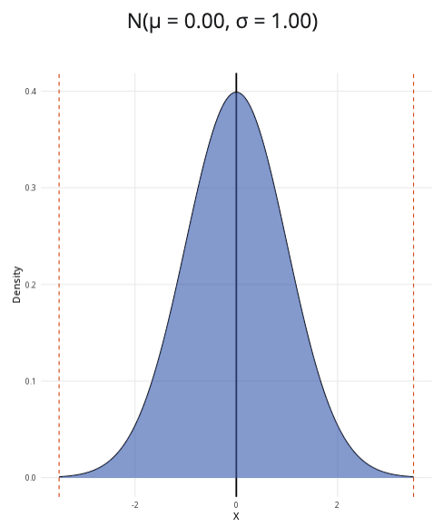

```{r, setup, include = FALSE}
library("webexercises")
```

::: {.content-visible when-format="html"}

```{=html}
<!DOCTYPE html>
<html lang="en">
<head>
  <meta charset="UTF-8">
  <meta name="viewport" content="width=device-width, initial-scale=1.0">
  <title>Normal Distribution Calculator</title>

  <style>
    * { box-sizing: border-box; }

    body {
      margin: 0;
      padding: 1rem;
      background: #f5f6f8;
      color: #222222;
    }

    /* =========================================================
       NORMAL DISTRIBUTION CALCULATOR
       ========================================================= */

    .normal-calculator {
      width: 100%;
      max-width: 1200px;
      margin: 0 auto;
    }

    .normal-calculator .calculator-row {
      display: grid;
      grid-template-columns: minmax(280px, 1fr) minmax(0, 2fr);
      gap: 1rem;
      align-items: stretch;
    }

    .normal-calculator .calculator-card {
      background: #ffffff;
      border: 1px solid #dddddd;
      border-radius: 8px;
      overflow: hidden;
      box-shadow: 0 2px 6px rgba(0, 0, 0, 0.08);
      margin-bottom: 1rem;
    }

    .normal-calculator .calculator-card-header {
      background: #3F6BB6;
      color: #ffffff;
      padding: 0.75rem 1rem;
      font-weight: 700;
      line-height: 1.4;
    }

    .normal-calculator .calculator-card-body { padding: 1rem; }
    .normal-calculator .form-group { margin-bottom: 1rem; }

    .normal-calculator label {
      display: block;
      margin-bottom: 0.4rem;
      font-weight: 500;
    }

    .normal-calculator input[type="number"] {
      width: 100%;
      padding: 0.55rem 0.65rem;
      border: 1px solid #cccccc;
      border-radius: 5px;
      background: #ffffff;
      font-size: 1rem;
    }

    .normal-calculator .distribution-slider {
      width: 100%;
      margin: 0.5rem 0;
      accent-color: #3F68B6;
      cursor: pointer;
    }

    .normal-calculator .slider-value {
      text-align: center;
      color: #3F68B6;
      font-weight: 700;
      margin-top: 0.1rem;
    }

    .normal-calculator hr {
      border: 0;
      border-top: 1px solid #dddddd;
      margin: 1.2rem 0;
    }

    .normal-calculator .probability-options {
      border: 0;
      padding: 0;
      margin: 0;
    }

    .normal-calculator .probability-options legend {
      font-size: 1rem;
      font-weight: 500;
      margin-bottom: 0.6rem;
    }

    .normal-calculator .radio-option {
      display: flex;
      align-items: center;
      gap: 0.45rem;
      margin-bottom: 0.55rem;
      cursor: pointer;
      font-weight: 400;
    }

    .normal-calculator .radio-option input {
      margin: 0;
      width: 16px;
      height: 16px;
      accent-color: #3F68B6;
    }

    .normal-calculator .conditional-input { margin-top: 1rem; }
    .normal-calculator .conditional-input[hidden] { display: none; }
    .normal-calculator .upper-label { margin-top: 1rem; }

    .normal-calculator .distribution-plot-title {
      text-align: center;
      font-size: 1.1rem;
      font-weight: 600;
      margin-bottom: 1rem;
    }

    .normal-calculator .normal-chart-wrapper {
      position: relative;
      width: 100%;
      height: 320px;
    }

    .normal-calculator canvas {
      width: 100% !important;
      height: 100% !important;
    }

    .normal-calculator .calculation-result {
      font-size: 1.05rem;
      line-height: 1.6;
      text-align: center;
    }

    .normal-calculator input:focus,
    .normal-calculator canvas:focus {
      outline: 3px solid rgba(63, 104, 182, 0.3);
      outline-offset: 2px;
    }

    @media (max-width: 768px) {
      .normal-calculator .calculator-row { grid-template-columns: 1fr; }
      .normal-calculator .plot-card { min-width: 0; }
      .normal-calculator .normal-chart-wrapper { height: 280px; }
    }

    @media (max-width: 480px) {
      body { padding: 0.5rem; }
      .normal-calculator .calculator-card-body { padding: 0.9rem; }
      .normal-calculator .normal-chart-wrapper { height: 250px; }
    }
  </style>
</head>

<body>

<div class="distribution-calculator normal-calculator">

  <div class="calculator-row">

    <!-- PARAMETERS CARD -->
    <div class="calculator-card parameters-card">
      <div class="calculator-card-header">Parameters</div>

      <div class="calculator-card-body">

        <div class="form-group">
          <label for="normal-mean">Mean (&mu;):</label>
          <input
            type="number"
            id="normal-mean"
            value="0"
            step="0.1"
            class="form-control">
        </div>

        <div class="form-group">
          <label for="normal-sd">Standard deviation (&sigma;):</label>
          <input
            type="number"
            id="normal-sd"
            value="1"
            min="0.1"
            step="0.1"
            class="form-control">
        </div>

        <hr>

        <fieldset class="probability-options">
          <legend>Probability to calculate:</legend>

          <label class="radio-option">
            <input type="radio" name="normal-prob-type" value="less" checked>
            <span>P(X &le; x)</span>
          </label>

          <label class="radio-option">
            <input type="radio" name="normal-prob-type" value="greater">
            <span>P(X &ge; x)</span>
          </label>

          <label class="radio-option">
            <input type="radio" name="normal-prob-type" value="between">
            <span>P(a &le; X &le; b)</span>
          </label>
        </fieldset>

        <!-- SINGLE X VALUE -->
        <div id="normal-x-container" class="conditional-input">
          <label for="normal-x">x value:</label>
          <input
            type="range"
            id="normal-x"
            min="-5"
            max="5"
            value="1"
            step="0.1"
            class="distribution-slider">
          <div class="slider-value" id="normal-x-value">1.0</div>
        </div>

        <!-- LOWER / UPPER VALUES -->
        <div id="normal-between-container" class="conditional-input" hidden>
          <label for="normal-lower">Lower bound (a):</label>
          <input
            type="range"
            id="normal-lower"
            min="-5"
            max="5"
            value="-1"
            step="0.1"
            class="distribution-slider">
          <div class="slider-value" id="normal-lower-value">-1.0</div>

          <label for="normal-upper" class="upper-label">Upper bound (b):</label>
          <input
            type="range"
            id="normal-upper"
            min="-5"
            max="5"
            value="1"
            step="0.1"
            class="distribution-slider">
          <div class="slider-value" id="normal-upper-value">1.0</div>
        </div>

      </div>
    </div>

    <!-- PLOT CARD -->
    <div class="calculator-card plot-card">
      <div class="calculator-card-header">Normal distribution plot</div>

      <div class="calculator-card-body">
        <div id="normal-plot-title" class="distribution-plot-title">
          N(&mu; = 0.0, &sigma; = 1.0)
        </div>

        <div class="normal-chart-wrapper">
          <canvas
            id="normal-chart"
            tabindex="0"
            role="img"
            aria-label="Normal distribution probability density function">
          </canvas>
        </div>
      </div>
    </div>

  </div>

  <!-- RESULTS CARD -->
  <div class="calculator-card results-card">
    <div class="calculator-card-header">Results</div>
    <div class="calculator-card-body">
      <div id="normal-result" class="calculation-result" aria-live="polite"></div>
    </div>
  </div>

</div>

<script>
/* =========================================================
   NORMAL DISTRIBUTION CALCULATOR
   ========================================================= */

(function() {
  "use strict";

  const root = document.querySelector(".normal-calculator");
  if (!root) return;

  const meanInput = root.querySelector("#normal-mean");
  const sdInput = root.querySelector("#normal-sd");
  const xInput = root.querySelector("#normal-x");
  const lowerInput = root.querySelector("#normal-lower");
  const upperInput = root.querySelector("#normal-upper");

  const xDisplay = root.querySelector("#normal-x-value");
  const lowerDisplay = root.querySelector("#normal-lower-value");
  const upperDisplay = root.querySelector("#normal-upper-value");

  const title = root.querySelector("#normal-plot-title");
  const result = root.querySelector("#normal-result");
  const xContainer = root.querySelector("#normal-x-container");
  const betweenContainer = root.querySelector("#normal-between-container");
  const canvas = root.querySelector("#normal-chart");
  const ctx = canvas.getContext("2d");

  function erf(value) {
    const sign = value < 0 ? -1 : 1;
    const z = Math.abs(value);
    const a1 = 0.254829592;
    const a2 = -0.284496736;
    const a3 = 1.421413741;
    const a4 = -1.453152027;
    const a5 = 1.061405429;
    const p = 0.3275911;
    const t = 1 / (1 + p * z);

    const y = 1 -
      (((((a5 * t + a4) * t + a3) * t + a2) * t + a1) * t) *
      Math.exp(-z * z);

    return sign * y;
  }

  function normalPDF(value, mean, sd) {
    const z = (value - mean) / sd;
    return Math.exp(-0.5 * z * z) / (sd * Math.sqrt(2 * Math.PI));
  }

  function normalCDF(value, mean, sd) {
    return 0.5 * (1 + erf((value - mean) / (sd * Math.sqrt(2))));
  }

  function getProbabilityType() {
    const selected = root.querySelector(
      'input[name="normal-prob-type"]:checked'
    );
    return selected ? selected.value : "less";
  }

  function validateParameters() {
    let mean = parseFloat(meanInput.value);
    let sd = parseFloat(sdInput.value);

    if (!Number.isFinite(mean)) {
      mean = 0;
      meanInput.value = 0;
    }

    if (!Number.isFinite(sd) || sd <= 0) {
      sd = 0.1;
      sdInput.value = 0.1;
    }

    return { mean, sd };
  }

  function updateSliderRanges(mean, sd) {
    const minimum = mean - 5 * sd;
    const maximum = mean + 5 * sd;
    const step = Math.max(0.01, sd / 10);

    [xInput, lowerInput, upperInput].forEach(function(input) {
      input.min = minimum;
      input.max = maximum;
      input.step = step;
    });

    if (parseFloat(xInput.value) < minimum || parseFloat(xInput.value) > maximum) {
      xInput.value = mean + sd;
    }

    if (parseFloat(lowerInput.value) < minimum || parseFloat(lowerInput.value) > maximum) {
      lowerInput.value = mean - sd;
    }

    if (parseFloat(upperInput.value) < minimum || parseFloat(upperInput.value) > maximum) {
      upperInput.value = mean + sd;
    }
  }

  function formatValue(value) {
    return Number(value).toFixed(2);
  }

  function updateDisplay() {
    const parameters = validateParameters();
    updateSliderRanges(parameters.mean, parameters.sd);

    xDisplay.textContent = formatValue(xInput.value);
    lowerDisplay.textContent = formatValue(lowerInput.value);
    upperDisplay.textContent = formatValue(upperInput.value);

    title.textContent =
      `N(μ = ${parameters.mean.toFixed(2)}, σ = ${parameters.sd.toFixed(2)})`;
  }

  function calculateProbability() {
    const parameters = validateParameters();
    const mean = parameters.mean;
    const sd = parameters.sd;
    const x = parseFloat(xInput.value);
    let lower = parseFloat(lowerInput.value);
    let upper = parseFloat(upperInput.value);
    const type = getProbabilityType();

    if (upper < lower) {
      upper = lower;
      upperInput.value = upper;
      upperDisplay.textContent = formatValue(upper);
    }

    let probability;

    if (type === "less") {
      probability = normalCDF(x, mean, sd);
      result.textContent =
        `P(X ≤ ${formatValue(x)}) = ${probability.toFixed(4)} ` +
        `or ${(probability * 100).toFixed(2)}%`;
    } else if (type === "greater") {
      probability = 1 - normalCDF(x, mean, sd);
      result.textContent =
        `P(X ≥ ${formatValue(x)}) = ${probability.toFixed(4)} ` +
        `or ${(probability * 100).toFixed(2)}%`;
    } else {
      probability =
        normalCDF(upper, mean, sd) -
        normalCDF(lower, mean, sd);

      result.textContent =
        `P(${formatValue(lower)} ≤ X ≤ ${formatValue(upper)}) = ` +
        `${probability.toFixed(4)} or ` +
        `${(probability * 100).toFixed(2)}%`;
    }

    probability = Math.max(0, Math.min(1, probability));

    return { type, x, lower, upper, probability, mean, sd };
  }

  function drawChart() {
    const selected = calculateProbability();
    const mean = selected.mean;
    const sd = selected.sd;
    const rect = canvas.getBoundingClientRect();

    if (!rect.width || !rect.height) return;

    const dpr = window.devicePixelRatio || 1;
    canvas.width = Math.round(rect.width * dpr);
    canvas.height = Math.round(rect.height * dpr);
    ctx.setTransform(dpr, 0, 0, dpr, 0, 0);

    const width = rect.width;
    const height = rect.height;
    const padding = { left: 62, right: 22, top: 25, bottom: 52 };
    const chartWidth = width - padding.left - padding.right;
    const chartHeight = height - padding.top - padding.bottom;
    const minimumX = mean - 4 * sd;
    const maximumX = mean + 4 * sd;
    const maximumY = normalPDF(mean, mean, sd) * 1.12;
    const pointCount = Math.max(600, Math.round(chartWidth * 1.7));

    ctx.clearRect(0, 0, width, height);

    function xScale(value) {
      return padding.left +
        ((value - minimumX) / (maximumX - minimumX)) * chartWidth;
    }

    function yScale(value) {
      return padding.top + chartHeight -
        (value / maximumY) * chartHeight;
    }

    ctx.font = "12px Arial";
    ctx.textAlign = "right";
    ctx.textBaseline = "middle";

    for (let i = 0; i <= 4; i++) {
      const density = (i / 4) * maximumY;
      const y = yScale(density);

      ctx.strokeStyle = "#e5e5e5";
      ctx.lineWidth = 1;
      ctx.beginPath();
      ctx.moveTo(padding.left, y);
      ctx.lineTo(width - padding.right, y);
      ctx.stroke();

      ctx.fillStyle = "#555555";
      ctx.fillText(density.toFixed(2), padding.left - 8, y);
    }

    function fillArea(start, end, colour) {
      const boundedStart = Math.max(minimumX, Math.min(maximumX, start));
      const boundedEnd = Math.max(minimumX, Math.min(maximumX, end));

      if (boundedEnd <= boundedStart) return;

      const count = Math.max(
        2,
        Math.round(
          pointCount * (boundedEnd - boundedStart) /
          (maximumX - minimumX)
        )
      );

      ctx.beginPath();
      ctx.moveTo(xScale(boundedStart), yScale(0));

      for (let i = 0; i <= count; i++) {
        const value = boundedStart +
          (i / count) * (boundedEnd - boundedStart);
        ctx.lineTo(xScale(value), yScale(normalPDF(value, mean, sd)));
      }

      ctx.lineTo(xScale(boundedEnd), yScale(0));
      ctx.closePath();
      ctx.fillStyle = colour;
      ctx.fill();
    }

    fillArea(minimumX, maximumX, "rgba(211, 211, 211, 0.55)");

    if (selected.type === "less") {
      fillArea(minimumX, selected.x, "rgba(63, 107, 182, 0.58)");
    } else if (selected.type === "greater") {
      fillArea(selected.x, maximumX, "rgba(63, 107, 182, 0.58)");
    } else {
      fillArea(selected.lower, selected.upper, "rgba(63, 107, 182, 0.58)");
    }

    ctx.beginPath();

    for (let i = 0; i <= pointCount; i++) {
      const value = minimumX +
        (i / pointCount) * (maximumX - minimumX);
      const chartX = xScale(value);
      const chartY = yScale(normalPDF(value, mean, sd));

      if (i === 0) ctx.moveTo(chartX, chartY);
      else ctx.lineTo(chartX, chartY);
    }

    ctx.strokeStyle = "#274f91";
    ctx.lineWidth = 2.5;
    ctx.stroke();

    function drawBoundary(value) {
      if (value < minimumX || value > maximumX) return;

      ctx.save();
      ctx.setLineDash([5, 4]);
      ctx.strokeStyle = "#274f91";
      ctx.lineWidth = 1.5;
      ctx.beginPath();
      ctx.moveTo(xScale(value), yScale(0));
      ctx.lineTo(xScale(value), yScale(normalPDF(value, mean, sd)));
      ctx.stroke();
      ctx.restore();
    }

    if (selected.type === "between") {
      drawBoundary(selected.lower);
      drawBoundary(selected.upper);
    } else {
      drawBoundary(selected.x);
    }

    ctx.strokeStyle = "#777777";
    ctx.lineWidth = 1;
    ctx.beginPath();
    ctx.moveTo(padding.left, padding.top);
    ctx.lineTo(padding.left, padding.top + chartHeight);
    ctx.lineTo(width - padding.right, padding.top + chartHeight);
    ctx.stroke();

    ctx.save();
    ctx.setLineDash([3, 4]);
    ctx.strokeStyle = "#aaaaaa";
    ctx.beginPath();
    ctx.moveTo(xScale(mean), padding.top);
    ctx.lineTo(xScale(mean), padding.top + chartHeight);
    ctx.stroke();
    ctx.restore();

    ctx.fillStyle = "#333333";
    ctx.font = "12px Arial";
    ctx.textAlign = "center";
    ctx.textBaseline = "alphabetic";

    const tickCount = width < 500 ? 4 : 8;

    for (let i = 0; i <= tickCount; i++) {
      const value = minimumX +
        (i / tickCount) * (maximumX - minimumX);
      ctx.fillText(
        formatValue(value),
        xScale(value),
        padding.top + chartHeight + 20
      );
    }

    ctx.font = "13px Arial";
    ctx.fillText(
      "value of X",
      padding.left + chartWidth / 2,
      height - 8
    );

    ctx.save();
    ctx.translate(15, padding.top + chartHeight / 2);
    ctx.rotate(-Math.PI / 2);
    ctx.textAlign = "center";
    ctx.fillText("probability density", 0, 0);
    ctx.restore();

    canvas.setAttribute(
      "aria-label",
      `Normal distribution plot with mean ${mean.toFixed(2)} and ` +
      `standard deviation ${sd.toFixed(2)}. The selected probability is ` +
      `${selected.probability.toFixed(4)}.`
    );
  }

  function updateVisibility() {
    const type = getProbabilityType();
    xContainer.hidden = type === "between";
    betweenContainer.hidden = type !== "between";
  }

  function update() {
    updateVisibility();
    updateDisplay();
    drawChart();
  }

  meanInput.addEventListener("input", update);
  sdInput.addEventListener("input", update);
  meanInput.addEventListener("change", update);
  sdInput.addEventListener("change", update);
  xInput.addEventListener("input", update);

  lowerInput.addEventListener("input", function() {
    if (parseFloat(lowerInput.value) > parseFloat(upperInput.value)) {
      upperInput.value = lowerInput.value;
    }
    update();
  });

  upperInput.addEventListener("input", function() {
    if (parseFloat(upperInput.value) < parseFloat(lowerInput.value)) {
      lowerInput.value = upperInput.value;
    }
    update();
  });

  root.querySelectorAll('input[name="normal-prob-type"]').forEach(
    function(radio) {
      radio.addEventListener("change", update);
    }
  );

  let resizeTimer;

  window.addEventListener("resize", function() {
    window.clearTimeout(resizeTimer);
    resizeTimer = window.setTimeout(drawChart, 80);
  });

  update();
})();
</script>

</body>
</html>
```

:::

::: {.content-hidden when-format="html"}

{width="80%"}

:::

**Where to use:** The normal distribution can be used to model continuous random variables, which can include any positive or negative real values. The use of this distribution is often justified by the Central Limit Theorem: as the sample size increases, the distribution of sample means will resemble a normal distribution more and more closely.

**Notation:** $X \sim \textrm{Normal}(\mu,\sigma^2)$ or $X \sim N(\mu,\sigma^2)$

**Parameters:** Two real numbers $\mu$ and $\sigma^2$.

-   $\mu$ is the centre of the distribution (the mean/expected value).
-   $\sigma^2$ is the measure of how the distribution is spread (the variance).

| Quantity | Value | Notes |
|:--------|:----------------------------|:-------------------|
| **Mean** | $\mathbb{E}(X) = \mu$ |  |
| **Variance** | $\mathbb{V}(X) = \sigma^2$ |  |
| **PDF** | $\mathbb{P}(X=x)=\dfrac{1}{\sqrt{2\pi\sigma^2}}\exp\left({-\dfrac{(x-\mu)^2}{2\sigma^2}}\right)$ | $\exp(y) = e^y$ |
| **CDF** | $\displaystyle\mathbb{P}(X\leq x)=\dfrac{1}{2}\left[1+\textrm{erf}\left(\dfrac{x-\mu}{\sigma\sqrt{2}}\right)\right]$ | $\textrm{erf}(x)$ is the error function of $x$ |

**Example:** The lengths of chocolate bars produced by Cantor’s Confectionery follow a normal distribution with a mean of $5.6$ inches and a variance of $1.44$. This can be expressed as $X \sim N(5.6, 1.44)$, meaning the data is normally distributed, centered at $5.6$ with standard deviation $\sqrt{1.44} = 1.2$.


# Further reading {-}

This interactive element appears in [Guide: PMFs, PDFs, CDFs](../studyguides/pmfspdfscdfs.qmd) and [Overview: Probability distributions.](../overviews/o-distributions.qmd) Please click the relevant links to go to the guides.

## Version history {-}

v1.0: initial version created 04/25 by tdhc and Michelle Arnetta as part of a University of St Andrews VIP project.

  - v1.1: moved to factsheet form and populated with material from [Overview: Probability distributions](../overviews/o-distributions.qmd) by tdhc.
  
  - v1.2: graph transferred from R Shinylive to html by tdhc in 06/26.
  
[This work is licensed under CC BY-NC-SA 4.0.](https://creativecommons.org/licenses/by-nc-sa/4.0/?ref=chooser-v1)


