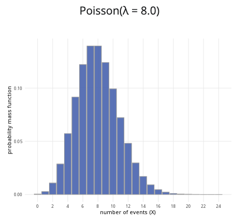

```{r, setup, include = FALSE}
library("webexercises")
```

::: {.content-visible when-format="html"}

```{=html}

<!DOCTYPE html>
<html lang="en">
<head>
  <meta charset="UTF-8">
  <meta name="viewport" content="width=device-width, initial-scale=1.0">
  <title>Poisson Distribution Calculator</title>

  <style>
    * { box-sizing: border-box; }

    body {
      margin: 0;
      padding: 1rem;
      background: #f5f6f8;
      color: #222222;
    }

    /* =========================================================
       POISSON DISTRIBUTION CALCULATOR
       ========================================================= */

    .poisson-calculator {
      width: 100%;
      max-width: 1200px;
      margin: 0 auto;
    }

    .poisson-calculator .calculator-row {
      display: grid;
      grid-template-columns: minmax(280px, 1fr) minmax(0, 2fr);
      gap: 1rem;
      align-items: stretch;
    }

    .poisson-calculator .calculator-card {
      background: #ffffff;
      border: 1px solid #dddddd;
      border-radius: 8px;
      overflow: hidden;
      box-shadow: 0 2px 6px rgba(0, 0, 0, 0.08);
      margin-bottom: 1rem;
    }

    .poisson-calculator .calculator-card-header {
      background: #3F6BB6;
      color: #ffffff;
      padding: 0.75rem 1rem;
      font-weight: 700;
      line-height: 1.4;
    }

    .poisson-calculator .calculator-card-body { padding: 1rem; }
    .poisson-calculator .form-group { margin-bottom: 1rem; }

    .poisson-calculator label {
      display: block;
      margin-bottom: 0.4rem;
      font-weight: 500;
    }

    .poisson-calculator .distribution-slider {
      width: 100%;
      margin: 0.5rem 0;
      accent-color: #3F68B6;
      cursor: pointer;
    }

    .poisson-calculator .slider-value {
      text-align: center;
      color: #3F68B6;
      font-weight: 700;
      margin-top: 0.1rem;
    }

    .poisson-calculator hr {
      border: 0;
      border-top: 1px solid #dddddd;
      margin: 1.2rem 0;
    }

    .poisson-calculator .probability-options {
      border: 0;
      padding: 0;
      margin: 0;
    }

    .poisson-calculator .probability-options legend {
      font-size: 1rem;
      font-weight: 500;
      margin-bottom: 0.6rem;
    }

    .poisson-calculator .radio-option {
      display: flex;
      align-items: center;
      gap: 0.45rem;
      margin-bottom: 0.55rem;
      cursor: pointer;
      font-weight: 400;
    }

    .poisson-calculator .radio-option input {
      margin: 0;
      width: 16px;
      height: 16px;
      accent-color: #3F68B6;
    }

    .poisson-calculator .conditional-input { margin-top: 1rem; }
    .poisson-calculator .conditional-input[hidden] { display: none; }
    .poisson-calculator .upper-label { margin-top: 1rem; }

    .poisson-calculator .distribution-plot-title {
      text-align: center;
      font-size: 1.1rem;
      font-weight: 600;
      margin-bottom: 1rem;
    }

    .poisson-calculator .poisson-chart-wrapper {
      position: relative;
      width: 100%;
      height: 320px;
    }

    .poisson-calculator canvas {
      width: 100% !important;
      height: 100% !important;
    }

    .poisson-calculator .calculation-result {
      font-size: 1.05rem;
      line-height: 1.6;
      text-align: center;
    }

    .poisson-calculator input:focus,
    .poisson-calculator canvas:focus {
      outline: 3px solid rgba(63, 104, 182, 0.3);
      outline-offset: 2px;
    }

    @media (max-width: 768px) {
      .poisson-calculator .calculator-row { grid-template-columns: 1fr; }
      .poisson-calculator .plot-card { min-width: 0; }
      .poisson-calculator .poisson-chart-wrapper { height: 280px; }
    }

    @media (max-width: 480px) {
      body { padding: 0.5rem; }
      .poisson-calculator .calculator-card-body { padding: 0.9rem; }
      .poisson-calculator .poisson-chart-wrapper { height: 250px; }
    }
  </style>
</head>

<body>

<div class="distribution-calculator poisson-calculator">

  <div class="calculator-row">

    <!-- PARAMETERS CARD -->
    <div class="calculator-card parameters-card">
      <div class="calculator-card-header">Parameters</div>

      <div class="calculator-card-body">

        <div class="form-group">
          <label for="poisson-lambda">Mean event rate (&lambda;):</label>
          <input
            type="range"
            id="poisson-lambda"
            min="0.1"
            max="30"
            value="4"
            step="0.1"
            class="distribution-slider">
          <div class="slider-value" id="poisson-lambda-value">4.0</div>
        </div>

        <hr>

        <fieldset class="probability-options">
          <legend>Probability to calculate:</legend>

          <label class="radio-option">
            <input type="radio" name="poisson-prob-type" value="less" checked>
            <span>P(X &le; x)</span>
          </label>

          <label class="radio-option">
            <input type="radio" name="poisson-prob-type" value="greater">
            <span>P(X &ge; x)</span>
          </label>

          <label class="radio-option">
            <input type="radio" name="poisson-prob-type" value="between">
            <span>P(a &le; X &le; b)</span>
          </label>
        </fieldset>

        <!-- SINGLE X VALUE -->
        <div id="poisson-x-container" class="conditional-input">
          <label for="poisson-x">x value:</label>
          <input
            type="range"
            id="poisson-x"
            min="0"
            max="25"
            value="5"
            step="1"
            class="distribution-slider">
          <div class="slider-value" id="poisson-x-value">5</div>
        </div>

        <!-- LOWER / UPPER VALUES -->
        <div id="poisson-between-container" class="conditional-input" hidden>
          <label for="poisson-lower">Lower bound (a):</label>
          <input
            type="range"
            id="poisson-lower"
            min="0"
            max="25"
            value="2"
            step="1"
            class="distribution-slider">
          <div class="slider-value" id="poisson-lower-value">2</div>

          <label for="poisson-upper" class="upper-label">Upper bound (b):</label>
          <input
            type="range"
            id="poisson-upper"
            min="0"
            max="25"
            value="7"
            step="1"
            class="distribution-slider">
          <div class="slider-value" id="poisson-upper-value">7</div>
        </div>

      </div>
    </div>

    <!-- PLOT CARD -->
    <div class="calculator-card plot-card">
      <div class="calculator-card-header">Poisson distribution plot</div>

      <div class="calculator-card-body">
        <div id="poisson-plot-title" class="distribution-plot-title">
          Poisson(&lambda; = 4.0)
        </div>

        <div class="poisson-chart-wrapper">
          <canvas
            id="poisson-chart"
            tabindex="0"
            role="img"
            aria-label="Poisson distribution probability mass function">
          </canvas>
        </div>
      </div>
    </div>

  </div>

  <!-- RESULTS CARD -->
  <div class="calculator-card results-card">
    <div class="calculator-card-header">Results</div>
    <div class="calculator-card-body">
      <div id="poisson-result" class="calculation-result" aria-live="polite"></div>
    </div>
  </div>

</div>

<script>
/* =========================================================
   POISSON DISTRIBUTION CALCULATOR
   ========================================================= */

(function() {
  "use strict";

  const root = document.querySelector(".poisson-calculator");
  if (!root) return;

  const lambdaInput = root.querySelector("#poisson-lambda");
  const xInput = root.querySelector("#poisson-x");
  const lowerInput = root.querySelector("#poisson-lower");
  const upperInput = root.querySelector("#poisson-upper");

  const lambdaDisplay = root.querySelector("#poisson-lambda-value");
  const xDisplay = root.querySelector("#poisson-x-value");
  const lowerDisplay = root.querySelector("#poisson-lower-value");
  const upperDisplay = root.querySelector("#poisson-upper-value");

  const title = root.querySelector("#poisson-plot-title");
  const result = root.querySelector("#poisson-result");
  const xContainer = root.querySelector("#poisson-x-container");
  const betweenContainer = root.querySelector("#poisson-between-container");
  const canvas = root.querySelector("#poisson-chart");
  const ctx = canvas.getContext("2d");

  /* Stable recurrence avoids factorial overflow. */

  function poissonProbabilities(maximumK, lambda) {
    const probabilities = new Array(maximumK + 1);
    probabilities[0] = Math.exp(-lambda);

    for (let k = 1; k <= maximumK; k++) {
      probabilities[k] = probabilities[k - 1] * lambda / k;
    }

    return probabilities;
  }

  function poissonCDF(k, lambda) {
    if (k < 0) return 0;

    k = Math.floor(k);
    let term = Math.exp(-lambda);
    let total = term;

    for (let i = 1; i <= k; i++) {
      term *= lambda / i;
      total += term;
    }

    return Math.max(0, Math.min(1, total));
  }

  function getProbabilityType() {
    const selected = root.querySelector(
      'input[name="poisson-prob-type"]:checked'
    );
    return selected ? selected.value : "less";
  }

  function updateRanges() {
    const lambda = parseFloat(lambdaInput.value);
    const suggestedMaximum = Math.min(
      100,
      Math.max(15, Math.ceil(lambda + 6 * Math.sqrt(lambda) + 3))
    );

    [xInput, lowerInput, upperInput].forEach(function(input) {
      input.max = suggestedMaximum;
      if (parseInt(input.value, 10) > suggestedMaximum) {
        input.value = suggestedMaximum;
      }
    });

    if (parseInt(upperInput.value, 10) < parseInt(lowerInput.value, 10)) {
      upperInput.value = lowerInput.value;
    }
  }

  function updateDisplay() {
    updateRanges();

    const lambda = parseFloat(lambdaInput.value);
    lambdaDisplay.textContent = lambda.toFixed(1);
    xDisplay.textContent = parseInt(xInput.value, 10);
    lowerDisplay.textContent = parseInt(lowerInput.value, 10);
    upperDisplay.textContent = parseInt(upperInput.value, 10);
    title.textContent = `Poisson(λ = ${lambda.toFixed(1)})`;
  }

  function calculateProbability() {
    const lambda = parseFloat(lambdaInput.value);
    const x = parseInt(xInput.value, 10);
    let lower = parseInt(lowerInput.value, 10);
    let upper = parseInt(upperInput.value, 10);
    const type = getProbabilityType();

    if (upper < lower) {
      upper = lower;
      upperInput.value = upper;
      upperDisplay.textContent = upper;
    }

    let probability;

    if (type === "less") {
      probability = poissonCDF(x, lambda);
      result.textContent =
        `P(X ≤ ${x}) = ${probability.toFixed(4)} ` +
        `or ${(probability * 100).toFixed(2)}%`;
    } else if (type === "greater") {
      probability = x <= 0 ? 1 : 1 - poissonCDF(x - 1, lambda);
      result.textContent =
        `P(X ≥ ${x}) = ${probability.toFixed(4)} ` +
        `or ${(probability * 100).toFixed(2)}%`;
    } else {
      probability = poissonCDF(upper, lambda) - poissonCDF(lower - 1, lambda);
      result.textContent =
        `P(${lower} ≤ X ≤ ${upper}) = ${probability.toFixed(4)} ` +
        `or ${(probability * 100).toFixed(2)}%`;
    }

    probability = Math.max(0, Math.min(1, probability));
    return { type, x, lower, upper, probability, lambda };
  }

  function getPlotMaximum(lambda, selected) {
    const selectedMaximum = selected.type === "between"
      ? selected.upper
      : selected.x;

    return Math.min(
      100,
      Math.max(
        12,
        selectedMaximum + 3,
        Math.ceil(lambda + 5 * Math.sqrt(lambda) + 2)
      )
    );
  }

  function drawChart() {
    const selected = calculateProbability();
    const lambda = selected.lambda;
    const maximumK = getPlotMaximum(lambda, selected);
    const probabilities = poissonProbabilities(maximumK, lambda);
    const rect = canvas.getBoundingClientRect();

    if (!rect.width || !rect.height) return;

    const dpr = window.devicePixelRatio || 1;
    canvas.width = Math.round(rect.width * dpr);
    canvas.height = Math.round(rect.height * dpr);
    ctx.setTransform(dpr, 0, 0, dpr, 0, 0);

    const width = rect.width;
    const height = rect.height;
    const padding = { left: 58, right: 20, top: 25, bottom: 52 };
    const chartWidth = width - padding.left - padding.right;
    const chartHeight = height - padding.top - padding.bottom;
    const maximumY = Math.max(...probabilities) * 1.12;

    ctx.clearRect(0, 0, width, height);

    function xScale(k) {
      return padding.left + ((k + 0.5) / (maximumK + 1)) * chartWidth;
    }

    function yScale(value) {
      return padding.top + chartHeight - (value / maximumY) * chartHeight;
    }

    /* GRID AND Y-AXIS LABELS */

    ctx.font = "12px Arial";
    ctx.textAlign = "right";
    ctx.textBaseline = "middle";

    for (let i = 0; i <= 4; i++) {
      const probability = (i / 4) * maximumY;
      const y = yScale(probability);

      ctx.strokeStyle = "#e5e5e5";
      ctx.lineWidth = 1;
      ctx.beginPath();
      ctx.moveTo(padding.left, y);
      ctx.lineTo(width - padding.right, y);
      ctx.stroke();

      ctx.fillStyle = "#555555";
      ctx.fillText(probability.toFixed(2), padding.left - 8, y);
    }

    /* BARS */

    const availableWidth = chartWidth / (maximumK + 1);
    const barWidth = Math.max(2, Math.min(34, availableWidth * 0.72));

    for (let k = 0; k <= maximumK; k++) {
      const probability = probabilities[k];
      const barHeight = (probability / maximumY) * chartHeight;
      const x = xScale(k) - barWidth / 2;
      const y = padding.top + chartHeight - barHeight;
      let highlighted = false;

      if (selected.type === "less") {
        highlighted = k <= selected.x;
      } else if (selected.type === "greater") {
        highlighted = k >= selected.x;
      } else {
        highlighted = k >= selected.lower && k <= selected.upper;
      }

      ctx.fillStyle = highlighted ? "#3F6BB6" : "#d3d3d3";
      ctx.fillRect(x, y, barWidth, barHeight);

      ctx.strokeStyle = "#777777";
      ctx.lineWidth = 1;
      ctx.strokeRect(x, y, barWidth, barHeight);
    }

    /* AXES */

    ctx.strokeStyle = "#777777";
    ctx.lineWidth = 1;
    ctx.beginPath();
    ctx.moveTo(padding.left, padding.top);
    ctx.lineTo(padding.left, padding.top + chartHeight);
    ctx.lineTo(width - padding.right, padding.top + chartHeight);
    ctx.stroke();

    /* X-AXIS LABELS */

    ctx.fillStyle = "#333333";
    ctx.font = "12px Arial";
    ctx.textAlign = "center";
    ctx.textBaseline = "alphabetic";

    const interval = maximumK <= 15 ? 1 : maximumK <= 30 ? 2 : 5;

    for (let k = 0; k <= maximumK; k++) {
      if (k === 0 || k === maximumK || k % interval === 0) {
        ctx.fillText(k, xScale(k), padding.top + chartHeight + 20);
      }
    }

    ctx.font = "13px Arial";
    ctx.fillText(
      "number of events (X)",
      padding.left + chartWidth / 2,
      height - 8
    );

    ctx.save();
    ctx.translate(15, padding.top + chartHeight / 2);
    ctx.rotate(-Math.PI / 2);
    ctx.textAlign = "center";
    ctx.fillText("probability mass function", 0, 0);
    ctx.restore();

    canvas.setAttribute(
      "aria-label",
      `Poisson probability mass function with mean rate ${lambda.toFixed(1)}. ` +
      `The selected probability is ${selected.probability.toFixed(4)}.`
    );
  }

  function updateVisibility() {
    const type = getProbabilityType();
    xContainer.hidden = type === "between";
    betweenContainer.hidden = type !== "between";
  }

  function update() {
    updateVisibility();
    updateDisplay();
    drawChart();
  }

  lambdaInput.addEventListener("input", update);
  xInput.addEventListener("input", update);

  lowerInput.addEventListener("input", function() {
    if (parseInt(lowerInput.value, 10) > parseInt(upperInput.value, 10)) {
      upperInput.value = lowerInput.value;
    }
    update();
  });

  upperInput.addEventListener("input", function() {
    if (parseInt(upperInput.value, 10) < parseInt(lowerInput.value, 10)) {
      lowerInput.value = upperInput.value;
    }
    update();
  });

  root.querySelectorAll('input[name="poisson-prob-type"]').forEach(
    function(radio) {
      radio.addEventListener("change", update);
    }
  );

  let resizeTimer;

  window.addEventListener("resize", function() {
    window.clearTimeout(resizeTimer);
    resizeTimer = window.setTimeout(drawChart, 80);
  });

  update();
})();
</script>

</body>
</html>

```

:::

::: {.content-hidden when-format="html"}

{width="80%"}

:::

**Where to use:** The Poisson distribution is used when a specific event occurs at some rate $\lambda$, and you are counting $X$, the number of times this event occurs in some interval.

**Notation:** $X \sim \textrm{Poisson}(\lambda)$ or $X \sim \textrm{Pois}(\lambda)$.

**Parameter:** $\lambda$ is the integer number of times an event occurs within a specific period of time.

| Quantity | Value | Notes |
|:--------|:----------------------------|:-------------------|
| **Mean** | $\mathbb{E}(X) = \lambda$ |  |
| **Variance** | $\mathbb{V}(X) = \lambda$ |  |
| **PMF** | $\mathbb{P}(X=x)=\dfrac{\lambda^xe^{-\lambda}}{x!}$ |  |
| **CDF** | $\displaystyle\mathbb{P}(X\leq x)=\sum^{\lfloor x \rfloor}_{i=1}\frac{\lambda^xe^{-\lambda}}{x!}$ | $\lfloor x \rfloor$ the floor function |

**Example:** Customers enter Cantor’s Confectionery at an average rate of 20 people per hour, and you want to see the likelihood that $X$ number of customers walks in. This can be expressed as $X \sim \textrm{Pois}(20)$.


# Further reading {-}

[This interactive element appears in Overview: Probability distributions. Please click this link to go to the guide.](../overviews/o-distributions.qmd)

## Version history {-}

v1.0: initial version created 04/25 by tdhc and Michelle Arnetta as part of a University of St Andrews VIP project.

  - v1.1: moved to factsheet form and populated with material from [Overview: Probability distributions](../overviews/o-distributions.qmd) by tdhc.
  
[This work is licensed under CC BY-NC-SA 4.0.](https://creativecommons.org/licenses/by-nc-sa/4.0/?ref=chooser-v1)


