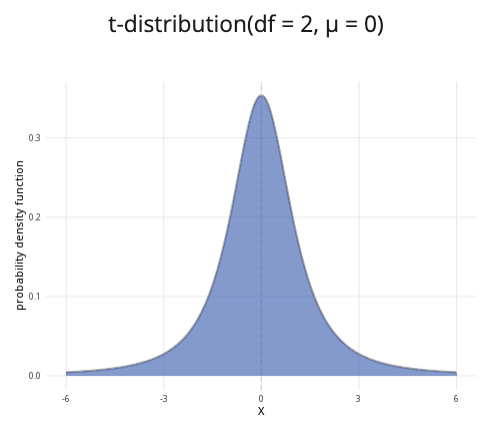

```{r, setup, include = FALSE}
library("webexercises")
```

::: {.content-visible when-format="html"}

```{=html}

<!DOCTYPE html>
<html lang="en">
<head>
  <meta charset="UTF-8">
  <meta name="viewport" content="width=device-width, initial-scale=1.0">
  <title>t-Distribution Calculator</title>

  <style>
    * {
      box-sizing: border-box;
    }

    body {
      margin: 0;
      padding: 1rem;
      background: #f5f6f8;
      color: #222222;
    }

    /* =========================================================
       T-DISTRIBUTION CALCULATOR
       ========================================================= */

    .t-calculator {
      width: 100%;
      max-width: 1200px;
      margin: 0 auto;
    }

    /* TOP ROW */

    .t-calculator .calculator-row {
      display: grid;
      grid-template-columns: minmax(280px, 1fr) minmax(0, 2fr);
      gap: 1rem;
      align-items: stretch;
    }

    /* CARDS */

    .t-calculator .calculator-card {
      background: #ffffff;
      border: 1px solid #dddddd;
      border-radius: 8px;
      overflow: hidden;
      box-shadow: 0 2px 6px rgba(0, 0, 0, 0.08);
      margin-bottom: 1rem;
    }

    /* CARD HEADERS */

    .t-calculator .calculator-card-header {
      background: #3F6BB6;
      color: #ffffff;
      padding: 0.75rem 1rem;
      font-weight: 700;
      line-height: 1.4;
    }

    /* CARD BODY */

    .t-calculator .calculator-card-body {
      padding: 1rem;
    }

    /* FORM ELEMENTS */

    .t-calculator .form-group {
      margin-bottom: 1rem;
    }

    .t-calculator label {
      display: block;
      margin-bottom: 0.4rem;
      font-weight: 500;
    }

    .t-calculator input[type="number"] {
      width: 100%;
      padding: 0.55rem 0.65rem;
      border: 1px solid #cccccc;
      border-radius: 5px;
      background: #ffffff;
      font-size: 1rem;
    }

    /* SLIDERS */

    .t-calculator .distribution-slider {
      width: 100%;
      margin: 0.5rem 0;
      accent-color: #3F68B6;
      cursor: pointer;
    }

    .t-calculator .slider-value {
      text-align: center;
      color: #3F68B6;
      font-weight: 700;
      margin-top: 0.1rem;
    }

    /* DIVIDER */

    .t-calculator hr {
      border: 0;
      border-top: 1px solid #dddddd;
      margin: 1.2rem 0;
    }

    /* RADIO BUTTONS */

    .t-calculator .probability-options {
      border: 0;
      padding: 0;
      margin: 0;
    }

    .t-calculator .probability-options legend {
      font-size: 1rem;
      font-weight: 500;
      margin-bottom: 0.6rem;
    }

    .t-calculator .radio-option {
      display: flex;
      align-items: center;
      gap: 0.45rem;
      margin-bottom: 0.55rem;
      cursor: pointer;
      font-weight: 400;
    }

    .t-calculator .radio-option input {
      margin: 0;
      width: 16px;
      height: 16px;
      accent-color: #3F68B6;
    }

    /* CONDITIONAL INPUTS */

    .t-calculator .conditional-input {
      margin-top: 1rem;
    }

    .t-calculator .conditional-input[hidden] {
      display: none;
    }

    .t-calculator .upper-label {
      margin-top: 1rem;
    }

    /* PLOT */

    .t-calculator .distribution-plot-title {
      text-align: center;
      font-size: 1.1rem;
      font-weight: 600;
      margin-bottom: 1rem;
    }

    .t-calculator .t-chart-wrapper {
      position: relative;
      width: 100%;
      height: 320px;
    }

    .t-calculator canvas {
      width: 100% !important;
      height: 100% !important;
    }

    /* RESULTS */

    .t-calculator .calculation-result {
      font-size: 1.05rem;
      line-height: 1.6;
      text-align: center;
    }

    /* FOCUS */

    .t-calculator input:focus,
    .t-calculator canvas:focus {
      outline: 3px solid rgba(63, 104, 182, 0.3);
      outline-offset: 2px;
    }

    /* MOBILE */

    @media (max-width: 768px) {
      .t-calculator .calculator-row {
        grid-template-columns: 1fr;
      }

      .t-calculator .plot-card {
        min-width: 0;
      }

      .t-calculator .t-chart-wrapper {
        height: 280px;
      }
    }

    /* SMALL MOBILE */

    @media (max-width: 480px) {
      body {
        padding: 0.5rem;
      }

      .t-calculator .calculator-card-body {
        padding: 0.9rem;
      }

      .t-calculator .t-chart-wrapper {
        height: 250px;
      }
    }
  </style>
</head>

<body>

<div class="distribution-calculator t-calculator">

  <div class="calculator-row">

    <!-- PARAMETERS CARD -->
    <div class="calculator-card parameters-card">

      <div class="calculator-card-header">
        Parameters
      </div>

      <div class="calculator-card-body">

        <div class="form-group">
          <label for="t-df">
            Degrees of freedom (&nu;):
          </label>

          <input
            type="number"
            id="t-df"
            value="10"
            min="1"
            max="500"
            step="1"
            class="form-control">
        </div>

        <hr>

        <fieldset class="probability-options">

          <legend>
            Probability to calculate:
          </legend>

          <label class="radio-option">
            <input
              type="radio"
              name="t-prob-type"
              value="less"
              checked>
            <span>P(X &le; t)</span>
          </label>

          <label class="radio-option">
            <input
              type="radio"
              name="t-prob-type"
              value="greater">
            <span>P(X &ge; t)</span>
          </label>

          <label class="radio-option">
            <input
              type="radio"
              name="t-prob-type"
              value="between">
            <span>P(a &le; X &le; b)</span>
          </label>

        </fieldset>

        <!-- SINGLE T VALUE -->
        <div id="t-value-container" class="conditional-input">

          <label for="t-value">
            t value:
          </label>

          <input
            type="range"
            id="t-value"
            min="-5"
            max="5"
            value="1.5"
            step="0.1"
            class="distribution-slider">

          <div class="slider-value" id="t-value-display">
            1.5
          </div>

        </div>

        <!-- LOWER / UPPER VALUES -->
        <div id="t-between-container" class="conditional-input" hidden>

          <label for="t-lower">
            Lower bound (a):
          </label>

          <input
            type="range"
            id="t-lower"
            min="-5"
            max="5"
            value="-1"
            step="0.1"
            class="distribution-slider">

          <div class="slider-value" id="t-lower-value">
            -1.0
          </div>

          <label for="t-upper" class="upper-label">
            Upper bound (b):
          </label>

          <input
            type="range"
            id="t-upper"
            min="-5"
            max="5"
            value="1"
            step="0.1"
            class="distribution-slider">

          <div class="slider-value" id="t-upper-value">
            1.0
          </div>

        </div>

      </div>
    </div>

    <!-- PLOT CARD -->
    <div class="calculator-card plot-card">

      <div class="calculator-card-header">
        t-distribution plot
      </div>

      <div class="calculator-card-body">

        <div id="t-plot-title" class="distribution-plot-title">
          t(&nu; = 10)
        </div>

        <div class="t-chart-wrapper">
          <canvas
            id="t-chart"
            tabindex="0"
            role="img"
            aria-label="Student's t-distribution probability density function">
          </canvas>
        </div>

      </div>
    </div>

  </div>

  <!-- RESULTS CARD -->
  <div class="calculator-card results-card">

    <div class="calculator-card-header">
      Results
    </div>

    <div class="calculator-card-body">
      <div id="t-result" class="calculation-result" aria-live="polite"></div>
    </div>

  </div>

</div>

<script>
/* =========================================================
   STUDENT'S T-DISTRIBUTION CALCULATOR
   ========================================================= */

(function() {
  "use strict";

  const root = document.querySelector(".t-calculator");
  if (!root) return;

  const dfInput = root.querySelector("#t-df");
  const tInput = root.querySelector("#t-value");
  const lowerInput = root.querySelector("#t-lower");
  const upperInput = root.querySelector("#t-upper");

  const tDisplay = root.querySelector("#t-value-display");
  const lowerDisplay = root.querySelector("#t-lower-value");
  const upperDisplay = root.querySelector("#t-upper-value");

  const title = root.querySelector("#t-plot-title");
  const result = root.querySelector("#t-result");
  const valueContainer = root.querySelector("#t-value-container");
  const betweenContainer = root.querySelector("#t-between-container");
  const canvas = root.querySelector("#t-chart");
  const ctx = canvas.getContext("2d");

  /* LANCZOS LOG-GAMMA APPROXIMATION */

  function logGamma(z) {
    const coefficients = [
      676.5203681218851,
      -1259.1392167224028,
      771.32342877765313,
      -176.61502916214059,
      12.507343278686905,
      -0.13857109526572012,
      9.9843695780195716e-6,
      1.5056327351493116e-7
    ];

    if (z < 0.5) {
      return Math.log(Math.PI) -
        Math.log(Math.sin(Math.PI * z)) -
        logGamma(1 - z);
    }

    z -= 1;
    let x = 0.99999999999980993;

    for (let i = 0; i < coefficients.length; i++) {
      x += coefficients[i] / (z + i + 1);
    }

    const t = z + coefficients.length - 0.5;

    return 0.5 * Math.log(2 * Math.PI) +
      (z + 0.5) * Math.log(t) - t + Math.log(x);
  }

  /* CONTINUED FRACTION FOR THE INCOMPLETE BETA FUNCTION */

  function betaContinuedFraction(a, b, x) {
    const maxIterations = 200;
    const epsilon = 3e-14;
    const tiny = 1e-300;
    const qab = a + b;
    const qap = a + 1;
    const qam = a - 1;

    let c = 1;
    let d = 1 - qab * x / qap;
    if (Math.abs(d) < tiny) d = tiny;
    d = 1 / d;
    let h = d;

    for (let m = 1; m <= maxIterations; m++) {
      const m2 = 2 * m;
      let aa = m * (b - m) * x /
        ((qam + m2) * (a + m2));

      d = 1 + aa * d;
      if (Math.abs(d) < tiny) d = tiny;
      c = 1 + aa / c;
      if (Math.abs(c) < tiny) c = tiny;
      d = 1 / d;
      h *= d * c;

      aa = -(a + m) * (qab + m) * x /
        ((a + m2) * (qap + m2));

      d = 1 + aa * d;
      if (Math.abs(d) < tiny) d = tiny;
      c = 1 + aa / c;
      if (Math.abs(c) < tiny) c = tiny;
      d = 1 / d;

      const delta = d * c;
      h *= delta;

      if (Math.abs(delta - 1) < epsilon) break;
    }

    return h;
  }

  function regularizedIncompleteBeta(x, a, b) {
    if (x <= 0) return 0;
    if (x >= 1) return 1;

    const logarithmicTerm =
      logGamma(a + b) - logGamma(a) - logGamma(b) +
      a * Math.log(x) + b * Math.log(1 - x);

    const front = Math.exp(logarithmicTerm);

    if (x < (a + 1) / (a + b + 2)) {
      return front * betaContinuedFraction(a, b, x) / a;
    }

    return 1 - front * betaContinuedFraction(b, a, 1 - x) / b;
  }

  /* T-DISTRIBUTION PDF AND CDF */

  function tPDF(value, df) {
    const logCoefficient =
      logGamma((df + 1) / 2) -
      logGamma(df / 2) -
      0.5 * Math.log(df * Math.PI);

    return Math.exp(
      logCoefficient -
      ((df + 1) / 2) * Math.log(1 + value * value / df)
    );
  }

  function tCDF(value, df) {
    if (value === 0) return 0.5;

    const betaX = df / (df + value * value);
    const beta = regularizedIncompleteBeta(betaX, df / 2, 0.5);

    return value > 0 ? 1 - 0.5 * beta : 0.5 * beta;
  }

  function getProbabilityType() {
    const selected = root.querySelector(
      'input[name="t-prob-type"]:checked'
    );

    return selected ? selected.value : "less";
  }

  function validateDegreesOfFreedom() {
    let df = parseInt(dfInput.value, 10);

    if (!Number.isFinite(df) || df < 1) df = 1;
    if (df > 500) df = 500;

    dfInput.value = df;
    return df;
  }

  function updateDisplay() {
    const df = validateDegreesOfFreedom();

    tDisplay.textContent = parseFloat(tInput.value).toFixed(1);
    lowerDisplay.textContent = parseFloat(lowerInput.value).toFixed(1);
    upperDisplay.textContent = parseFloat(upperInput.value).toFixed(1);
    title.textContent = `t(ν = ${df})`;
  }

  function calculateProbability() {
    const df = validateDegreesOfFreedom();
    const t = parseFloat(tInput.value);
    let lower = parseFloat(lowerInput.value);
    let upper = parseFloat(upperInput.value);
    const type = getProbabilityType();

    if (upper < lower) {
      upper = lower;
      upperInput.value = upper.toFixed(1);
      upperDisplay.textContent = upper.toFixed(1);
    }

    let probability;

    if (type === "less") {
      probability = tCDF(t, df);
      result.textContent =
        `P(X ≤ ${t.toFixed(1)}) = ${probability.toFixed(4)} ` +
        `or ${(probability * 100).toFixed(2)}%`;
    } else if (type === "greater") {
      probability = 1 - tCDF(t, df);
      result.textContent =
        `P(X ≥ ${t.toFixed(1)}) = ${probability.toFixed(4)} ` +
        `or ${(probability * 100).toFixed(2)}%`;
    } else {
      probability = tCDF(upper, df) - tCDF(lower, df);
      result.textContent =
        `P(${lower.toFixed(1)} ≤ X ≤ ${upper.toFixed(1)}) = ` +
        `${probability.toFixed(4)} or ` +
        `${(probability * 100).toFixed(2)}%`;
    }

    probability = Math.max(0, Math.min(1, probability));

    return { type, t, lower, upper, probability, df };
  }

  function drawChart() {
    const selected = calculateProbability();
    const df = selected.df;
    const rect = canvas.getBoundingClientRect();

    if (!rect.width || !rect.height) return;

    const dpr = window.devicePixelRatio || 1;
    canvas.width = Math.round(rect.width * dpr);
    canvas.height = Math.round(rect.height * dpr);
    ctx.setTransform(dpr, 0, 0, dpr, 0, 0);

    const width = rect.width;
    const height = rect.height;
    const padding = { left: 62, right: 22, top: 25, bottom: 52 };
    const chartWidth = width - padding.left - padding.right;
    const chartHeight = height - padding.top - padding.bottom;

    ctx.clearRect(0, 0, width, height);

    const selectedMagnitude = selected.type === "between"
      ? Math.max(Math.abs(selected.lower), Math.abs(selected.upper))
      : Math.abs(selected.t);

    const maximumX = Math.max(5, selectedMagnitude * 1.25);
    const minimumX = -maximumX;
    const maximumY = tPDF(0, df) * 1.12;
    const pointCount = Math.max(600, Math.round(chartWidth * 1.7));

    function xScale(value) {
      return padding.left +
        ((value - minimumX) / (maximumX - minimumX)) * chartWidth;
    }

    function yScale(value) {
      return padding.top + chartHeight -
        (value / maximumY) * chartHeight;
    }

    /* GRID AND Y LABELS */

    ctx.font = "12px Arial";
    ctx.textAlign = "right";
    ctx.textBaseline = "middle";

    for (let i = 0; i <= 4; i++) {
      const density = (i / 4) * maximumY;
      const y = yScale(density);

      ctx.strokeStyle = "#e5e5e5";
      ctx.lineWidth = 1;
      ctx.beginPath();
      ctx.moveTo(padding.left, y);
      ctx.lineTo(width - padding.right, y);
      ctx.stroke();

      ctx.fillStyle = "#555555";
      ctx.fillText(density.toFixed(2), padding.left - 8, y);
    }

    function fillArea(start, end, colour) {
      const boundedStart = Math.max(minimumX, Math.min(maximumX, start));
      const boundedEnd = Math.max(minimumX, Math.min(maximumX, end));

      if (boundedEnd <= boundedStart) return;

      const count = Math.max(
        2,
        Math.round(
          pointCount *
          (boundedEnd - boundedStart) /
          (maximumX - minimumX)
        )
      );

      ctx.beginPath();
      ctx.moveTo(xScale(boundedStart), yScale(0));

      for (let i = 0; i <= count; i++) {
        const value = boundedStart +
          (i / count) * (boundedEnd - boundedStart);

        ctx.lineTo(xScale(value), yScale(tPDF(value, df)));
      }

      ctx.lineTo(xScale(boundedEnd), yScale(0));
      ctx.closePath();
      ctx.fillStyle = colour;
      ctx.fill();
    }

    /* BACKGROUND AND SELECTED REGION */

    fillArea(minimumX, maximumX, "rgba(211, 211, 211, 0.55)");

    if (selected.type === "less") {
      fillArea(minimumX, selected.t, "rgba(63, 107, 182, 0.58)");
    } else if (selected.type === "greater") {
      fillArea(selected.t, maximumX, "rgba(63, 107, 182, 0.58)");
    } else {
      fillArea(selected.lower, selected.upper, "rgba(63, 107, 182, 0.58)");
    }

    /* DENSITY CURVE */

    ctx.beginPath();

    for (let i = 0; i <= pointCount; i++) {
      const value = minimumX +
        (i / pointCount) * (maximumX - minimumX);
      const x = xScale(value);
      const y = yScale(tPDF(value, df));

      if (i === 0) ctx.moveTo(x, y);
      else ctx.lineTo(x, y);
    }

    ctx.strokeStyle = "#274f91";
    ctx.lineWidth = 2.5;
    ctx.stroke();

    /* BOUNDARY LINES */

    function drawBoundary(value) {
      if (value < minimumX || value > maximumX) return;

      ctx.save();
      ctx.setLineDash([5, 4]);
      ctx.strokeStyle = "#274f91";
      ctx.lineWidth = 1.5;
      ctx.beginPath();
      ctx.moveTo(xScale(value), yScale(0));
      ctx.lineTo(xScale(value), yScale(tPDF(value, df)));
      ctx.stroke();
      ctx.restore();
    }

    if (selected.type === "between") {
      drawBoundary(selected.lower);
      drawBoundary(selected.upper);
    } else {
      drawBoundary(selected.t);
    }

    /* AXES */

    ctx.strokeStyle = "#777777";
    ctx.lineWidth = 1;
    ctx.beginPath();
    ctx.moveTo(padding.left, padding.top);
    ctx.lineTo(padding.left, padding.top + chartHeight);
    ctx.lineTo(width - padding.right, padding.top + chartHeight);
    ctx.stroke();

    /* ZERO REFERENCE LINE */

    ctx.save();
    ctx.setLineDash([3, 4]);
    ctx.strokeStyle = "#aaaaaa";
    ctx.beginPath();
    ctx.moveTo(xScale(0), padding.top);
    ctx.lineTo(xScale(0), padding.top + chartHeight);
    ctx.stroke();
    ctx.restore();

    /* X-AXIS LABELS */

    ctx.fillStyle = "#333333";
    ctx.font = "12px Arial";
    ctx.textAlign = "center";
    ctx.textBaseline = "alphabetic";

    const tickCount = width < 500 ? 6 : 10;

    for (let i = 0; i <= tickCount; i++) {
      const value = minimumX +
        (i / tickCount) * (maximumX - minimumX);

      ctx.fillText(
        value.toFixed(1),
        xScale(value),
        padding.top + chartHeight + 20
      );
    }

    ctx.font = "13px Arial";
    ctx.fillText(
      "t value",
      padding.left + chartWidth / 2,
      height - 8
    );

    /* Y-AXIS TITLE */

    ctx.save();
    ctx.translate(15, padding.top + chartHeight / 2);
    ctx.rotate(-Math.PI / 2);
    ctx.textAlign = "center";
    ctx.fillText("probability density", 0, 0);
    ctx.restore();

    canvas.setAttribute(
      "aria-label",
      `Student's t-distribution plot with ${df} degrees of freedom. ` +
      `The selected probability is ${selected.probability.toFixed(4)}.`
    );
  }

  function updateVisibility() {
    const type = getProbabilityType();
    valueContainer.hidden = type === "between";
    betweenContainer.hidden = type !== "between";
  }

  function update() {
    updateVisibility();
    updateDisplay();
    drawChart();
  }

  dfInput.addEventListener("input", update);
  dfInput.addEventListener("change", update);
  tInput.addEventListener("input", update);

  lowerInput.addEventListener("input", function() {
    if (parseFloat(lowerInput.value) > parseFloat(upperInput.value)) {
      upperInput.value = lowerInput.value;
    }
    update();
  });

  upperInput.addEventListener("input", function() {
    if (parseFloat(upperInput.value) < parseFloat(lowerInput.value)) {
      lowerInput.value = upperInput.value;
    }
    update();
  });

  root.querySelectorAll('input[name="t-prob-type"]').forEach(
    function(radio) {
      radio.addEventListener("change", update);
    }
  );

  let resizeTimer;

  window.addEventListener("resize", function() {
    window.clearTimeout(resizeTimer);
    resizeTimer = window.setTimeout(drawChart, 80);
  });

  update();
})();
</script>

</body>
</html>


```

:::

::: {.content-hidden when-format="html"}

{width="80%"}

:::

**Where to use:** The $t$-distribution is a special case of the $F$-distribution, as $(t(\nu))^2 = F(1,\nu)$. This distribution is used for continuous random variables with heavier tails than the normal distribution, and it is often employed in hypothesis testing where the population standard deviation is unknown. (See [Guide: Introduction to hypothesis testing](../studyguides/hypothesistesting.qmd) for more.)

**Notation:** $X \sim t(\nu)$

**Parameter:** The integer $\nu$ representing the degrees of freedom.

| Quantity | Value | Notes |
|:--------|:----------------------------|:-------------------|
| **Mean** | $\mathbb{E}(X) = 0$ |  |
| **Variance** | $\mathbb{V}(X) = \dfrac{\nu}{\nu -2}$ | $\nu > 2$ |
| **PDF** | $\mathbb{P}(X=x)=\dfrac{\Gamma\left(\frac{\nu+1}{2}\right)}{\Gamma\left(\frac{\nu}{2}\right)\sqrt{\pi \nu}}\left(1+\frac{x^2}{\nu}\right)^{-\frac{\nu+1}{2}}$ | $\Gamma(x)$ is the gamma function |
| **CDF** | $\mathbb{P}(X \leq x)=\dfrac{1}{2}+x\Gamma\left(\frac{\nu+1}{2}\right)\left(\frac{_{2}F_{1}\left(\frac{1}{2},\frac{\nu+1}{2};\frac{3}{2};-\frac{x^2}{\nu}\right)}{\Gamma\left(\frac{\nu}{2}\right)\sqrt{\pi \nu}}\right)$ | $\Gamma(x)$ is the gamma function, $_{2}F_{1}(a,b;c;z)$ is the hypergeometric function |

**Example:** You have a sample of 40 measurements of Cantor’s Confectionery chocolate bar lengths. From this, you would like to conduct a one sample $t$-test comparing the sample to a hypothesized mean. You find the degrees of freedom:

$$
\textsf{degrees of freedom = sample size} - 1 = 40 - 1 = 39
$$

The $t$ distribution, which will be used as a reference distribution for the $t$-test, can be expressed as $X \sim t(39)$, meaning the degrees of freedom is 39. See [Guide: Introduction to hypothesis testing](../studyguides/hypothesistesting.qmd) for more.

# Further reading {-}

[This interactive element appears in Overview: Probability distributions. Please click this link to go to the guide.](../overviews/o-distributions.qmd)

## Version history {-}

v1.0: initial version created 04/25 by tdhc and Michelle Arnetta as part of a University of St Andrews VIP project.

  - v1.1: moved to factsheet form and populated with material from [Overview: Probability distributions](../overviews/o-distributions.qmd) by tdhc.
  
[This work is licensed under CC BY-NC-SA 4.0.](https://creativecommons.org/licenses/by-nc-sa/4.0/?ref=chooser-v1)


