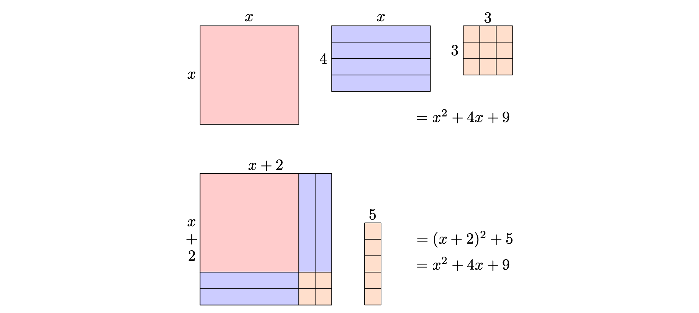

```{r, setup, include = FALSE}
library("webexercises")
```

*Before reading this guide, it is recommended that you read [Guide: Introduction to quadratic equations](introtoquadratics.qmd). Optionally, you may also find it useful to read [Guide: Factorization](factorization.qmd) for the purposes of checking your answers, [Guide: Laws of indices](lawsofindices.qmd) for algebraic manipulation, [Guide: Introduction to rearranging equations](introtorearrange.qmd) for rearranging completed squares to solve quadratics and [Guide: Introduction to complex numbers](introtocomplexnumbers.qmd) for dealing with square roots of negative numbers.*

::: {.content-visible when-format="html"}

```{=html}
<table><tr><td style="vertical-align: middle"><strong>Narration of study guide:</strong>&nbsp;&nbsp;</td><td><audio controls><source src="./Narrations/completingthesquare.mp3" type="audio/mpeg">Your browser does not support the audio element.</audio></tr></table>
```

:::

# What is completing the square? {-}

As you have seen in [Guide: Introduction to quadratic equations](introtoquadratics.qmd), quadratic expressions are incredibly important in mathematics, and having a variety of techniques of dealing with them will be important tools in your future work. 

One of these techniques is called **completing the square**, which takes a quadratic expression like $ax^2 + bx + c$ and expresses it in the form $a(x+p)^2 + q$; essentially, completing the square is like 'factorization with a remainder'. Completing the square is a useful tool in many areas of mathematics, such as geometry (particularly in the theory of conic sections), integral calculus, and solving quadratic equations. Not only is it useful in these areas, it also gives you an opportunity to practise your skills involving algebraic manipulation and factorization. 

This guide will focus on completing the square for quadratic expressions of the form $ax^2 + bx + c$, both where $a = 1$ and where $a \neq 1$. 

# Expressions of the form $x^2 + bx + c$ {-}

The idea is to turn a quadratic expression like $$x^2 + bx + c$$ into one that looks like $$(x+p)^2 + q$$ where $b,c,p,q$ are numbers. The best way to see how this works is via an example, which relies on expanding brackets (see [Guide: Expanding brackets] for more). 

:::: {.callout-note appearance="simple"}

## Example 1

Suppose you want to complete the square of a quadratic expression like $x^2 + 4x + 9$. The aim of completing the square is to find numbers $p,q$ such that $$(x+p)^2 + q = x^2 + 4x + 9.$$ Expanding the brackets on the left-hand side of this equation gives $$x^2 + 2px + p^2 + q = x^2 + 4x + 9.$$ These two expressions are equal if and only if the coefficients match. Comparing the coefficients for the $x$ terms on both sides gives $2p = 4$ and so $p = 2$. With this knowledge, you can then compare the $9$ with the $p^2 + q$ term to get $$4 + q = 9$$ and so $q = 5$. You can then write that $x^2 + 4x + 9 = (x+2)^2 + 5$ and you have completed the square.

To check your answer, you can expand the brackets of the completed square:

$$
\begin{aligned}
(x+2)^2 + 5 &= x^2 + 4x + 4 + 5\\[0.5em]
&= x^2 + 4x + 9
\end{aligned}
$$

which is the original expression.

::: {.content-visible when-format="html" .callout-video}



::: {.callout-tip collapse="true"}
## Full transcript

So, this example shows how to complete the square for the quadratic expression $$x^2+4x+9$$

Now, the aim is to rewrite this expression in the form $$(x+p)^2+q$$ where $p$ and $q$ are numbers.

So, to do this, you need to start from the general form $(x+p)^2+q$ and expand the brackets to get $x^2+2px+p^2+q$.

Now you need to compare this with the original expression $x^2+4x+9$.

The coefficients of both expressions need to match for the expressions to be equal to each other.

So, start by comparing the $x$ terms. In the expanded form, the coefficient on $x$ is $2p$, and in the original expression the coefficient on $x$ is $4$, so $p$ must be $2$.

Now you need to compare the constant terms. In the expanded form, the constant term is $p^2+q$, and in the original expression the constant term is $9$.

So, this means that for $p^2+q$ to be equal to $9$, you can substitute in $p=2$ and rearrange to get $q=5$.

Using these values for $p$ and $q$, the quadratic can be rewritten in the completed square form as $$(x+2)^2+5$$

And you can check if your answer is correct by expanding $(x+2)^2+5$ to get $x^2+4x+4+5$, which gives $x^2+4x+9$ which is the original quadratic.

Now, the name “completing the square” comes from a geometric idea. The term $x^2$ can be seen as the area of a square with side length $x$, the term $4x$ can be seen as four thin strips placed alongside the sides of this square, and the number $9$ can be seen as the area of a smaller square with side length $3$.

Rearranging these parts forms a larger square of side length $x+2$, with an extra piece with an area of $5$.

This corresponds to the expression $(x+2)^2+5$, and it explains why the method is called “completing the square”.
:::

:::

::: {.content-hidden when-format="html"}

:::{.callout-tip}

**Watch on YouTube:**

https://youtu.be/Yl0GZrIdSxY (Completing the square - Example 1 | STARMAST)

A full transcript is available on the
[STARMAST website](https://starmast.org/studyguides/completingthesquare.html) under Example 1.

:::

:::

::::

::: {.content-visible when-format="html"}

You can investigate what happens in the completing the square for $x^2 + bx + c$ in this interactive figure, which works for whole numbered values of $b$ which are **positive and even**. Put your choice of $b$ and $c$ into the boxes given, and click through the steps to see how 'completing the square' gets its name!

<!-- {width="150%" fig-alt="Two figures, one on top, one on the bottom. The top figure has a red square with side labelled $x$, a blue rectangle split into four strips with sides labelled $4$ and $x$, and an orange square, split into $9$ smaller squares, sides labelled $3$ and $3$. There is a $x^2 + 4x + 9$ term. The bottom figure has a larger square, with a red square portion in the top left with two blue strips to the right and two blue strips below, and four orange cells in the bottom right, side lengths of $x+2$. There are five more orange squares in a strip separate to the larger square. There are two terms, saying that $(x+2)^2 + 5 = x^2 + 4x + 9$, completing the figure." #fig-1} -->

```{=html}

<!DOCTYPE html>
<html lang="en">
<head>
  <meta charset="UTF-8">
  <meta name="viewport" content="width=device-width, initial-scale=1.0">
  <title>Completing the Square Interactive</title>

  <script>
    window.MathJax = {
      tex: { inlineMath: [['\\(', '\\)'], ['$', '$']] },
      options: { enableMenu: false }
    };
  </script>
  <script
    defer
    src="https://cdn.jsdelivr.net/npm/mathjax@3/es5/tex-mml-chtml.js">
  </script>

  <style>
    * {
      box-sizing: border-box;
    }

    body {
      margin: 0;
      padding: 20px;
      color: #222222;
      background: #ffffff;
      line-height: 1.5;
    }

    h1 {
      margin-top: 0;
      font-size: 1.7rem;
    }

    .instructions {
      max-width: 800px;
      margin-bottom: 1rem;
    }

    .controls {
      max-width: 800px;
      margin-bottom: 12px;
      padding: 1rem;
      border: 1px solid #cccccc;
      border-radius: 8px;
      background: #f7f8fa;
    }

    .input-row {
      display: flex;
      flex-wrap: wrap;
      gap: 1rem;
      align-items: flex-end;
      margin-bottom: 1rem;
    }

    .form-group {
      min-width: 180px;
    }

    .form-group label {
      display: block;
      margin-bottom: 0.3rem;
      font-weight: 700;
    }

    .form-group input {
      width: 100%;
      min-height: 42px;
      padding: 0.45rem 0.55rem;
      border: 1px solid #777777;
      border-radius: 4px;
      font: inherit;
    }

    .field-help {
      display: block;
      margin-top: 0.25rem;
      color: #4a4a4a;
      font-size: 0.9rem;
    }

    .button-row {
      display: flex;
      flex-wrap: wrap;
      gap: 0.5rem;
    }

    button {
      min-height: 42px;
      padding: 0.55rem 0.9rem;
      border: 2px solid #31558f;
      border-radius: 5px;
      color: #ffffff;
      background: #3F6BB6;
      font: inherit;
      font-weight: 700;
      cursor: pointer;
    }

    button:hover:not(:disabled) {
      background: #31558f;
    }

    button:disabled {
      color: #555555;
      background: #dddddd;
      border-color: #aaaaaa;
      opacity: 1;
      cursor: not-allowed;
    }

    button:focus-visible,
    input:focus-visible,
    .canvas:focus-visible {
      outline: 4px solid #ffbf47;
      outline-offset: 3px;
    }

    #warning {
      min-height: 1.5em;
      margin-top: 0.75rem;
      color: #b00020;
      font-weight: 700;
    }

    .stage-heading {
      margin: 1rem 0 0.4rem;
      font-size: 1.25rem;
    }

    .stage-description {
      max-width: 800px;
      min-height: 3em;
      margin: 0 0 0.75rem;
      padding: 0.7rem 0.8rem;
      border-left: 5px solid #3F6BB6;
      background: #f2f5fa;
    }

    .canvas-scroll {
      max-width: 100%;
      overflow-x: auto;
      padding: 3px;
    }

    .canvas {
      position: relative;
      width: 800px;
      height: 420px;
      border: 2px solid #666666;
      overflow: hidden;
      background: #ffffff;
    }

    .square {
      position: absolute;
      width: 120px;
      height: 120px;
      background: #e6b8b7;
      border: 2px solid #000000;
      display: flex;
      align-items: center;
      justify-content: center;
      font-weight: 700;
    }

    .strip {
      position: absolute;
      background: #b4a7d6;
      border: 1px solid #000000;
      display: flex;
      align-items: center;
      justify-content: center;
      font-size: 12px;
      transition: all 0.8s ease;
    }

    .tile {
      position: absolute;
      width: 20px;
      height: 20px;
      background: #f3d5c0;
      border: 1px solid #333333;
      font-size: 10px;
      display: flex;
      align-items: center;
      justify-content: center;
      transition: all 0.8s ease;
    }

    .missing {
      position: absolute;
      border: 3px dashed #b00020;
      background: rgba(176, 0, 32, 0.15);
    }

    .result {
      max-width: 800px;
      margin-top: 20px;
      padding: 1rem;
      border: 1px solid #cccccc;
      border-radius: 8px;
      font-size: 20px;
      text-align: center;
    }

    .text-equivalent {
      max-width: 800px;
      margin-top: 1rem;
      padding: 0.8rem;
      border: 1px solid #cccccc;
      border-radius: 6px;
    }

    .text-equivalent summary {
      font-weight: 700;
      cursor: pointer;
    }

    .sr-only {
      position: absolute !important;
      width: 1px !important;
      height: 1px !important;
      padding: 0 !important;
      margin: -1px !important;
      overflow: hidden !important;
      clip: rect(0, 0, 0, 0) !important;
      white-space: nowrap !important;
      border: 0 !important;
    }

    @media (prefers-reduced-motion: reduce) {
      .strip,
      .tile {
        transition: none;
      }
    }

    @media (max-width: 840px) {
      body {
        padding: 12px;
      }
    }
  </style>
</head>

<body>

<main>
  <h1>Completing the square</h1>

  <p class="instructions" id="instructions">
    Enter an even, non-negative value for <strong>b</strong> and a value for
    <strong>c</strong>. Use the Previous step and Next step buttons to explore
    how the algebra tiles form a completed square. A textual description is
    provided below the diagram.
  </p>

  <section class="controls" aria-labelledby="controls-heading">
    <h2 id="controls-heading" class="sr-only">Interactive controls</h2>

    <div class="input-row">
      <div class="form-group">
        <label for="bVal">Coefficient b</label>
        <input
          id="bVal"
          type="number"
          value="4"
          min="0"
          step="2"
          inputmode="numeric"
          aria-describedby="bHelp warning">
        <span class="field-help" id="bHelp">
          Enter an even number greater than or equal to zero.
        </span>
      </div>

      <div class="form-group">
        <label for="cVal">Constant c</label>
        <input
          id="cVal"
          type="number"
          value="9"
          step="1"
          inputmode="numeric"
          aria-describedby="cHelp warning">
        <span class="field-help" id="cHelp">
          Enter the number of unit tiles. Negative values are not supported.
        </span>
      </div>
    </div>

    <div class="button-row" role="group" aria-label="Step navigation">
      <button
        id="prevBtn"
        type="button"
        aria-controls="canvas stageDescription result textDescription">
        Previous step
      </button>

      <button
        id="nextBtn"
        type="button"
        aria-controls="canvas stageDescription result textDescription">
        Next step
      </button>
    </div>

    <div id="warning" role="alert" aria-live="assertive"></div>
  </section>

  <h2 class="stage-heading" id="stageHeading">Step 1 of 3: Algebra tiles</h2>

  <p
    class="stage-description"
    id="stageDescription"
    role="status"
    aria-live="polite"
    aria-atomic="true">
  </p>

  <div class="canvas-scroll">
    <div
      class="canvas"
      id="canvas"
      tabindex="0"
      role="img"
      aria-labelledby="stageHeading"
      aria-describedby="stageDescription textDescription">
    </div>
  </div>

  <div
    class="result"
    id="result"
    role="status"
    aria-live="polite"
    aria-atomic="true">
  </div>

  <details class="text-equivalent" open>
    <summary>Text description of the diagram</summary>
    <p id="textDescription"></p>
  </details>

  <div id="stepAnnouncement" class="sr-only" aria-live="polite" aria-atomic="true"></div>
</main>

<script>
(function() {
  "use strict";

  const size = 120;
  const unit = 20;

  const bInput = document.getElementById("bVal");
  const cInput = document.getElementById("cVal");
  const warning = document.getElementById("warning");
  const canvas = document.getElementById("canvas");
  const result = document.getElementById("result");
  const prevBtn = document.getElementById("prevBtn");
  const nextBtn = document.getElementById("nextBtn");
  const stageHeading = document.getElementById("stageHeading");
  const stageDescription = document.getElementById("stageDescription");
  const textDescription = document.getElementById("textDescription");
  const stepAnnouncement = document.getElementById("stepAnnouncement");

  let stage = 0;
  let strips = [];
  let tiles = [];
  let square = null;
  let missingSquare = null;

  function setInvalid(input, invalid) {
    input.setAttribute("aria-invalid", invalid ? "true" : "false");
  }

  function validate() {
    const b = Number(bInput.value);
    const c = Number(cInput.value);
    const messages = [];

    setInvalid(bInput, false);
    setInvalid(cInput, false);

    if (!Number.isFinite(b)) {
      messages.push("Enter a value for b.");
      setInvalid(bInput, true);
    } else if (b < 0) {
      messages.push("b must be non-negative.");
      setInvalid(bInput, true);
    } else if (!Number.isInteger(b) || b % 2 !== 0) {
      messages.push("b must be an even whole number.");
      setInvalid(bInput, true);
    }

    if (!Number.isFinite(c)) {
      messages.push("Enter a value for c.");
      setInvalid(cInput, true);
    } else if (!Number.isInteger(c) || c < 0) {
      messages.push("c must be a non-negative whole number.");
      setInvalid(cInput, true);
    } else if (c > 100) {
      messages.push("c must be 100 or less so that all unit tiles fit in the diagram.");
      setInvalid(cInput, true);
    }

    warning.textContent = messages.join(" ");
    return messages.length === 0;
  }

  function updateButtons() {
    const valid = validate();
    prevBtn.disabled = !valid || stage === 0;
    nextBtn.disabled = !valid || stage === 2;

    prevBtn.setAttribute("aria-disabled", String(prevBtn.disabled));
    nextBtn.setAttribute("aria-disabled", String(nextBtn.disabled));
  }

  function equationText(b, c) {
    const n = b / 2;
    const difference = c - n * n;
    const sign = difference >= 0 ? "+" : "−";
    return `x squared plus ${b}x plus ${c} equals open bracket x plus ${n} close bracket squared ${sign} ${Math.abs(difference)}.`;
  }

  function updateAccessibleDescription() {
    if (!validate()) {
      stageHeading.textContent = "Diagram unavailable";
      stageDescription.textContent = "Correct the input errors to display the algebra tiles.";
      textDescription.textContent = "The diagram is not available because one or more inputs are invalid.";
      canvas.setAttribute("aria-label", "Diagram unavailable because the inputs are invalid.");
      return;
    }

    const b = Number(bInput.value);
    const c = Number(cInput.value);
    const n = b / 2;
    const needed = n * n;
    const availableForCorner = Math.min(c, needed);
    const remaining = Math.max(0, c - needed);
    const shortage = Math.max(0, needed - c);

    if (stage === 0) {
      stageHeading.textContent = "Step 1 of 3: Algebra tiles";
      stageDescription.textContent =
        `The expression is represented by one x-squared tile, ${b} x tiles, and ${c} unit tiles.`;
      textDescription.textContent =
        `A square tile represents x squared. To its right are ${b} rectangular x tiles. ` +
        `There are also ${c} unit tiles. The tiles have not yet been rearranged.`;
    } else if (stage === 1) {
      stageHeading.textContent = "Step 2 of 3: Split the x tiles";
      stageDescription.textContent =
        `The ${b} x tiles are split equally into two groups of ${n} and placed along two adjacent sides of the x-squared tile.`;
      textDescription.textContent =
        `The x-squared tile is in the upper-left corner. ${n} vertical x tiles are placed to its right, ` +
        `and ${n} horizontal x tiles are placed below it. This creates an incomplete square with a corner of size ${n} by ${n}.`;
    } else {
      stageHeading.textContent = "Step 3 of 3: Complete the square";

      if (shortage > 0) {
        stageDescription.textContent =
          `The missing corner requires ${needed} unit tiles, but only ${c} are available. ${shortage} more unit tiles are needed.`;
        textDescription.textContent =
          `The corner is ${n} units by ${n} units, so it needs ${needed} unit tiles. ` +
          `${availableForCorner} tiles fill part of the corner, leaving a shortage of ${shortage}. ` +
          `The completed-square form is ${equationText(b, c)}`;
      } else {
        stageDescription.textContent =
          `${needed} unit tiles fill the ${n} by ${n} corner. ${remaining} unit tiles remain outside the completed square.`;
        textDescription.textContent =
          `The corner is ${n} units by ${n} units and is filled by ${needed} unit tiles. ` +
          `${remaining} unit tiles remain outside the square. The completed square has side length x plus ${n}. ` +
          `The completed-square form is ${equationText(b, c)}`;
      }
    }

    canvas.setAttribute(
      "aria-label",
      `${stageHeading.textContent}. ${stageDescription.textContent}`
    );
  }

  function createSquare() {
    square = document.createElement("div");
    square.className = "square";
    square.setAttribute("aria-hidden", "true");
    square.textContent = "x²";
    canvas.appendChild(square);
  }

  function drawInitial() {
    if (!validate()) {
      canvas.innerHTML = "";
      stage = 0;
      updateAccessibleDescription();
      updateButtons();
      updateMath();
      return;
    }

    canvas.innerHTML = "";
    strips = [];
    tiles = [];
    missingSquare = null;
    stage = 0;

    const b = Number(bInput.value);
    const c = Number(cInput.value);
    let xPosition = 20;

    createSquare();
    square.style.left = xPosition + "px";
    square.style.top = "150px";

    xPosition += size + 20;

    for (let i = 0; i < b; i++) {
      const strip = document.createElement("div");
      strip.className = "strip";
      strip.setAttribute("aria-hidden", "true");
      strip.style.width = unit + "px";
      strip.style.height = size + "px";
      strip.style.left = xPosition + "px";
      strip.style.top = "150px";
      strip.textContent = "x";
      canvas.appendChild(strip);
      strips.push(strip);
      xPosition += unit;
    }

    xPosition += 20;

    for (let i = 0; i < c; i++) {
      const tile = document.createElement("div");
      tile.className = "tile";
      tile.setAttribute("aria-hidden", "true");
      tile.textContent = "1";
      tile.style.left = (xPosition + (i % 10) * 22) + "px";
      tile.style.top = (150 + Math.floor(i / 10) * 22) + "px";
      canvas.appendChild(tile);
      tiles.push(tile);
    }

    updateMath();
    updateAccessibleDescription();
    updateButtons();
  }

  function splitStrips() {
    const b = Number(bInput.value);
    const n = b / 2;
    const baseX = 50;
    const baseY = 80;

    square.style.left = baseX + "px";
    square.style.top = baseY + "px";

    strips.forEach(function(strip, index) {
      if (index < n) {
        strip.style.width = unit + "px";
        strip.style.height = size + "px";
        strip.style.left = (baseX + size + index * unit) + "px";
        strip.style.top = baseY + "px";
      } else {
        strip.style.width = size + "px";
        strip.style.height = unit + "px";
        strip.style.left = baseX + "px";
        strip.style.top = (baseY + size + (index - n) * unit) + "px";
      }
    });
  }

  function completeSquare() {
    const b = Number(bInput.value);
    const c = Number(cInput.value);
    const n = b / 2;
    const baseX = 50;
    const baseY = 80;
    const needed = n * n;

    if (missingSquare) missingSquare.remove();

    missingSquare = document.createElement("div");
    missingSquare.className = "missing";
    missingSquare.setAttribute("aria-hidden", "true");
    missingSquare.style.left = (baseX + size) + "px";
    missingSquare.style.top = (baseY + size) + "px";
    missingSquare.style.width = (n * unit) + "px";
    missingSquare.style.height = (n * unit) + "px";
    canvas.appendChild(missingSquare);

    tiles.forEach(function(tile, index) {
      if (index < needed) {
        const row = Math.floor(index / Math.max(n, 1));
        const column = index % Math.max(n, 1);
        tile.style.left = (baseX + size + column * unit) + "px";
        tile.style.top = (baseY + size + row * unit) + "px";
      } else {
        const column = (index - needed) % 10;
        const row = Math.floor((index - needed) / 10);
        tile.style.left = (baseX + size + n * unit + 60 + column * unit) + "px";
        tile.style.top = (baseY + row * unit) + "px";
      }
    });

    if (c < needed) {
      missingSquare.style.background = "rgba(176, 0, 32, 0.3)";
    }
  }

  function announceStage() {
    stepAnnouncement.textContent =
      `${stageHeading.textContent}. ${stageDescription.textContent}`;
  }

  function nextStage() {
    if (!validate()) return;

    if (stage === 0) {
      splitStrips();
      stage = 1;
    } else if (stage === 1) {
      completeSquare();
      stage = 2;
    }

    updateMath();
    updateAccessibleDescription();
    updateButtons();
    announceStage();
    stageHeading.focus?.();
  }

  function previousStage() {
    if (!validate() || stage === 0) return;

    if (stage === 1) {
      drawInitial();
    } else {
      drawInitial();
      splitStrips();
      stage = 1;
      updateMath();
      updateAccessibleDescription();
      updateButtons();
    }

    announceStage();
  }

  function updateMath() {
    if (!validate()) {
      result.textContent = "Correct the input errors to display the completed-square form.";
      return;
    }

    const b = Number(bInput.value);
    const c = Number(cInput.value);
    const n = b / 2;
    const difference = c - n * n;
    const sign = difference >= 0 ? "+" : "-";
    const absoluteValue = Math.abs(difference);

    result.innerHTML =
      `<span class="sr-only">${equationText(b, c)}</span>` +
      `<span aria-hidden="true">\\[x^2 + ${b}x + ${c} = (x + ${n})^2 ${sign} ${absoluteValue}\\]</span>`;

    if (window.MathJax && window.MathJax.typesetPromise) {
      window.MathJax.typesetClear?.([result]);
      window.MathJax.typesetPromise([result]).catch(function() {
        /* The screen-reader text remains available if MathJax fails. */
      });
    }
  }

  prevBtn.addEventListener("click", previousStage);
  nextBtn.addEventListener("click", nextStage);
  bInput.addEventListener("input", drawInitial);
  cInput.addEventListener("input", drawInitial);

  drawInitial();
})();
</script>

</body>
</html>


```

:::

::: {.content-hidden when-format="html"}

A pictorial representation of this process is given in @fig-1. Notice that breaking down the top and rearranging gives the bottom figure. This is the source of the phrase 'completing the square'!

{fig-alt="Two figures, one on top, one on the bottom. The top figure has a red square with side labelled $x$, a blue rectangle split into four strips with sides labelled $4$ and $x$, and an orange square, split into $9$ smaller squares, sides labelled $3$ and $3$. There is a $x^2 + 4x + 9$ term. The bottom figure has a larger square, with a red square portion in the top left with two blue strips to the right and two blue strips below, and four orange cells in the bottom right, side lengths of $x+2$. There are five more orange squares in a strip separate to the larger square. There are two terms, saying that $(x+2)^2 + 5 = x^2 + 4x + 9$, completing the figure." #fig-1}
:::

<!-- ::: {.callout-note} -->

<!-- ## Definition of quadratic expression -->

<!-- A **quadratic expression** is a string of mathematical terms of the form $$ax^2 + bx + c$$ where $a,b,c$ are numbers with $a \neq 0$. -->

<!-- ::: -->

<!-- ::: {.callout-warning} -->

<!-- A quadratic expression is **not** the same as a quadratic equation; it does not contain an equals sign and so cannot be an equation! -->

<!-- ::: -->

You can notice three things about Example 1:

- If you are trying to write $x^2 + bx + c$ in the form $(x+p)^2 + q$, then the value of $p$ is going to be half that of $b$, so $p = b/2$.

- Whether or not $q$ is positive or negative depends on the value of $c$. If $c > p^2$, then $q$ is positive; if $c < p^2$, then $q$ is negative.

- This gives a method for working out the completed square of any expression of the form $x^2 + bx + c$. See below for such a method.

::: {.callout-note}

## Method 1 ($x^2 + bx + c$)

Suppose you're given an expression like $x^2 + bx + c$ and you want to write it in the form $(x+p)^2 + q$. Here's how to complete the square:

- First, write $p = b/2$. This gives you $p$.

- Work out $p^2$, and solve the equation $p^2 + q = c$ for $q$. This gives you $q$. 

Then the expression $(x+p)^2 + q$ is equal to $x^2 + bx + c$, and you have completed the square. 

:::

You can use this method to complete the square in the examples that follow. 

::: {.callout-note appearance="simple"}

## Example 2

Suppose you would like to complete the square of the expression $x^2 + 12x + 20$. Here, you can identify the expression as in the form $x^2 + bx + c$ with $b = 12$ and $c = 20$. Now, you can follow the steps in Method 1. 

- Here, $p = b/2 = 12/2 = 6$. 

- Working out $p^2$ gives $6^2 = 36$. Solving $p^2 + q = c$ gives $q$, and so here $36 + q = 20$. It follows that $q = -16$.

You can then say that $(x + 6)^2 - 16 = x^2 + 12x + 20$. Expanding the brackets to check your answer gives 
\begin{align*}
(x+6)^2 - 16 &= x^2 + 12x + 36 - 16 = x^2 + 12x + 20.
\end{align*}

:::

You can see in this example that $q$ may be negative. The next example demonstrates a case where $p$ is negative.

::: {.callout-note appearance="simple"}

## Example 3

Suppose you would like to complete the square of the expression $y^2 - 10y + 41$. Once again, you can identify the expression as in the form $y^2 + by + c$ with $b = -10$ and $c = 41$. Now, you can follow the steps in Method 1. 

- Here, $p = b/2 = -10/2 = -5$. 

- Working out $p^2$ gives $(-5)^2 = 25$. Solving $p^2 + q = c$ gives $q$, and so here $25 + q = 41$. It follows that $q = 16$.

You can then say that $(y - 5)^2 + 16 = y^2 - 10y + 41$. Expanding the brackets to check your answer gives 
\begin{align*}
(y-5)^2 + 16 &= y^2 - 10y + 25 + 16 = y^2 - 10y + 41.
\end{align*}

:::

The next example contains a case where $b$ is odd, and so $p$ will not be a whole number.

::: {.callout-note appearance="simple"}

## Example 4

You are given the quadratic expression $x^2 + 3x - 1$, and you would like to complete the square. Identifying the expression as in the form $x^2 + bx + c$ with $b = 3$ and $c = -1$,  you can follow the steps in Method 1. 

- Here, $p = b/2 = 3/2$.

- Working out $p^2$ gives $(3/2)^2 = 9/4$. Solving $p^2 + q = c$ gives $q$, and so here $$\frac{9}{4} + q = -1.$$ Since $-1 = -4/4$, you can work out that $q = -13/4$.

You can then say that $\displaystyle \left(x + \frac{3}{2}\right)^2 - \frac{13}{4}$ is the completed square of $x^2 + 3x - 1$.

Expanding the brackets to check your answer gives 
\begin{align*}
\left(x + \frac{3}{2}\right)^2 - \frac{13}{4} &= x^2 + 3x + \frac{9}{4} - \frac{13}{4}\\[0.5em]
&= x^2 + 3x - \frac{4}{4} = x^2 + 3x - 1.
\end{align*}

:::

Here's a final example of an important quadratic expression previously seen in [Guide: Using the quadratic formula](quadraticformula.qmd).

::: {.callout-note appearance="simple"}

## Example 5

You are given the quadratic expression $m^2 - m - 1$, and you would like to complete the square. Identifying the expression as in the form $m^2 + bm + c$ with $b = -1$ and $c = -1$,  you can follow the steps in Method 1. 

- Here, $p = -1/2$.

- Working out $p^2$ gives $(-1/2)^2 = 1/4$. Solving $p^2 + q = c$ gives $q$, and so here $$\frac{1}{4} + q = -1.$$ Since $-1 = -4/4$, you can work out that $q = -5/4$.

You can then say that $\displaystyle\left(m - \frac{1}{2}\right)^2 - \frac{5}{4}$ is the completed square of $m^2 - m - 1$.

Expanding the brackets to check your answer gives 
\begin{align*}
\left(m - \frac{1}{2}\right)^2 - \frac{5}{4} &= m^2 - m + \frac{1}{4} - \frac{5}{4}\\[0.5em]
&= m^2 - m - \frac{4}{4} = m^2 - m - 1.
\end{align*}

:::

# Expressions of the form $ax^2 + bx + c$ {-}

Unfortunately, not every quadratic expression has the coefficient of the $x^2$ term equal to $1$. It is often the case that that $a\neq 1$ in the quadratic expression $ax^2 + bx + c$. So how do you deal with this?

The idea is to factorize the quadratic expression, taking out the constant $a$ (which is necessarily non-zero in a quadratic expression). Doing this gives $$ax^2 + bx + c = a\left(x^2 + \frac{b}{a}x + \frac{c}{a}\right)$$ You can then notice that the term inside the brackets is of the form $x^2 + rx + s$, where $r,s$ are numbers; but you can complete the square of these kinds of expressions already!

So, to complete the square of $ax^2 + bx + c$ into a form of $a(x+p)^2 + t$, you can follow this method:

::: {.callout-note}

## Method 2 ($ax^2 + bx + c$)

Suppose you're given an expression like $ax^2 + bx + c$ and you want to write it in the form $a(x+p)^2 + t$. Here's how to complete the square:

1. First of all, take out a factor of $a$ to get $a(x^2 + rx + s)$, where $r = b/a$ and $s = c/a$. 

2. Complete the square on $x^2 + rx + s$ to get $(x+p)^2 + q$. 

3. The expression $a((x+p)^2 + q)$ is equal to $ax^2 + bx + c$. Multiplying out the brackets shows that $a(x+p)^2 + aq = ax^2 + bx + c$.

:::

::: {.callout-tip}

There is a way of completing the square for $ax^2 + bx + c$ in the form $(dx + e)^2 + f$. The formula is given here:
$$ax^2 + bx + c = \left(x\sqrt{a} + \frac{b}{2\sqrt{a}}\right)^2 + \left(c - \frac{b^2}{4a}\right)$$ This works well if $a$ is a perfect square; see Example 8 for more.

**Do not try and remember this formula!** It is much better to reinforce the methods given in this guide rather than input numbers into this formula. 

:::

::: {.callout-note appearance="simple"}

## Example 6

Suppose you would like to complete the square of the expression $2x^2 + 12x + 24$. Here, you can identify the expression as in the form $ax^2 + bx + c$ with $a = 2$, $b = 12$ and $c = 24$. Now, you can follow the steps in Method 1. 

1. Taking out a factor of $a = 2$ gives the expression as $$2x^2 + 12x + 24 = 2(x^2 + 6x + 12)$$ You can now notice the part inside the brackets is of the form $x^2 + rx + s$ with $r = 6$ and $s = 12$.

2. Now, complete the square on $x^2 + 6x + 12$. Here $p = 6/2 = 3$. Working out $p^2$ gives $3^2 = 9$. Solving $p^2 + q = s$ gives $q$, and so here $9 + q = 12$. It follows that $q = 3$.

3. This means that $2x^2 + 12x + 24 = 2((x+3)^2 + 3)$ and so taking out the last term in brackets gives $$2x^2 + 12x + 24 = 2(x+3)^2 + 6$$ This is your final answer.

Once again, you can expand the brackets to check your answer: 
\begin{align*}
2(x+3)^2 + 6 &= 2(x^2 + 6x + 9) + 6\\[0.5em]
&= 2x^2 + 12x + 18 + 6 = 2x^2 + 12x + 24
\end{align*}

:::

::: {.callout-note appearance="simple"}

## Example 7

Suppose you would like to complete the square of the expression $4y^2 + 12y - 4$. You can identify the expression as in the form $ay^2 + by + c$ with $a = 4$, $b = 12$ and $c = -4$.

1. Taking out a factor of $a = 4$ gives the expression as $$4y^2 + 12y - 4 = 4(y^2 + 3y - 1)$$ You can now notice the part inside the brackets is of the form $y^2 + ry + s$ with $r = 3$ and $s = -1$.

2. Now, complete the square on $y^2 + 3y -1$. You can notice that you have already done this in Example 4 with $x$ as the variable. So here $$y^2 + 3y - 1 = \left(y + \frac{3}{2}\right)^2 - \frac{13}{4}.$$

3. This means that $\displaystyle 4y^2 + 12y - 4 = 4\left(\left(y + \frac{3}{2}\right)^2 - \frac{13}{4}\right)$ and so taking out the last term in brackets gives $$4y^2 + 12y - 4 = 4\left(y + \frac{3}{2}\right)^2 - 4\cdot \frac{13}{4} = 4\left(y + \frac{3}{2}\right)^2 - 13.$$

Once again, you can expand the brackets to check your answer: 
\begin{align*}
4\left(y + \frac{3}{2}\right)^2 - 13 &= 4\left(y^2 + 3y + \frac{9}{4}\right) - 13\\[0.5em]
&= 4y^2 + 12y + 9 - 13 = 4y^2 + 12y - 4
\end{align*}

You can simplify this example even further. You could notice here that $a=4$ is a square number; specifically, $2\cdot 2$. By writing $4 = 2\cdot 2$, you can use the laws of indices (see [Guide: Laws of indices](lawsofindices.qmd)) to say that 
\begin{align*}
4\left(y + \frac{3}{2}\right)^2 &= 2^2\left(y + \frac{3}{2}\right)^2 = \left(2\left(y + \frac{3}{2}\right)\right)^2 = (2y + 3)^2
\end{align*}
and so $4y^2 + 12y - 4 = (2y+3)^2 - 13$. This technique is particularly useful if $a$ is the square of an integer; less useful if it is not!

:::

The final example in this section deals with some slightly odder looking numbers. Although the numbers will not be as nice as the previous examples, if you follow the process carefully then uglier numbers will not matter!

::: {.callout-note appearance="simple"}

## Example 8

Suppose you would like to complete the square of the expression $3m^2 - 2m - 1$. You can identify the expression as in the form $am^2 + bm + c$ with $a = 3$, $b = -2$ and $c = -1$.

1. Taking out a factor of $a = 3$ gives the expression as $$3m^2 - 2m - 1 = 3\left(m^2 - \frac{2}{3}m - \frac{1}{3}\right)$$ You can now notice the part inside the brackets is of the form $m^2 + rm + s$ with $r = -2/3$ and $s = -1/3$.

2. Now, complete the square on $m^2 - \frac{2}{3}m - \frac{1}{3}$. Here $p = (-2/3)/2 = -1/3$. Working out $p^2$ gives $(-1/3)^2 = 1/9$. Solving $p^2 + q = s$ gives $q$, and so here $$\frac{1}{9} + q = -\frac{1}{3}$$ It follows that $q = -4/9$.

3. This means that $\displaystyle 3m^2 - 2m - 1 = 3\left(\left(m - \frac{1}{3}\right)^2 - \frac{4}{9}\right)$ and so taking out the last term in brackets gives $$3m^2 - 2m - 1 = 3\left(m - \frac{1}{3}\right)^2 - 3\cdot \frac{4}{9} = 3\left(m - \frac{1}{3}\right)^2 - \frac{4}{3}$$ and this is your final answer.

Once again, you can expand the brackets to check your answer: 
\begin{align*}
3\left(m - \frac{1}{3}\right)^2 - \frac{4}{3} &= 3\left(m^2 - \frac{2}{3}m + \frac{1}{9}\right) - \frac{4}{3}\\[0.5em]
&= 3m^2 - 2m + \frac{1}{3} - \frac{4}{3} = 3m^2 - 2m - 1
\end{align*}

:::

# Solving quadratic equations {-}

You can use what you have learned in this guide to solve quadratic equations of the form $ax^2 + bx^2 + c = 0$. To do this, write the expression $ax^2 + bx + c$ as a completed square $a(x+p)^2 + t$, which is equal to $0$. You can then rearrange the equation (see [Guide: Introduction to rearranging equations](introtorearrange.qmd) for more) for $x$ to work out the roots of the quadratic equation.

You may find that $(x+p)^2$ is equal to a negative number. You can use **imaginary numbers** to then solve the quadratic. See [Guide: Introduction to complex numbers](introtocomplexnumbers.qmd) for more.


::: {.callout-note appearance="simple"}

## Example 9

Suppose that you want to solve the quadratic equation $x^2 + 12x + 20 = 0$. You completed the square of $x^2 + 12x + 20$ in Example 2, getting $(x+6)^2 - 16$. So $(x+6)^2 - 16 = 0$; taking the $16$ over and removing the square - taking care to include both the positive and negative roots of $16$ - gives $$x + 6 = \pm 4$$ Therefore $x = -6 + 4= -2$ and $x = -6 - 4 = -10$ are the two solutions of $x^2 + 12x + 20 = 0$.

:::

::: {.callout-note appearance="simple"}

## Example 10

Suppose that you want to solve the quadratic equation $y^2 - 10y + 41 = 0$. You completed the square of $y^2 - 10y + 41$ in Example 3, getting $(y - 5)^2 + 16$. So $(y - 5)^2 + 16 = 0$; taking the $16$ over gives $(y-5)^2 = -16$. Using imaginary numbers (see [Guide: Introduction to complex numbers](introtocomplexnumbers.qmd)) gives $$y-5 = \pm 4i$$ Therefore $y = 5 + 4i$ and $y = 5 - 4i$ are the two complex solutions of $y^2 - 10y + 41 = 0$.

:::

::: {.callout-tip}

You can complete the square on the general quadratic equation $ax^2 + bx + c = 0$ to get the **quadratic formula**, which gives solutions to **any** quadratic equation: see [Guide: Using the quadratic formula](quadraticformula.qmd) for more, and [Proof: The quadratic formula](../proofsheets/ps-quadraticformula.qmd) for how it is done.

:::

# Quick check problems {-}

<!-- add facility for webexercises to work on html -->

::: {.content-visible when-format="html"}

<!-- add facility to check answers at end rather than one at a time -->

::: {.webex-check .webex-box data-topic="CTSQ1"}

You are given four quadratic expressions below. Complete the square on each of them, by giving the constants. If your answer contains rational numbers, they should be written as fractions in their simplest form.

1. $x^2 - 6x = (x+p)^2 + q$, where $p=$ `r fitb(-3)` and $q=$ `r fitb(-9)`.

2. $x^2 + 8x + 1 = (x+p)^2 + q$, where $p=$ `r fitb(4)` and $q=$ `r fitb(-15)`.

3. $x^2 - 5x + 8 = (x+p)^2 + q$, where $p=$ `r fitb("-5/2")` and $q=$ `r fitb("7/4")`.

4. $2x^2 + 8x + 15 = a(x+p)^2 + q$, where $a=$ `r fitb(2)`, $p=$ `r fitb(2)` and $q=$ `r fitb(7)`.

:::

:::

::: {.content-hidden when-format="html"}

Complete the square on each of the following quadratic expressions.

1. $x^2 - 6x$

2. $x^2 + 8x + 1$

3. $x^2 - 5x + 8$

4. $2x^2 + 8x + 15$

:::

# Further reading {-}

[For more questions on the subject, please go to Questions: Completing the square.](../questions/qs-completingthesquare.qmd)

## Version history {-}

v1.0: initial version created 09/24 by tdhc.

- v1.1: updated with Example 1 video 12/25 by Donald Campbell as part of a University of St Andrews VIP project.

- v1.2: updated with new interactive html figure 04/26 by tdhc.


  
[This work is licensed under CC BY-NC-SA 4.0.](https://creativecommons.org/licenses/by-nc-sa/4.0/?ref=chooser-v1)
